# From Exam to Mastery

> **For judges: protecting and strengthening human cognitive ability, in brief**
> - **One page for judges:** [`JUDGES.md`](JUDGES.md): the three proofs, the exact versions, what was checked live on
>   the production server, and what is not proven yet.
> - **What it is.** A teacher photographs a finished exam. Meta's models mark every answer and read *how* the learner
>   reached it, from their own handwriting, and every question not mastered becomes a level in their **Mastery Plan**:
>   the learner does the thinking, and the level ends in a real task. **Not a chatbot, and not a photo grader:** the
>   learner is never handed an answer. Built inside LoWisa, 26 Oct – 4 Nov 2026
>   ([what was new and what existed before](#14-what-was-built-during-the-event-and-what-existed-before)).
> - **Meta's models** ([who does what](#4-metas-models-who-does-what)). Muse Spark 1.3 marks and diagnoses; Muse Wonder
>   plays every level as the learner before they see it; Muse Voice Transcribe writes down the spoken answer; Muse Image
>   draws the corrected step; SAM 3.1 follows the ink on a filmed desk (the optional way in). Muse Spark Open, Meta's open
>   weights, has been tested on partner inference (9 of 12 runs completed); it is not switched on for users.
> - **On a real Grade 5 learner, against his own teacher** (three runs). On his multiple-choice papers the teacher checks
>   **11 to 14 of 109 marks** one by one and accepts the rest in one click; **6 or 7 of the teacher's 10 wrong answers
>   are caught**, and **no wrong idea is named** on any answer it did not accept, in any run. The limit: 2 to 4 of the
>   marks accepted in one click still call one of his wrong answers right; sure is not proof. So the one-click line rose
>   from 0.90 to 0.95 (edge vb1104o): the teacher checks 27 to 51, and 0 to 2 one-click marks are wrong. Every one of
>   those was judged with **no mark scheme**, against the model's own key. Since edge vb1104p, a mark whose readings
>   disagreed, with a struck-out answer or unreadable writing is checked by the teacher however sure, and the desk is
>   told whether the marks were judged against the teacher's mark scheme or, with none given, the model's own key.
>   **Since edge vb1105a (5 Nov), one click needs a mark scheme the teacher approved**: their own, or one Muse Spark
>   drafts from the paper for them to check before the exam is made. With no scheme, every mark is checked one by one,
>   so on his papers none of his wrong answers is accepted in one click
>   ([marking policy](docs/marking-policy.md)).
>   Nothing reaches him until the teacher releases it. On his
>   written answers it agrees with the teacher about as often as marking everything right would (36–38 of 42, against
>   38); there it never names a wrong idea, and asks him first instead. His papers show answers, not working, so every
>   answer it did not accept went to Lo to ask; naming the idea from the ink is measured on the held-out set, whose
>   papers are **simulated handwriting** (a handwriting font on a photographed page), not real students
>   ([Measured](#7-measured-a-real-students-handwriting-an-exam-it-had-never-seen-a-held-out-set-a-class-of-40),
>   [limits](#16-limits-stated-plainly)).
> - **The three strongest proofs, one click each.** (1) [One real learner against his own teacher](#real-handwriting-one-students-papers-against-his-own-teachers-marks)
>   (real handwriting). (2) [It asks instead of guessing](#held-out-53-papers-first-run-blind-then-run-again-on-the-shipped-code):
>   where the ink cannot tell the idea, nothing is named in 40 of 42 (simulated handwriting), and a learner who tries to
>   mislead it with planted working [never gets the planted idea named](harness/heldout/items_planted.py), 30 of 30.
>   (3) [Mark your own exam live](#12-try-it-and-verify-it-yourself) with your own Meta key, no LoWisa account.
> - **What is proven, and what is not yet.** Proven here: the marking, the diagnosis, the asking first, resistance to
>   misleading work, and levels built and checked from them. Checked live on the production server: Lo's live turns
>   never handed over the exam answer (18 of 18, a tampered app included), an online-safety lesson was taught, and an
>   unreadable photo was never marked ([live checks](evidence/live-checks/README.md)). Built to develop independent
>   capability; that it does so lastingly is not proven yet. The controlled study that will test it is written down
>   before it runs ([`docs/STUDY-PLAN.md`](docs/STUDY-PLAN.md)).
> - **What this repository holds.** The complete new work, which runs from here on its own: the tests, the recorded
>   Exam Desk, and live marking of any exam. The full phone-and-desktop flow also uses LoWisa's existing apps (from
>   the stores and [lowisa.dev](https://lowisa.dev)) as its host, as a startup building on its own product
>   ([what existed before](#14-what-was-built-during-the-event-and-what-existed-before)).
> - **Watch the 2:59 demo:** [youtu.be/s4DtrRzyQsI](https://youtu.be/s4DtrRzyQsI) (the same film is in this repository:
>   [`evidence/film/exam-to-mastery.mp4`](evidence/film/exam-to-mastery.mp4)).
> - **Try it in a minute, no account and no key:** `node demo/desk-server.js --replay`, then http://localhost:4747
>   ([more ways to try it](#12-try-it-and-verify-it-yourself), including your own exam marked live). The measured
>   results follow the introduction below.
> - **Licence:** [PolyForm Strict 1.0.0](LICENSE), source-available, not open source; judges have an
>   [additional permission](JUDGING-PERMISSION.md) to do everything verification needs ([licence](#licence)).

## The Problem We Solve: Protecting and Strengthening Human Cognitive Ability

**Millions of us are embracing AI, yet quietly wondering: Are we becoming more capable, or slowly losing our ability to
think for ourselves? And if we are already worried about our own ability to think independently, what does the future
hold for our children?**

This concern is no longer hypothetical. Emerging research reveals a troubling pattern: AI can make us more productive
without necessarily making us more capable (the studies, with their limits, are in section 1.1):

- **83% could not quote their own writing:** in a small MIT study, 15 of 18 participants who had written an essay using
  ChatGPT could not quote a sentence from it (MIT Media Lab, 2025).
- **17% lower performance without AI:** students who practised mathematics with an unrestricted AI assistant performed
  worse on a subsequent unassisted assessment than students who practised without AI (PNAS, 2025).
- **Greater AI trust, less critical-thinking effort:** Microsoft Research and Carnegie Mellon found an association
  between higher confidence in AI and reduced critical-thinking effort during AI-assisted work (2025).

These studies do not establish that AI inevitably weakens cognition. But they expose a critical challenge: **What happens
when technology becomes better at producing answers than we are at understanding them?**

### The Problem Didn't Begin With AI

Think back to the last exam you failed.

You probably remember the mark. Perhaps even the disappointment. But did anyone show you exactly where your thinking
went wrong, help you understand why, and guide you until you could confidently apply that knowledge in the real world?

For millions of learners, the answer is no.

We have spent generations measuring what students get wrong, without consistently transforming those mistakes into
capabilities they can carry beyond the classroom.

A failed mathematics question becomes "I'm not good at maths." A difficult technical concept becomes "Maybe I'm not
smart enough."

**But a failed answer is not evidence of someone's inability to learn. It is evidence of something they have not yet
mastered.**

The scale of this challenge is global. OECD PISA 2022 results show that approximately 31% of 15-year-olds across OECD
countries do not reach baseline proficiency in mathematics. The World Bank estimates that around 70% of 10-year-olds in
low- and middle-income countries cannot read and understand a simple age-appropriate text (section 1.2).

And now, with AI capable of producing answers almost instantly, the gap between getting the right answer and actually
understanding it risks becoming even wider.

### Our Mission: From Exam to Mastery

At LoWisa, we believe AI should not replace the human ability to think. It should strengthen it.

Our mission is to transform moments of failure into opportunities for genuine understanding, independent reasoning,
practical experience, and lasting capability.

Instead of treating an examination as the final judgement of what a learner knows, we see it as the beginning of
discovering what they can become capable of doing.

From Exam to Mastery brings that mission to life through four connected areas of cognitive development, addressing what
traditional approaches often leave unresolved and showing how AI can help learners move beyond answers towards
real-world capability.

The table below explains the four areas we target, what goes wrong today, and how From Exam to Mastery addresses each
one.

### Four Critical Areas: From Cognitive Dependence to Human Capability

**A correct answer is not proof of understanding. A passing grade is not proof of mastery. And using AI successfully is
not proof that we can perform without it.**

LoWisa addresses these gaps through four connected areas of cognitive development.

| The cognitive ability we strengthen | The problem we can no longer ignore | How From Exam to Mastery changes this |
|---|---|---|
| **1. From examination failure to capability** | **A grade tells a learner they failed, but rarely shows them how to succeed.** Students can leave an examination knowing their score but not understanding where their reasoning broke down. Teachers face substantial marking workloads, leaving limited time for individual feedback. A single failed question can become years of lost confidence. | **Failure becomes the starting point, not the final verdict.** Meta's AI models analyse handwritten examination papers, evaluate answers and identify gaps in understanding. Questions requiring improvement become part of a personalised Mastery Plan, turning mistakes into actionable learning opportunities rather than permanent labels. |
| **2. From theoretical knowledge to real-world application** | **What good is knowing an answer if you cannot use it?** Learners can memorise formulas, pass examinations and complete courses yet struggle when confronted with practical problems. The distance between classrooms and real environments leaves people qualified on paper but uncertain in practice. | **Learning must lead to demonstrated capability.** LoWisa connects concepts to practical tasks and real-world environments. Learners apply what they have understood, work through challenges and develop the confidence to use their knowledge beyond an examination. *(The levels and their real tasks are new this week; LoWisa's player that runs them existed before.)* |
| **3. From AI-generated answers to independent thinking** | **The greatest danger is not getting a wrong answer. It is getting the right answer without knowing why.** When AI repeatedly performs the reasoning, learners risk becoming dependent on conclusions they cannot explain, challenge or reproduce independently. Convenience must not come at the expense of critical thinking. | **AI guides the thinking instead of replacing it.** Lo asks learners to predict, reason, test their ideas and explain their conclusions before revealing solutions. Questions target seven thinking capabilities: pattern recognition, probability and uncertainty, optimisation, systems thinking, trade-offs, decision-making and root-cause analysis. The learner remains an active problem-solver. |
| **4. From temporary memorisation to lasting mastery** | **If knowledge disappears after the exam, what did we actually achieve?** Students cram, pass and forget. Without revisiting misconceptions and testing independent recall, yesterday's learning can become tomorrow's knowledge gap. Repeated exposure is not the same as lasting understanding. | **Mastery is revisited, reinforced and tested.** Previously failed questions return during learning, followed by later knowledge checks. LoWisa's flashcards and Insight mode *(both existed before the event)* support continued revision, helping learners revisit concepts, strengthen recall and build understanding that lasts beyond the original assessment. |

*Built for this hackathon: the marking, the fingerprint of each answer, Lo asking first, the Mastery Plan and its
levels, Muse Wonder's check and the re-check days later. LoWisa's lesson player, its flashcards and Insight mode, and
Lo's voice existed before (section 14).*

### The Change We Want to Make

**Today, we risk raising a generation that knows how to ask AI for answers but struggles to explain, challenge or apply
those answers independently.**

LoWisa is working towards a different future: one where a failed examination is not the end of someone's confidence,
where learning extends beyond the classroom, and where AI strengthens the very human abilities we cannot afford to lose.

**We don't measure success by how many answers AI can generate. We measure it by what learners become capable of doing
themselves.**

**From Exam to Mastery isn't about making AI smarter. It's about making the people who use it more capable.**

## Introducing From Exam to Mastery

**Built for this hackathon, inside LoWisa, powered by Meta's models: a way to turn every failed question into a moment
of discovery. Confusion into understanding. Understanding into practice. And practice into the confidence and ability
to solve real-world problems. Because a wrong answer should never define someone's ability.** This is what the four
areas above look like when they run, on a real exam, today.

**The 3-minute film:** [watch on YouTube](https://youtu.be/s4DtrRzyQsI), or [`evidence/film/exam-to-mastery.mp4`](evidence/film/exam-to-mastery.mp4) (2:59; every word with
its time and on-screen label: [`transcript.md`](evidence/film/transcript.md)). Its first 30 seconds are a short version
of the problem above; then it follows one student's failed question to mastery (0:28–2:09), with four of Meta's models
on screen, and ends on a real Grade 5 student and the rest of the loop. Section 2 walks through it frame by frame.

> **Judge it in 2 minutes**
> 1. **No account, no key:** `node demo/desk-server.js --replay`, then open http://localhost:4747: the teacher's Exam
>    Desk on an exam recorded on the production edge (marks, fingerprints, Lo asks first, class patterns).
> 2. **Check the numbers:** `python3 evidence/real-handwriting/score.py` and `python3 -X utf8 evidence/unseen-physics/score.py` (`python` on Windows)
>    recompute the real student's and the physics results from the committed files; `sh scripts/test.sh` runs the 182 tests, and every push runs them in [GitHub Actions](https://github.com/jsamuelkamau-dot/lowisa-witness/actions/workflows/test.yml).
> 3. **Live, on your own phone:** LoWisa on Google Play or the App Store, then section 12 (a sample paper to photograph is
>    [`evidence/unseen-physics/paper.jpg`](evidence/unseen-physics/paper.jpg)).

**Submission facts.** Startups track, "Build for Your World". Built 26 Oct – 4 Nov 2026 (first commit 27 Oct, 8 hours
after kickoff; `docs/built-during.md`). The headline numbers ran on the tag `v1.0.1-code`, three runs of every real set; earlier
code's runs are kept in their own table. The production edge now runs `v1.0.2-code`, which changes only when two
readings count as the same answer and one message's wording; the sets have not been run on it yet (`harness/PROVENANCE.md`).
Where each Meta model works:

| Model | Its job | Where |
|---|---|---|
| Muse Spark 1.3 | marks every answer and reads how it was reached; writes the fingerprint; judges the student's reason | `witness_photo:mark/4`, `witness_mark:fingerprint/4`, `witness_challenge` |
| Muse Wonder | plays each level as the student before the student sees it; asks the examiner's questions | `witness_check`, `witness_examiner` |
| Muse Voice Transcribe | the student's spoken answer to Lo | `witness_meta:transcribe/2` |
| Muse Image | draws the corrected step | `witness_draw:run/3` |
| SAM 3.1 | follows the ink in a filmed desk (the optional way in) | `witness_sam`, `witness_timeline` |
| Muse Spark Open | the same marking on Meta's open weights, run on Baseten | `witness_open:read_content/3`, `harness/open/` |

- **What it does.** A teacher photographs a finished exam. Meta's models mark every answer and read *how* the student
  reached it, from their own handwriting. Every question not mastered becomes a level in the student's **Mastery
  Plan**, built on their own mistake and ending in a real task. The teacher decides when they have turned it around.
- **Not a chatbot, and not a photo grader.** The student is never handed an answer. An idea is named as the student's
  mistake only when code finds their own ink to back it (`witness_mark:fingerprint/4`); otherwise Lo asks them first.
  Muse Wonder plays every level as the student before they see it, and nothing reaches a student until the teacher
  lets it.

**Measured.** Every number below is recomputed from the file beside it. One set of numbers: the latest code
(`v1.0.1-code`, three runs, 3–4 Nov) wherever it was run; earlier code follows in its own table.

| What was tested | Result | Raw results |
|---|---|---|
| A real Grade 5 student's three multiple-choice papers, against his own teacher's marks (photos as taken, three of them sideways) | **6 or 7 of his teacher's 10 wrong answers caught** (7, 6, 6; 6 of the 10 in every run); **no wrong idea named** on any of the 23 answers it did not accept; 104, 104 and 104 of 109 agree, where marking everything right would agree on 99 (kappa 0.68–0.71) | [`condition-c-on-v1.0.1-code-3-runs.json`](evidence/real-handwriting/results/condition-c-on-v1.0.1-code-3-runs.json), `python3 evidence/real-handwriting/score.py` |
| The same student's **written answers** (42 questions, three more papers, no marking scheme) | **every one of the 17 answers it did not accept was held for Lo to ask, with no wrong idea named**; 2, 2 and 3 of his teacher's 4 wrong answers caught; 36, 37 and 38 of 42 agree, where marking everything right would agree on 38 (kappa 0.32–0.55). One paper came back "could not be read" once; the same photos sent again were marked (recorded in the file) | [`written-answers-on-v1.0.1-code-3-runs.json`](evidence/real-handwriting/results/written-answers-on-v1.0.1-code-3-runs.json), the same script |
| **The teacher's work** on those papers: one click accepts the marks called right and at least as sure as the line; the rest are checked one by one. Corrected 4 Nov: the earlier figures here (8 to 10 checked) counted sure marks of every result, but one click only ever takes marks called right | at the 0.90 line (until 4 Nov, edge vb1104o): multiple choice, **the teacher checks 11, 11 and 14 of 109**, and of the 98, 98 and 95 accepted in one click, 2, 4 and 2 call one of his wrong answers right; written, 17, 17 and 18 of 42 checked, 1 wrong in one click. At **0.95** (third audit; live since edge vb1104o, 4 Nov): multiple choice, 38, 27 and 51 checked, and 0, 2 and 1 wrong in one click; written, 31, 27 and 32 checked, none wrong. **Since 5 Nov (edge vb1105a), one click needs a mark scheme the teacher approved; these papers had none, so the teacher checks all 109 and all 42, and none of his wrong answers is accepted in one click.** With a scheme (his teacher's, or Muse Spark's draft the teacher checks), one click returns: section 13. Nothing reaches the student until the teacher releases the paper | `python3 evidence/real-handwriting/score.py` |
| Wrong answers accepted as right (the error a teacher must still catch) | multiple choice: 3, 4 and 4 of the teacher's 10 marked right, always among the same four questions (English 23, science 33 and 42, maths 24). Written: 2, 2 and 1 of 4: question 41 in every run (sure enough for "Accept all"), and question 35 in two runs, where Muse Spark read his final option as "A. Wheat" instead of "Cow peas" and was not sure (0.65, 0.75), so it went to the teacher | the same files |
| 53 held-out papers × 3 runs: ink that cannot show the idea | Lo asks first **39 of 42**; a wrong idea named 3 of 42 (the harmful error) | [`v2-on-v1.0.1-code-3-runs.json`](harness/heldout/results/v2-on-v1.0.1-code-3-runs.json) |
| … ink that shows the idea; right work; instructions written in the ink | named right **43 of 48** (none named a different idea; 5 asked first); mastered **39 of 39**; never obeyed **30 of 30** | the same file |
| A physics exam it had never seen: one 30-question paper (on `v1.0-code`, not run since) | **30 of 30 marking decisions right in every run**: six live runs, then three on `v1.0-code`, with and without a mark scheme; each decision checked against the answer key in [`score.py`](evidence/unseen-physics/score.py) (the paper was written for the demo; section 7) | [`evidence/unseen-physics/`](evidence/unseen-physics/README.md), `python3 -X utf8 evidence/unseen-physics/score.py` |
| Muse Wonder playing each level as the student first (20 levels × 3 runs) | planted faults held **30 of 30**; false claims found **9 of 9** | [`selfcheck-3-runs.json`](harness/selfcheck/results/selfcheck-3-runs.json) |
| A class of 40 | all marked in **32 s** for **$1.01** | [`class-of-40.json`](harness/class/results/class-of-40.json) |
| Phone photos taken sideways or upside down (4 papers × 3 runs) | **45 of 45** pages turned the right way up | [`orient-03nov.json`](harness/orient/results/orient-03nov.json) |

**The same sets on earlier code** (kept for comparison; which commit each ran on is in [`harness/PROVENANCE.md`](harness/PROVENANCE.md)):

| Set | `e9fb96f` (first 3 runs) | `v1.0-code` (3 runs, 3 Nov) | `v1.0.1-code` (above) |
|---|---|---|---|
| Real student, multiple choice: agree of 109 | 105, 103, 105 | 105, 104, 104 | 104, 104, 104 |
| … his teacher's 10 wrong answers caught | 7, 7, 7 | 7, 6, 7 | 7, 6, 6 |
| … a wrong idea named on an answer not accepted | 0, 1, 3 (fixed in `38dd640`) | 0, 0, 0 | 0, 0, 0 |
| Real student, written: agree of 42 | 37, 38, 38 | 39, 37, 38 | 36, 37, 38 |
| … his teacher's 4 wrong answers caught | 3, 3, 3 | 3, 3, 3 | 2, 2, 3 |
| Held-out v2: Lo asks first of 42; wrong idea named | 39; 3 (`066c9d1`) | 40; 2 | 39; 3 |
| Held-out v2: named right of 48 | 44 (`066c9d1`) | 42 | 43 |

- **Built during the event (26 Oct – 4 Nov 2026), all in this repository:** the marking and diagnosis server
  (`witness/`, Erlang/OTP, 182 tests), the teacher's Exam Desk (`desk/`), the phone screens (`phone/`), and every
  measurement (`harness/`, `evidence/`).
- **Existed before, named but not shown:** the LoWisa app it runs in, its lesson player, flashcards, Insight mode and
  Lo's voice (section 14, [`docs/existed-before.md`](docs/existed-before.md)). In the film every shot is labelled one or
  the other. The demo school that judges can open (section 12) was added to LoWisa's own code this week; it is named in
  [`host/README.md`](host/README.md), not shown.
- **Meta's models do the work:** Muse Spark marks and diagnoses, Muse Wonder plays each level as the student, Muse Voice
  Transcribe writes down spoken answers, Muse Image draws the corrected step, and SAM 3.1 follows the ink in a filmed
  desk (section 4). Muse Spark Open, Meta's open weights, has been run on Baseten through the same code (`harness/open/`). Section 4 maps the hand-offs between the models,
  the code check between each, and what each check changed, measured.
- **Try it in one minute:** `node demo/desk-server.js --replay`, with no account and no key; or live with your own phone
  (section 12).
- **What comes next (section 17):** a Mastery Plan on every question a learner fails anywhere in LoWisa (Study Kit
  practice, every test question in the phone and desktop apps, the desktop app's electronic exams), interactive
  experiments the learner can change and investigate, and a pilot in schools. It also lists the fixes that needed an
  app release (shipped; the App Store's 1.10.5 is in Apple's review), the measurements still to run, and where to send us feedback: ten days were
  not enough for everything, and we will keep improving.
- **Names used here:** *Lo* is LoWisa's tutor. *Witness* is the code name of the marker (the `witness_*` modules) and of
  the optional desk-filming mode. Part of [LoWisa](https://lowisa.dev), for the Meta Global AI Developer Hackathon.


| | |
|---|---|
| 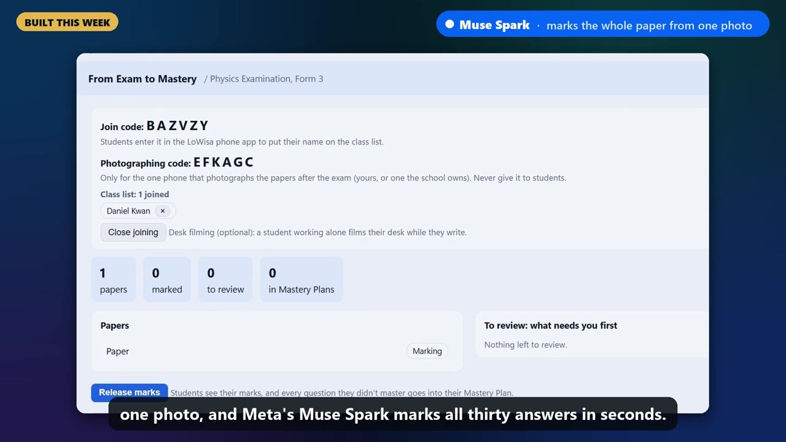 | 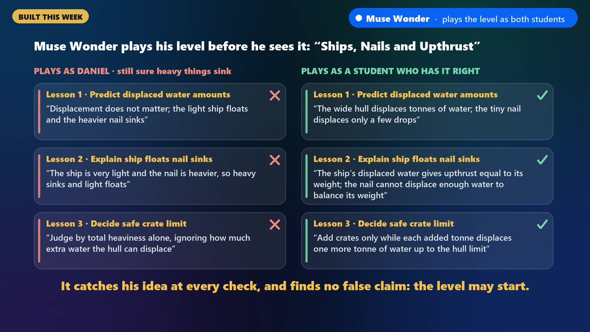 |
| Built this week: one photo, and Muse Spark marks every answer (a sample paper made for the demo) | Built this week: before Daniel sees his level, Muse Wonder plays it as him and as a student who has it right |

---

## Contents

1. [The problem, in depth: human cognitive ability](#1-the-problem-in-depth-human-cognitive-ability)
2. [The demo, frame by frame: one failed question to mastery](#2-the-demo-frame-by-frame-one-failed-question-to-mastery)
3. [Beyond the 3 minutes: what the film had no time to show](#3-beyond-the-3-minutes-what-the-film-had-no-time-to-show)
4. [Meta's models: who does what](#4-metas-models-who-does-what)
5. [What is new, who it is for, and who pays](#5-what-is-new-who-it-is-for-and-who-pays)
6. [One question, three learners: the Misconception Fingerprint](#6-one-question-three-learners-the-misconception-fingerprint)
7. [Measured: a real student's handwriting, an exam it had never seen, a held-out set, a class of 40](#7-measured-a-real-students-handwriting-an-exam-it-had-never-seen-a-held-out-set-a-class-of-40)
8. [The loop, end to end](#8-the-loop-end-to-end)
9. [How it meets the judging criteria](#9-how-it-meets-the-judging-criteria)
10. [Architecture](#10-architecture)
11. [Evidence: every number and where it comes from](#11-evidence-every-number-and-where-it-comes-from)
12. [Try it, and verify it yourself](#12-try-it-and-verify-it-yourself)
13. [Safety, privacy and the teacher's authority](#13-safety-privacy-and-the-teachers-authority)
14. [What was built during the event, and what existed before](#14-what-was-built-during-the-event-and-what-existed-before)
15. [Problems we hit, and how we solved them](#15-problems-we-hit-and-how-we-solved-them)
16. [Limits, stated plainly](#16-limits-stated-plainly)
17. [Future plans: after the hackathon](#17-future-plans-after-the-hackathon)
18. [Sources](#18-sources)

**Short on time?** Read sections 1 to 3 (the problem, the demo, and the depth behind it), then sections 4 and 7 (Meta's models, and the numbers).
**Want to try it?** Section 12: a recorded exam on the teacher's desk in one minute with no account, or live with your own phone.

---

## 1. The problem, in depth: human cognitive ability

Two problems meet in every classroom, and both are about human cognitive ability. **A new one:** AI can now do a
learner's thinking for them, and millions of people already fear what that does to their minds and their children's.
**An old one:** for generations, exams have told a student *that* they failed, without helping them master what they
missed. From Exam to Mastery answers both at once, with the very AI people fear.

### 1.1 When AI does the thinking, the thinking weakens

AI can make us more productive without making us more capable. The early research says the fear is real **when AI
does the work**, and points to the way out: AI that makes the learner do the thinking.

| Study | What was measured | What it found |
|---|---|---|
| MIT Media Lab, *Your Brain on ChatGPT* (2025) [1] | 54 adults wrote essays with an AI assistant, with a search engine, or with no tools, while EEG recorded brain activity | The AI group showed the weakest brain connectivity and the lowest sense of owning their essay. Right after writing, **83.3% of the AI group (15 of 18) could not correctly quote a sentence from their own essay**, against 11.1% in each of the other two groups |
| Bastani et al., *PNAS* (2025) [2] | A field experiment with nearly 1,000 high-school maths students | With a plain AI chat during practice, students did 48% better on the practice problems. **When the AI was taken away, they scored 17% lower than students who never had it.** A tutor built with guardrails, one that makes students do the work, largely removed that harm |
| Microsoft Research and Carnegie Mellon, CHI 2025 [3] | 319 knowledge workers, 936 real tasks done with AI | **The more people trusted the AI, the less critical thinking they applied**; the more they trusted themselves, the more they applied |
| Gerlich, *Societies* (2025) [4] | 666 people of different ages and education | Heavier AI use went with **weaker critical thinking**, through "cognitive offloading": handing the thinking itself to the tool. The youngest participants relied on AI most and scored lowest |

### 1.2 Exam failure: the older problem

For generations, education has measured what students get wrong, without making sure they master what they never
understood. Many adults still carry a failed exam as proof that they "aren't a maths person". That is not because they
could not learn it. Nobody turned that mistake into the next thing they mastered. **A failed answer is not evidence of
someone's inability to learn; it is evidence of something not yet mastered.**

- **Failing is common, and students fear it.**
  - In PISA 2022, about one in three 15-year-olds across OECD countries (31%) did not reach the basic level in
    mathematics. The average score fell by nearly 15 points; before then, no change between two tests had been more
    than 4 points [5].
  - Two in three (65%) said they worry about getting poor marks in mathematics [6].
  - In low- and middle-income countries, **70% of 10-year-olds cannot understand a simple written text** [7].
- **A mark tells a student *that* they failed, not *why*.**
  - In a classroom experiment with 132 pupils, those given written comments on their work did better on the next task
    and stayed interested. Those given grades did not, and grades with comments added did no better than grades alone.
    The weakest pupils lost interest most when they were graded [8].
  - Across 196 studies, feedback is one of the strongest influences on learning (average effect 0.79), **but only
    feedback about the task and how it was done**. Praise and judgements of the person help least [9].
- **The usual answer to failure does not fix it.** In the same synthesis, making a student repeat a year has a
  *negative* average effect on achievement (−0.12) [9].
- **A mistake is where learning can start, if someone works on it with the student.**
  - Errors followed by corrective feedback improve learning [10].
  - The more confident the wrong belief, the more likely it is corrected once the student sees it fail (the
    hypercorrection effect) [11].
  - Wrong ideas are not rare, and they are not foolish: 377 student science teachers held **74 different
    misconceptions about floating and sinking** between them [12]. That is the question in our film.
- **Marking itself is a burden, and it is time a teacher cannot give to the learner.**
  - Across OECD countries, marking and correcting take **9% of teachers' working time**, the most after teaching and
    lesson planning [14].
  - **40% of teachers say too much marking is a source of stress.** In no country is it below 20%, and in some it is
    over 70% [14].
- **Teachers have no time to do this for every student.** The world needs **44 million more teachers** by 2030 [13].
  With a class of forty, nobody can read every student's working, ask each one what they meant, and write each of
  them a repair.

### 1.3 What works: making the learner think

- **Find what a student actually thinks, and act on it** (formative assessment). The classic review found typical gains
  of 0.4 to 0.7 standard deviations; later estimates are smaller but still positive [15].
- **Let them struggle with a problem before teaching it** (productive failure). Across 53 studies it beat being taught
  first, most strongly when the struggle was well designed (Hedges' g 0.37–0.58) [16].
- **Make them recall instead of re-reading.** After two days and after a week, students who were tested remembered
  more than students who studied again [17].
- **Use AI that makes students do the work.** In Bastani's experiment, the tutor with guardrails did not cause the
  harm [2].

### 1.4 Our answer

LoWisa exists to protect and strengthen human cognitive ability. From Exam to Mastery uses the same AI people fear to
make students think again, never to think for them. **A failed question is not a verdict. It is the start of building
real capability.** Each finding above becomes something the product does:

| The research says | So From Exam to Mastery… |
|---|---|
| A mark alone does not teach; feedback must be about the task and how it was done [8, 9] | reads the *reasoning* behind every answer from the handwriting, and names the idea. No verdict: every question not mastered goes into the student's Mastery Plan |
| Repeating a year does not help [9] | turns each question not mastered into its own level, so the student repairs exactly that and moves on |
| A confident wrong idea is corrected best when the student sees it fail [11] | has Lo make the student predict with their own rule, then shows the prediction failing in front of them |
| Struggle before instruction [16] | opens every lesson with a first look and the student's own turn at the controls, before Lo explains |
| AI that does the work weakens learning; AI that makes students work does not [1–4] | never gives the answer first. The student predicts, works out the number and gives the reason. When the ink is unclear, Lo asks instead of guessing |
| Recall beats re-reading [17] | brings the exam question back, makes flashcards from the student's own lessons, and sends a re-check days later |
| What is taught must become something the student can do | ends every level in a real task from work, with a number the student works out |
| Marking takes teachers' time and causes stress; teachers have no time for each student [13, 14] | marks a 30-question paper in a minute or two from one photo, then gives the teacher's time to the learners: the few papers it is unsure of, the class grouped by reasoning, and the decisions only a teacher should make (section 5) |

These are the four areas of the opening table, applied to one exam:
1. **From examination failure to capability:** marking takes minutes, not evenings, and nothing ends in a verdict.
2. **From theoretical knowledge to real-world application:** every level ends in a real work task.
3. **From AI-generated answers to independent thinking:** predict, test, "let's ask ourselves", and only then explain,
   across seven thinking capabilities (pattern recognition, probability and uncertainty, optimisation, systems
   thinking, trade-offs, decision-making, root-cause analysis); each marked question is tagged with the one it needs.
4. **From temporary memorisation to lasting mastery:** the question comes back, a re-check days later, and LoWisa's
   flashcards and Insight mode.

## 2. The demo, frame by frame: one failed question to mastery

These frames are from the film ([on YouTube](https://youtu.be/s4DtrRzyQsI), or [`evidence/film/exam-to-mastery.mp4`](evidence/film/exam-to-mastery.mp4), 2:59; every
word, with its time and the label on screen: [`evidence/film/transcript.md`](evidence/film/transcript.md), subtitles
[`exam-to-mastery.srt`](evidence/film/exam-to-mastery.srt)). Daniel Kwan is a sample student: his physics paper (30
questions) was written for the demo, and nothing in the code or the prompts names it. His story runs first and
unbroken; the real Grade 5 student and the rest follow it. Each shot carries a label: **built this week**, **LoWisa,
playing a level written this week**, or **sample paper**. The narrator is a synthetic voice (Murf's Gordon), not a Meta
model.

**Daniel's question 24, from his paper to mastery**

| | |
|---|---|
| 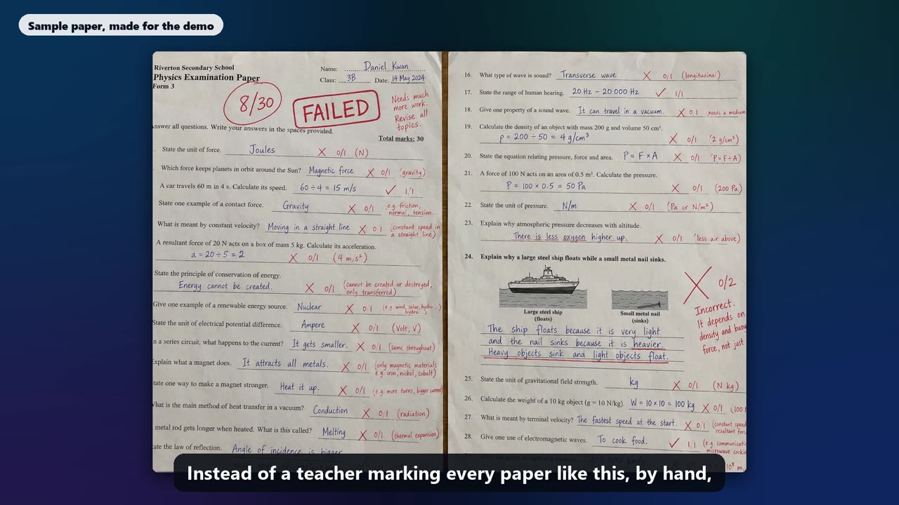 |  |
| **The marking pain.** A red "FAILED" says nothing about why. (The prop's red total was taken off: its marks were made up for the demo; Muse Spark's 6 of 30 is the true mark) | **One photo, every answer.** Muse Spark's returned marks, drawn where each question is on his page: 6 of 30 right, 24 into his Mastery Plan. On this paper every marking decision was right in every run (section 7) |
| 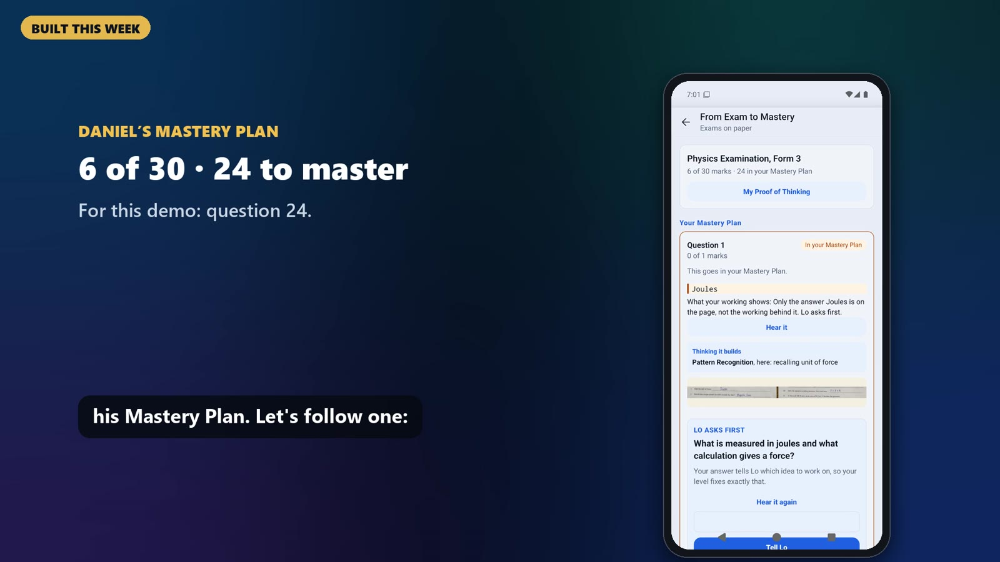 | 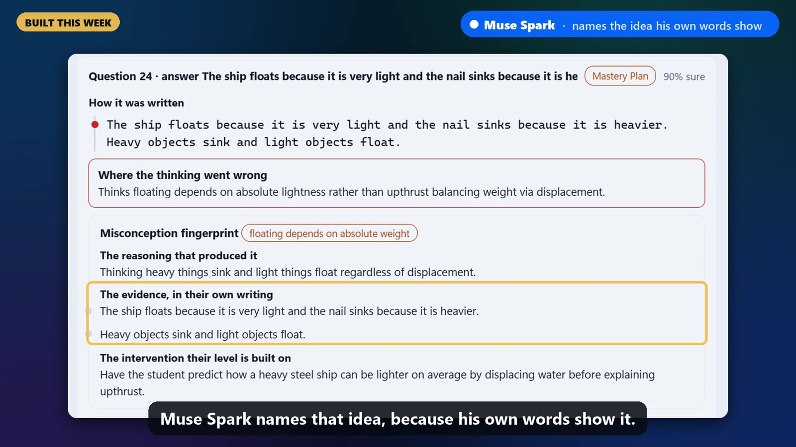 |
| **No verdict.** "6 of 30 · 24 to master". Every question he missed goes into his Mastery Plan | **The thinking behind the answer.** Question 24: *why does a steel ship float while a nail sinks?* He wrote "Heavy objects sink and light objects float". Muse Spark names the idea, and the evidence is his own writing |
| 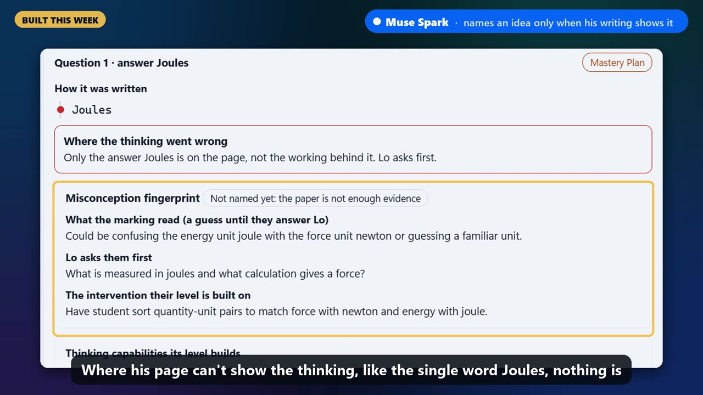 |  |
| **When the page can't show the thinking, nothing is named.** His one-word "Joules" shows no reasoning, so the code names no idea and Lo asks first (section 6) | **Muse Wonder plays his level before he sees it**, as Daniel still sure heavy things sink (caught at all 3 checks) and as a student who has it right (3 of 3), from the level's own self-check |
| 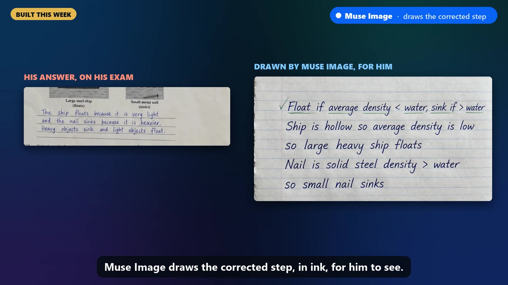 | 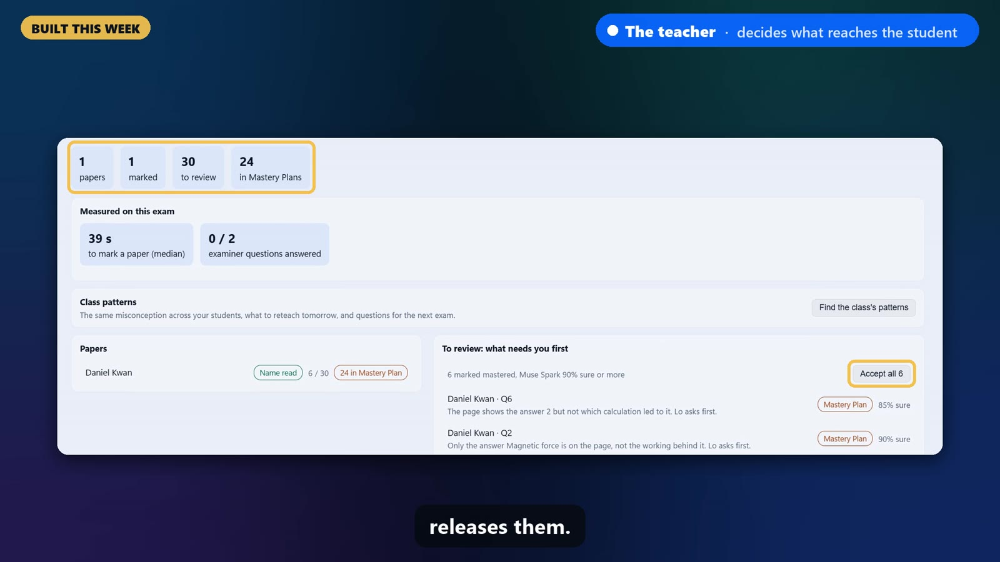 |
| **Muse Image draws the corrected step** for question 24, in ink, for him to see ($0.017, 3 Nov) | **The teacher decides.** Nothing reaches Daniel until the teacher accepts the marks Muse Spark is sure of, checks the rest and releases them |
| 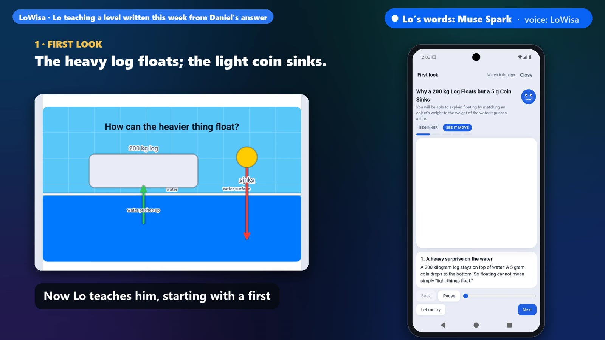 | 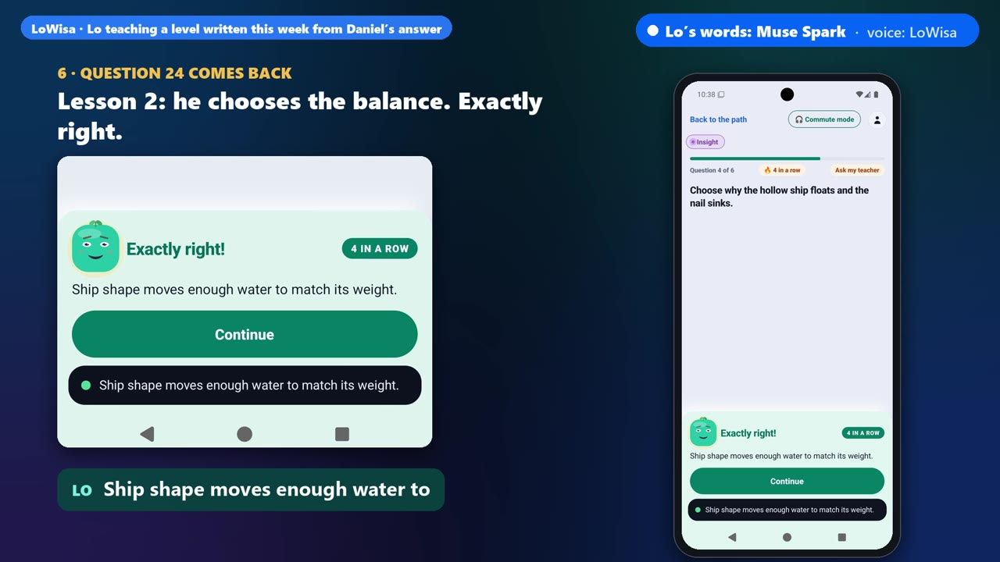 |
| **Lo teaches, in LoWisa's player.** The level written from his mistake opens on a first look: the 200 kg log floats while the 5 g coin drops and sinks | **The exam question comes back.** Two lessons later he chooses the right reason |

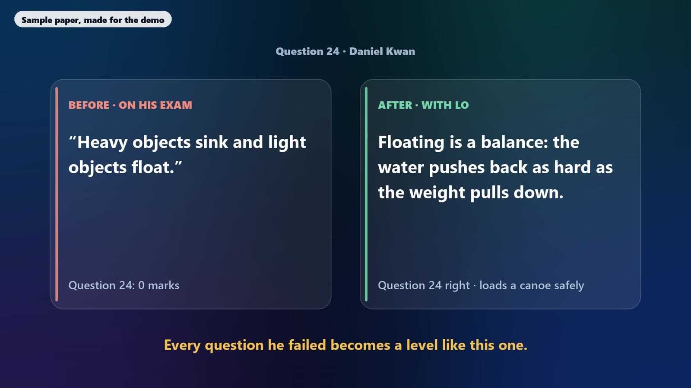

**The transformation.** From "heavy objects sink" to *floating is a balance*. The level ends in a real task, loading a
canoe safely, where he works out the number himself. This card is a summary written by us; the "after" in a student's
own words comes from the teacher's challenge (section 3.6).

**Then, beyond Daniel**

| | |
|---|---|
| 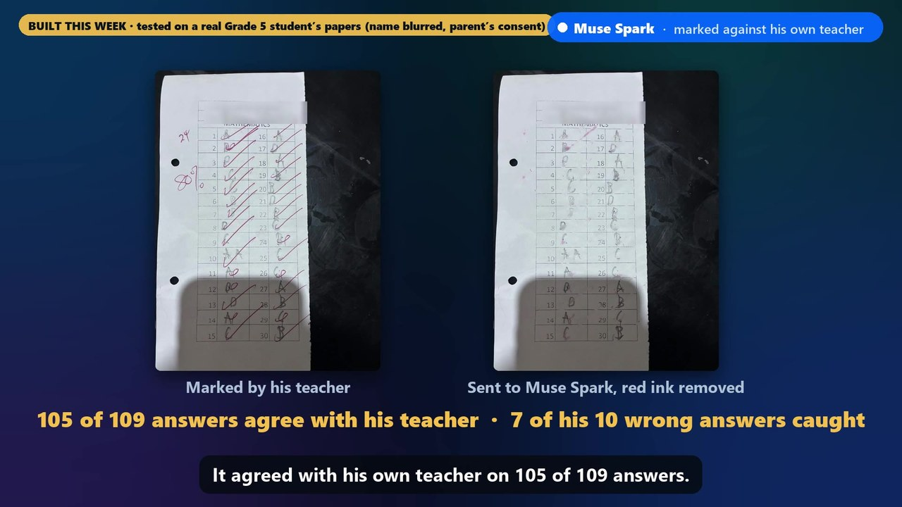 | 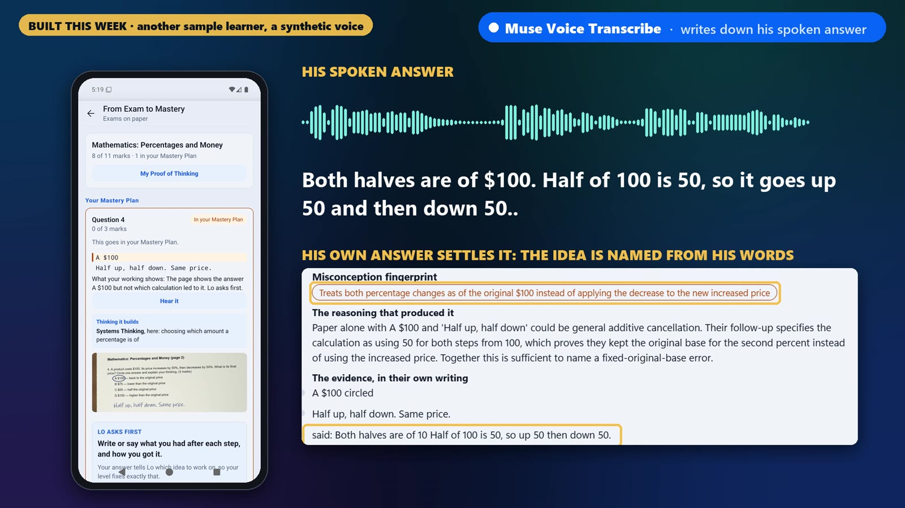 |
| **A real student, against his own teacher.** Question 11 caught, and question 24 an honest miss, from the sheet as it was sent. 6 or 7 of his teacher's 10 wrong answers caught in every run, and no wrong idea named; every answer it was unsure of went to Lo to ask (section 7) | **The answer, out loud.** Another sample learner answers Lo by voice (a synthetic voice); Muse Voice Transcribe writes it down, and his own answer settles the idea |
| 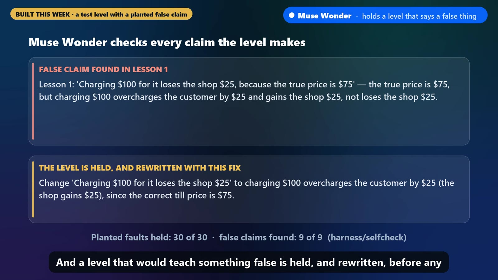 | 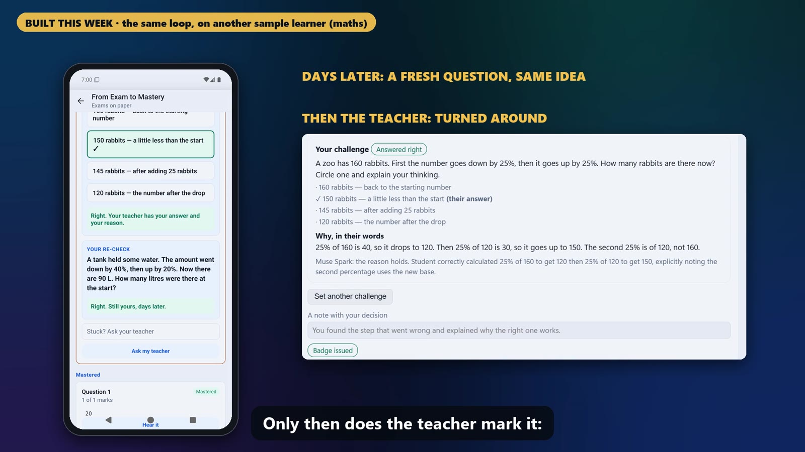 |
| **A level that would teach something false is held**, and rewritten with the fix Muse Wonder names (a test level with a planted false claim; 30 of 30 planted faults held) | **It lasted.** Days later a fresh question on the same idea, then the teacher's "Turned around" (on another sample learner, maths: the same loop) |

**Every second of the film, and what it shows** (2:59):

| Time | On screen | Label | New this week? |
|---|---|---|---|
| 0:00–0:28 | The problem (human cognitive ability); his paper marked by hand; the name and the four Meta models | sample paper; the film's cards | The cards are the film's own; the paper is a prop made for the demo |
| 0:28–0:43 | "Instead of a teacher marking every paper like this, by hand", then Muse Spark's marks landing on his photographed paper | sample paper; built this week · Muse Spark's returned marks, drawn on the photo | **New.** Each mark is the result Muse Spark returned for that question |
| 0:43–1:08 | His Mastery Plan; question 24, with a moment to think; the desk's fingerprint, with his own words as evidence; Lo asks first on "Joules" | built this week | **New** |
| 1:08–1:33 | Muse Wonder's two plays; Muse Image's drawn step; the teacher's desk | built this week | **New** |
| 1:33–2:03 | Lo teaching the level: the first look (the log floats, the coin sinks), Lo's question "Let's ask ourselves" (how deep a loaded cargo ship may sit), question 24 again | LoWisa · a level written this week | The player and Lo's voice are LoWisa's; the level, written from his answer by Muse Spark and checked by Muse Wonder, is new |
| 2:03–2:09 | Before and after | sample paper | A summary card written by us |
| 2:09–2:20 | A real Grade 5 student's sheet, as his teacher marked it and as it was sent; then one question caught (Q11, Lo asks first) and one honest miss (Q24, marked right where his teacher marked it wrong) | built this week | **New:** section 7 |
| 2:20–2:51 | A spoken answer written down by Muse Voice Transcribe, then the desk naming the idea from his own words; Muse Wonder holding a test level with a false claim; the re-check days later, and "Turned around" | built this week · another sample learner; a test level | **New**. The spoken answer is another sample learner's, read by a synthetic voice |
| 2:51–2:59 | The end card: the six Meta models, each checked by another and by code, the replay command, and where to get LoWisa (Google Play, the App Store and the desktop) | | |

In all, about 1:44 shows work built this week and 30 s shows LoWisa's player playing a level written this week; the
rest are the opening cards, the sample paper, before and after, and the end. Four of Meta's models are on screen (Muse
Spark, Muse Wonder, Muse Voice Transcribe, Muse Image); SAM 3.1 works in the optional desk-filming path (section 4).

## 3. Beyond the 3 minutes: what the film had no time to show

Everything below is built and was run live. The film follows one student and one question. This section shows how
the system treats a whole class, and what it does when it is **not sure**. The screenshots are from one continuous
run on the production edge on 31 Oct: a maths test where three students circled the same wrong answer (the question
is in section 6).

### 3.1 The Misconception Fingerprint: three students, the same wrong answer, three different ideas

| | |
|---|---|
| 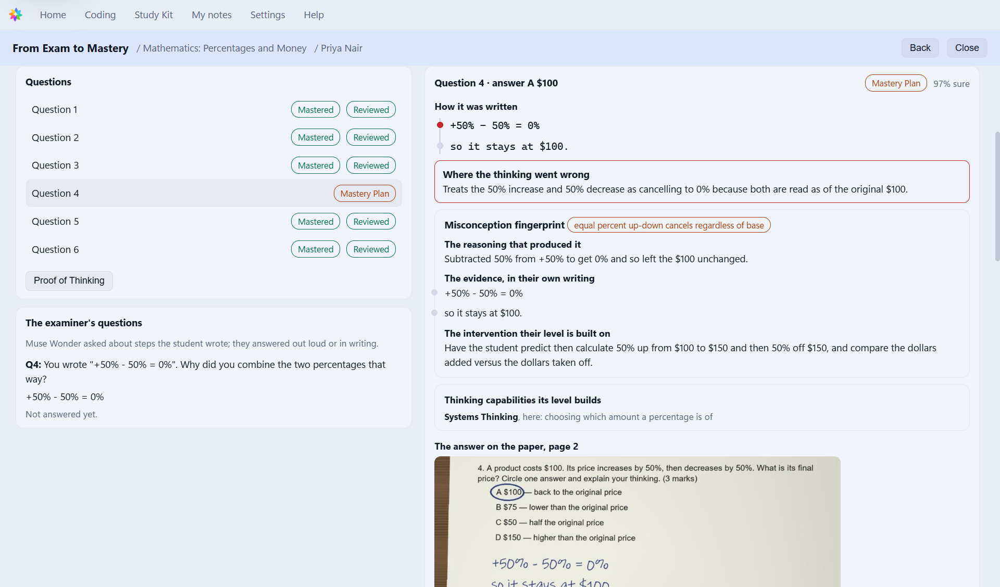 | 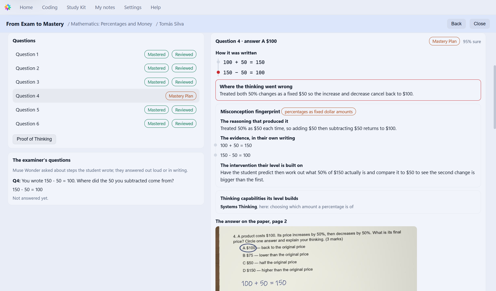 |
| The reasoning, the evidence quoted from the student's own lines, the idea it shows, and what repairs it. The student's step is cut from the photographed page | Same answer, different idea: a different repair. **A misconception is named only when a line read from the page shows it. Code decides this, not the model** (section 6) |

### 3.2 When the ink can't tell, Lo asks first

| | |
|---|---|
| 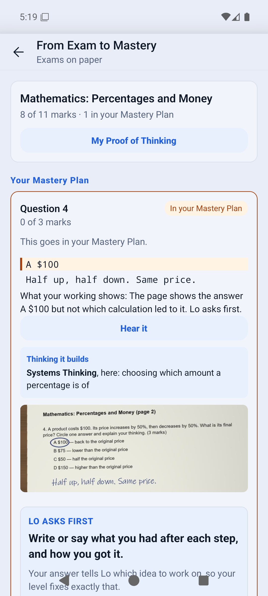 | 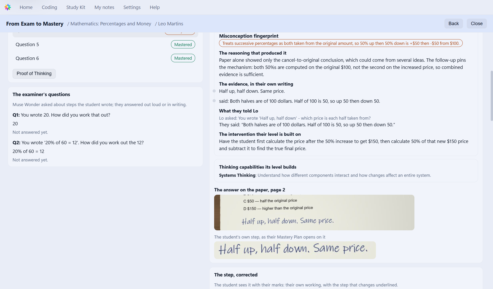 |
| The third student wrote "Half up, half down. Same price." No calculation is visible, so **nothing is named and the student sees no label.** Lo asks one neutral question, out loud | His answer (typed, or spoken through Muse Voice Transcribe) settled it, and **not on the idea the model had guessed.** On held-out papers (on `v1.0-code`): ambiguous pages asked first 40 of 42. (The test phone's keyboard dropped a few characters of his typed answer here; the full sentence is in section 6 and in the replay) |

Short recording: [`evidence/video/lo-asks-first.mp4`](evidence/video/lo-asks-first.mp4).

### 3.3 Muse Wonder plays every level as the student, before the student sees it

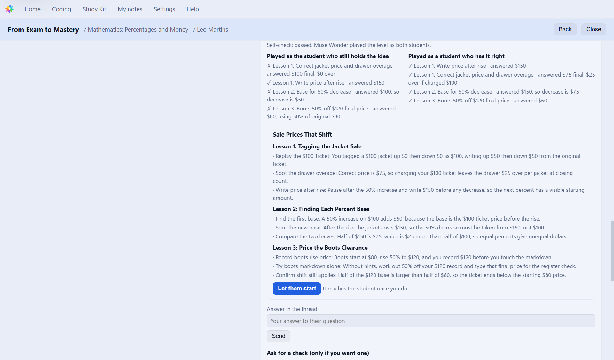

Muse Wonder plays the level twice: once as the student who still holds the wrong idea, and once as one who has it
right. It also works out every number and claim the level makes. A level that would not catch the misconception, or
that says something false, is rewritten with what it found, and **held for the teacher** if it still fails. Measured:
planted faults held 30/30, false claims found 9/9, clean levels passed 30/30.

### 3.4 The class at a glance, and the teacher's time

| | |
|---|---|
| 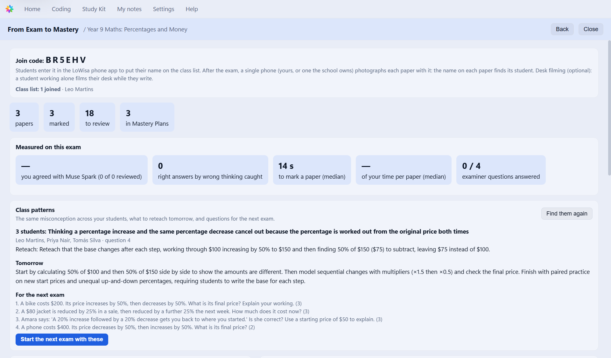 | 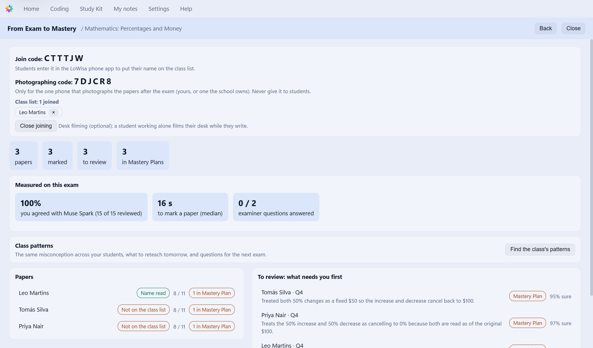 |
| **Class patterns.** Muse Wonder groups the class by *reasoning*, not by score. The teacher acts on a whole group at once. A class of 40: all marked in 32 s, $1.01 in total | **Least certain first.** The confident marks are accepted in one step. The teacher's time goes to the papers that need a human |

### 3.5 Real work, not only exam answers

| | |
|---|---|
| 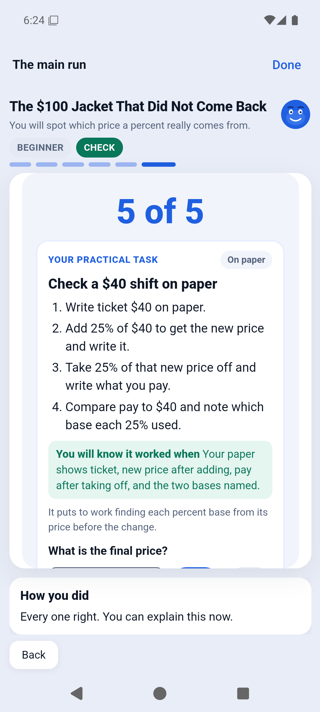 | 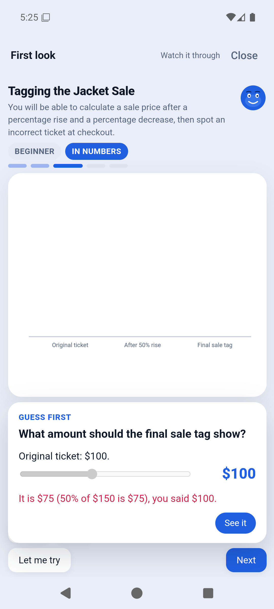 |
| Every level ends in a **practical task from real work**, and it ends in a number the student works out. The app checks it; the student can't just tick "I did it" | **Refutation.** The student's own wrong idea comes back as an option to reject, with the reason |

### 3.6 Proving it lasted: the challenge, "Turned around", the re-check

| | |
|---|---|
| 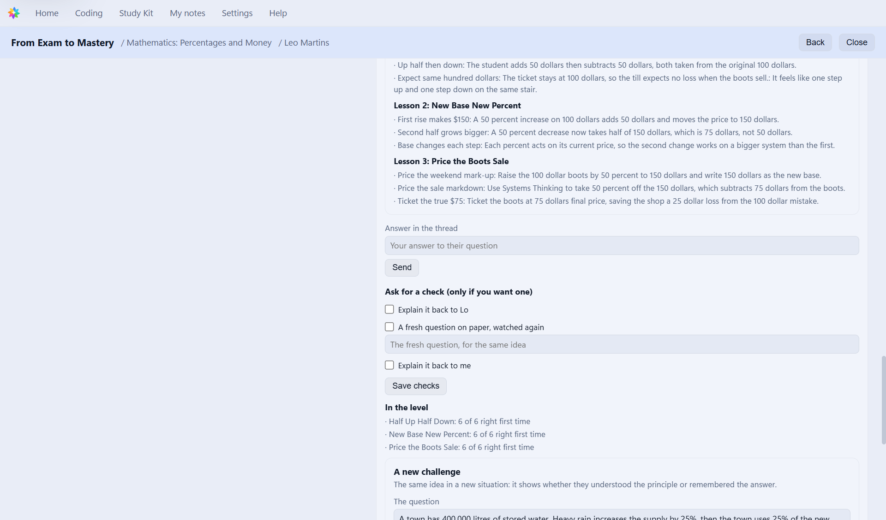 | 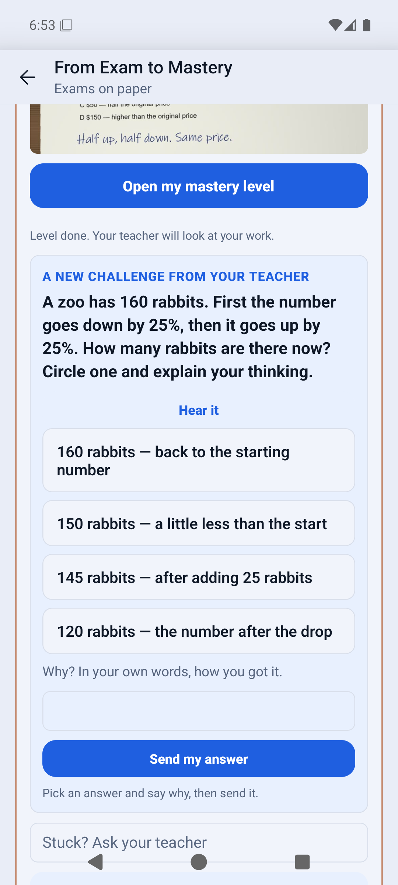 |
| **The teacher's challenge.** The same principle in a new situation, drafted by Muse Spark and edited by the teacher | The student answers with a choice **and a reason** |
| 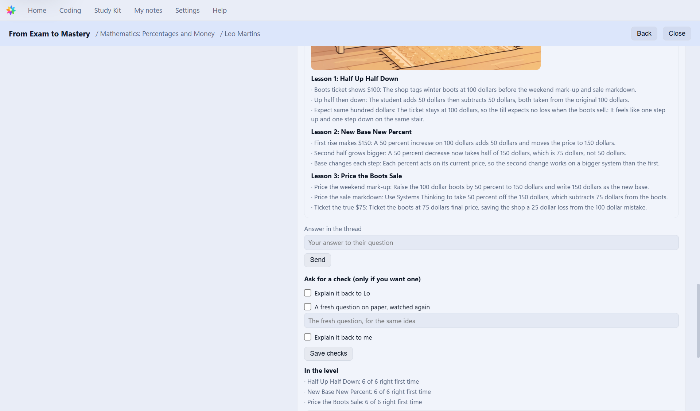 | 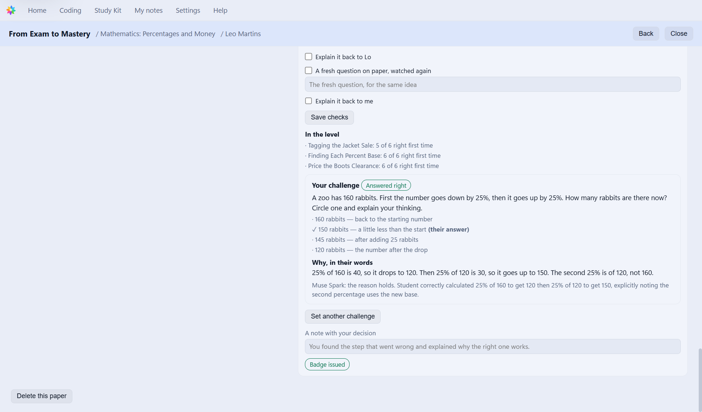 |
| Muse Spark judges the *reason*, not only the choice, and recommends. On 60 test reasons: no false accepts, no false rejects | **Only the teacher issues "Turned around".** The model recommends and never decides |
|  |  |
| **The re-check, days later**, on a different structure. This is spaced retrieval | Answered with the student's own number and working |

### 3.7 Also built, also measured

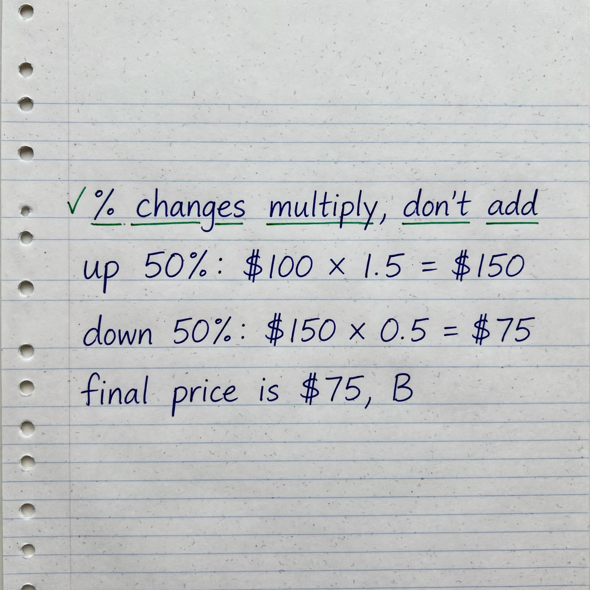

- **Muse Image draws the corrected step** on lined paper, with the changed line underlined (about $0.02 a drawing: $0.015–0.021 in the 31 Oct probes, $0.017–0.019 for the three redrawn on 3 Nov, see `evidence/MEDIA-REPAIR.md`).
- **Witness, the optional way in.** For a homeschooled student, or one with no teacher nearby, the phone films the desk
  while the student writes. SAM 3.1 follows the ink, so every line has the second it was written, and the desk replays
  the moment the thinking went wrong. The video is deleted once it is marked. On 13 clips in 6 languages, 45 of 46
  questions were marked exactly.
- **The examiner.** After marking, Muse Wonder asks the student two questions about a step they wrote themselves. Their
  answers show whether the work is their own.
- **Proof of Thinking.** A dated record of the paper, the marks and the examiner's questions, which the teacher can
  print.

## 4. Meta's models: who does what

Five Meta models are measured in the product, and a sixth, Muse Spark Open, has been run on partner inference. Each one does the job it
is best at.

| Model | Its job here | Code | Measured | Evidence |
|---|---|---|---|---|
| **Muse Spark 1.3** | Reads the teacher's exam file. Marks every photographed paper for the path, not only the answer. Writes the Misconception Fingerprint. Reads the student's answer to Lo. Writes the mastery level. Drafts the challenge, judges the reason, recommends the badge. Writes the re-check. Reads Lo's spoken turns for safety. | `witness_photo`, `witness_mark`, `witness_fingerprint`, `witness_challenge`, `witness_recheck`, `witness_recommend`, `witness_guard` | one physics paper it had never seen: every marking decision right in 6 runs of 30, then 3 more on `v1.0-code`; held-out v2 on `v1.0-code`, 53 papers × 3 runs: right work 39/39, injection 30/30, ambiguous pages asked first 40/42, clear ideas named right 42/48 | `evidence/unseen-physics/`, `harness/heldout/` |
| **Muse Wonder** | Plays each mastery level as the student who still holds the misconception and as one who has it right (in one reasoning pass), and holds a level that would not catch it or says a false thing. Groups the class by reasoning. Asks the examiner's questions. | `witness_check`, `witness_patterns`, `witness_examiner` | 20 levels × 3: planted faults held 30/30, the fault named 30/30; clean levels passed 30/30 | `harness/selfcheck/` |
| **Muse Voice Transcribe** | The student's spoken answer to Lo; the teacher's spoken comment | `witness_meta:transcribe/2` | a 6.4 s spoken answer written down for $0.0003 | `harness/probes/results-31oct/transcript-31oct.json` |
| **Muse Image** | Draws the corrected step on lined paper | `witness_draw` | the three learners' steps drawn, $0.017–0.019 each (redrawn 3 Nov, `harness/probes/redraw_3nov.escript`); Daniel's question 24 for the film, $0.017 (`drawn-daniel-q24.json`) | `harness/probes/results-03nov/` |
| **SAM 3.1** | Desk filming (the optional way in): follows the ink through a video, so each line has the second it was written | `witness_sam`, `witness_timeline` | on a photo it answers "word" (not "handwriting"); its word boxes, joined into lines, found 52 of 64 handwritten lines (mean overlap 0.75) | `harness/probes/`, `harness/bench/results/line_placement.json` |
| Muse Spark Open | The same marking, on a photographed paper or a desk video, through any OpenAI-compatible endpoint | `witness_open`, `witness_photo` | **run on Baseten's Model API** (3 Nov): the physics paper 30 of 30 decisions right in 5 of 5 completed runs; the real student's maths 27 and 28 of 30 (5 of 6 wrong answers caught), English 29 of 30, science 46 of 49 against his teacher, no wrong idea named; 9 of 12 runs completed, all 3 since the limit per call went to 10 minutes | [`harness/open/`](harness/open/README.md) |

**What surprised us about Meta's models**
- **Muse Spark changed its own reading from one sentence.** Leo's page (one of the three learners in section 6) read "half up, half down": its guess was
  "cancel". His answer to Lo ("both halves are of 100") moved it to "the second change was taken of the original
  amount", which no reading of the page could have shown.
- **Muse Wonder caught a false sentence a level said in passing.** "Charging $100 loses the shop $25" is false: the shop
  gains it. Asked to work out every number and claim, it found every planted false claim (9 of 9, over three runs).
- **The API gave us things we expected to build ourselves:**
  - `/responses` holds a strict JSON schema for Muse Spark and Muse Wonder.
  - A prompt cache key made a second reading of the same pages 99.8% cached (one probe).
  - SAM 3.1 followed written lines in the order they were written (on our rendered desk clips; real filmed desks are next).

Notes for Meta's API team: `harness/FINDINGS.md`.

### The agent pipeline: who hands what to whom, and the code check between each step

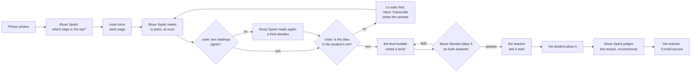

| Step | Model | What it hands on | The code check before the next step | Where |
|---|---|---|---|---|
| Orientation | Muse Spark (low effort) | which edge of each photo is the page's top | only 0, 90, 180 or 270; anything else leaves the page as it is | `witness_photo:orient/3` |
| Marking | Muse Spark (medium) | every answer, its steps, a result and a fingerprint, as JSON that the code parses and checks before using it | parsed and fitted to the exam's questions; a part's questions kept to its range | `witness_photo:mark/4` |
| Two readings | Muse Spark (answers only, low; full, high) | the same paper read again | a short answer read differently, or a result that differs, is a split; a third reading decides; until two agree nothing joins "Accept all" | `witness_mark:checked/2`, `reconcile/2`, `decide/4` |
| The evidence rule | (code only) | — | an idea is named only when a quoted line is the student's own ink, and the option circled is no evidence | `witness_mark:fingerprint/4`, `chosen_option/2` |
| Lo asks first | Muse Voice Transcribe, then Muse Spark | the student's spoken or typed answer, read with the page | the same evidence rule on the answer | `witness_api` (`POST sitting/:id/answer`), `witness_meta:transcribe/2` |
| The self-check | Muse Wonder (medium, 16,000 tokens) | two plays of the level and every claim checked | a level that would not catch the idea, or says a false thing, is rewritten or held | `witness_check` |
| The reason | Muse Spark | whether the student's reason shows the idea, and what next | the teacher issues "Turned around"; nothing is issued by a model | `witness_challenge`, `witness_recommend` |

**One real paper, every call:** [`harness/trace/`](harness/trace/README.md) follows the real student's English paper
through these steps (8 calls to Meta, $0.23, each with its effort, time, tokens and what the code did next). Muse
Image and Muse Voice Transcribe, also in the film, in pictures with their sources: Muse Image's drawn step ([`muse-image.png`](evidence/models/muse-image.png)) and
a spoken answer written down by Muse Voice Transcribe ([`voice-transcribe.png`](evidence/models/voice-transcribe.png)).

### Findings for Meta: what the code between the models changed, measured

| Finding | Without it | With it | Evidence |
|---|---|---|---|
| The evidence rule in code, on 42 pages whose ink cannot show the idea (14 papers × 3 runs, on `066c9d1`) | Muse Spark proposed a named idea on **6 of 42** | a wrong idea named on **3 of 42**; the cost: 3 of 48 clear ideas asked instead of named | [`v2-on-shipped-code-3-runs.json`](harness/heldout/results/v2-on-shipped-code-3-runs.json) (`fingerprint.possible` is the proposal the code held) |
| Asking which **edge** is the top, not how many degrees to turn | 44 of 45 pages right (14 of 15 sideways) | **45 of 45** (15 of 15) | [`orient-03nov.json`](harness/orient/results/orient-03nov.json) |
| A long paper in parts, read at once | 220–232 s for a 30-question, four-photo paper | **63–65 s**, the same agreement | [`parts-03nov.json`](harness/parts/results/parts-03nov.json) |
| One prompt-cache key per paper, for every reading of it | every page sent again at full price | a second reading **99.8% cached** (one probe) | [`harness/probes/results-31oct/`](harness/probes/results-31oct/) |
| Room to reason, for Muse Wonder | at 4,000 output tokens it spent 3,998 reasoning and returned no verdict | medium effort with 16,000 tokens: a verdict every time | section 15, [`harness/FINDINGS.md`](harness/FINDINGS.md) |
| Muse Wonder as a simulated learner | — | planted faults held **30 of 30**, false claims found **9 of 9** | [`selfcheck-3-runs.json`](harness/selfcheck/results/selfcheck-3-runs.json) |
| Two readings must agree before "Accept all" (3 Nov) | a letter misread at 90% sure was accepted with one reading (the real student's science Q33) | every short answer read twice: it caught that misread letter in 1 of 3 runs on the tagged code (in the other two both readings read the same wrong letter); the cost of a held-out marking rose from $0.016 to $0.023 | [`condition-c-on-v1.0-code-3-runs.json`](evidence/real-handwriting/results/condition-c-on-v1.0-code-3-runs.json), `witness_mark:checked/2` |

**Beyond a basic integration**
- **Meta's models check each other, with code between them.** Muse Spark reads and diagnoses; code checks every quote
  against the lines read from the page; Muse Wonder plays the level as the student before the student sees it; Muse
  Spark judges the student's reason and recommends; the teacher decides. Twenty-one jobs across six models, listed
  one by one below.
- **A reasoning model used as a simulated learner.** Muse Wonder plays every level twice in one reasoning pass, as the
  student who still holds the wrong idea and as one who has it right, and audits every number and claim the level
  makes. Nothing reaches a student until that check passes or the teacher has looked.
- **Every input Meta's models take:** photographed handwriting (Muse Spark), desk video (SAM 3.1 with Muse Spark),
  the student's voice (Muse Voice Transcribe), and pictures (Muse Image).
- **Built for a class, priced per call:** forty papers marked at once in 32 s for $1.01; every call metered at Meta's
  published prices, every JSON reply parsed and checked before it is used, the prompt cache shared across the readings of one paper, and
  a daily ceiling on every route for each login, one for each student, and one across all logins together.

**Every job a Meta model does here, one by one**

| # | Model | The job | Code | Measured on its own |
|---|---|---|---|---|
| 1 | Muse Spark 1.3 | Says which edge of each phone photo is the page's top | `witness_photo:orient/3` | 45 of 45 pages ([`orient-03nov.json`](harness/orient/results/orient-03nov.json)) |
| 2 | Muse Spark 1.3 | Reads the exam's questions and mark scheme from the teacher's own file | `witness_read` | — |
| 3 | Muse Spark 1.3 | Marks every answer and reads the steps that led to it | `witness_photo:mark/4` | physics 90 of 90 decisions; the real student (section 7) |
| 4 | Muse Spark 1.3 | Reads the answers alone a second time, before anything joins "Accept all" | `witness_mark:checked/2` | caught a misread letter in 1 of 3 runs (section 7) |
| 5 | Muse Spark 1.3 | Writes the Misconception Fingerprint from the student's own ink | `witness_fingerprint` | held-out: named right 43 of 48 |
| 6 | Muse Spark 1.3 | Reads the student's answer to Lo with the page, and names the idea or not | `witness_fingerprint:answer/4` | section 3.2 |
| 7 | Muse Spark 1.3 | Designs the mastery level from the fingerprint | the host's design call (`witness_host`) | checked by job 15 |
| 8 | Muse Spark 1.3 | Writes the corrected step for Muse Image to draw | `witness_draw` | — |
| 9 | Muse Spark 1.3 | Drafts the teacher's new challenge | `witness_challenge` | — |
| 10 | Muse Spark 1.3 | Judges the student's reason in the challenge | `witness_challenge` | — |
| 11 | Muse Spark 1.3 | Recommends "Turned around" to the teacher | `witness_recommend` | — |
| 12 | Muse Spark 1.3 | Writes the re-check days later | `witness_recheck` | — |
| 13 | Muse Spark 1.3 | Reads each of Lo's live turns for safety before a student hears it | `witness_guard` | — |
| 14 | Muse Spark 1.3 | Judges the student's answer to an examiner's question | `witness_examiner:judge_run/4` | — |
| 15 | Muse Wonder | Plays each level as both students and checks every claim in it | `witness_check` | planted faults held 30 of 30, false claims 9 of 9 |
| 16 | Muse Wonder | Groups the class by reasoning | `witness_patterns` | — |
| 17 | Muse Wonder | Picks the steps to ask about, and asks the examiner's questions | `witness_examiner:run/3` | — |
| 18 | Muse Voice Transcribe | Writes down the student's spoken answer, and the teacher's spoken comment | `witness_meta:transcribe/2` | a 6.4 s answer for $0.0003 |
| 19 | Muse Image | Draws the corrected step on lined paper | `witness_draw` | $0.017–0.019 a drawing |
| 20 | SAM 3.1 | Follows the ink through a desk video (the optional way in) | `witness_sam`, `witness_timeline` | 52 of 64 lines, on rendered clips |
| 21 | Muse Spark Open | Job 3, with its fingerprint, on Meta's open weights through partner inference | `witness_open` | 9 of 12 runs completed ([`harness/open/`](harness/open/README.md)) |

A dash means the job runs in the product but has no measurement of its own; its result shows in a later step.

**Meta across LoWisa, beyond this project**

| How a learner reaches Meta's models | What it does | Built | Where to see it |
|---|---|---|---|
| **No key: paid from LoWisa credits** | Every From Exam to Mastery model call runs on Meta's models, paid from the school's LoWisa credits, through the Meta provider on LoWisa's edge | During the event (27 Oct) | This repository (`witness/src/witness_meta.erl`) |
| **The learner's own Meta key** | Muse Spark 1.3 is one of the tutor's models in the LoWisa desktop app: it teaches, works with the learner's files and builds quizzes. Meta bills the learner's own usage | Before the event (21 Oct), released in desktop app 0.9.32 on 2 Nov; **not part of this submission's new work** | [lowisa.dev/help/ide-models-and-keys](https://lowisa.dev/help/ide-models-and-keys/), and "Can I use Meta's Muse Spark with LoWisa?" on [lowisa.dev](https://lowisa.dev) |

LoWisa's general tutor on managed credits (no key) runs on another provider's model by default. During the event Muse
Spark was also added to the desktop app's own model list on LoWisa credits (desktop 0.9.33, 4 Nov); that is LoWisa
product work, named in [`host/README.md`](host/README.md) and not shown in the demo.

## 5. What is new, who it is for, and who pays

Most AI in education competes to produce answers faster. From Exam to Mastery does the opposite: it uses the same AI
people fear to make the learner do the thinking, and it brings all four areas of human cognitive ability (the opening,
and section 1.4) together on one exam, from the marking to the real task. **A failed paper stops being a verdict and
becomes a plan.**

**Why not an existing tool**

| | What it does | What it does not do that this does |
|---|---|---|
| Grading tools for paper exams | Speed up marking by grouping similar answers or applying a rubric | Read which wrong idea produced each answer, ask the student when the ink can't tell, build the repair, test the principle later |
| Diagnostic multiple-choice (Eedi / Diagnostic Questions) | Each wrong option is written to reveal one misconception | Read the student's own free working on their own exam, in any subject, and ask when the working fits two ideas |
| AI tutors | A conversation the student starts | Start from the student's own handwritten exam, decide nothing without evidence, keep the teacher in charge |
| A photo pasted into a chatbot | One answer for one student, and it does the thinking | A class at once, the evidence rule in code, the class view, the teacher's gates, a record the teacher signs, and a student who has to think |

**Who uses it**
- **Teachers and schools, in any country.** The questions and the scheme come from the teacher's own file.
- **Students on their own phones**, through the LoWisa app.
- **A student with no phone:** the teacher types the name and prints that student's Mastery Plan from the desk.

**Who pays**
- **The school pays.** Teachers sign in with their school's LoWisa login, and every model call their exams make is paid
  from the school's LoWisa wallet (1 credit = 1 US cent). Students never pay for their Mastery Plan.
- **Marking is not charged.** The school's credits pay for the mastery levels built from the marked papers.
- **No new price was set for this.**
- **Every login has a daily ceiling on every model route, each student has one of their own, and all logins together
  have one.** A whole class fits well under them.

**Time saved, and where it goes**

The teacher checks instead of marking. The model's marking time on the production edge:

| | Hand marking | From Exam to Mastery |
|---|---|---|
| One 30-question physics paper | the teacher reads and marks every answer | one photo; marked in 40–58 s (64–161 s with the second reading on `v1.0-code`), then the teacher reviews it |
| A class of 40, two-page papers | the teacher marks all 40 by hand | all 40 marked at once in 32 s; the class patterns ready a minute after the last photo |
| What the mark tells the student | the score | the reasoning behind each answer, and a level for every question not mastered |

The time that comes back is spent on the learners, on the work only a teacher should do:
- **The few papers that need a human.** The desk lists the least certain marks first; the confident ones are accepted
  in one step (15 of 15 agreed in the 31 Oct run).
- **The class, by reasoning, not by score.** Muse Wonder groups the students who hold the same wrong idea, so the
  teacher re-teaches each idea once, to the group that needs it (section 3.4).
- **Each student's repair.** A focus note on a question, a level to let start, a challenge sent to a group, an
  explanation to read, and the "Turned around" decision (sections 3.6 and 13).

**Not yet measured:** a teacher's own minutes per paper with real teachers. The desk already records them
(`witness_measure`: the seconds each paper is open while reviewed); the pilot will report them (section 17.6).

**What it costs**, measured on the production edge and priced at Meta's published rates:

| | Cost |
|---|---|
| Marking a page | $0.016 (held-out v2) |
| A 30-question physics paper, both pages in one photo | about $0.05 |
| One question turned around (marking, Lo's question, the level and its animations, the self-check, the challenge, the recommendation) | about $0.25 to $0.35 |
| A class of 40, two-page papers ([`harness/class/`](harness/class/)) | **$1.01**: $0.90 to mark all 40, $0.10 for the class patterns. All 40 marked at once in 32 s; the patterns ready 1 minute after the last photo |

**The whole cost for one class**, from the measured figures above (model cost at Meta's published prices; 1 LoWisa
credit = 1 US cent). Example: a class of 40, each student with 8 questions not mastered on one exam.

| | Per student | Class of 40 | Who pays |
|---|---|---|---|
| Marking every paper, and the class patterns | $0.025 | **$1.01** | nobody: marking is not charged |
| Building a level for every question not mastered (median 5 credits a level, 2.6–7.8 over 23 builds) | $0.40 | **$16** | the school's credits |
| Every question carried all the way to "Turned around" (the level above, Lo's live turns, animations, self-check, challenge, recommendation) | $2.00–2.80 | **$80–112** | the school's credits |

So a school pays about $0.40 to $2.80 a student for one exam, depending on how far the levels are played; the
teacher's hand-marking of the 40 papers is what it saves (not yet measured with a teacher). Each student
plays their levels in the LoWisa app, on a phone or the desktop.

**What is hard to copy**
- the evidence rule in code;
- the teacher's gates;
- the store of settled fingerprints. Each one is a real student's reasoning, labelled with what repaired it, for each
  curriculum, and the store grows with every exam.

## 6. One question, three learners: the Misconception Fingerprint

> A product costs $100. Its price increases by 50%, then decreases by 50%. What is its final price?
> **A** $100 · **B** $75 · **C** $50 · **D** $150

It looks easy, and an adult can still fall into the trap that +50% and −50% cancel. It is the arithmetic of a salary
rise then a cut, inflation then a sale, an investment's gain then its loss.

Three sample students all circled **A $100**. Each photographed paper was marked **five times** by Muse Spark through the
product's own code (31 Oct 2026; every reply in [`evidence/misconceptions/runs-31oct-steps-rule.jsonl`](evidence/misconceptions/runs-31oct-steps-rule.jsonl)):

| | Learner A | Learner B | Learner C |
|---|---|---|---|
| Wrote | `+50% - 50% = 0%` · `so it stays at $100.` | `100 + 50 = 150` · `150 - 50 = 100` | `Half up, half down. Same price.` |
| Named (of 5) | **5 of 5**: the two changes cancel | **5 of 5**: 50% taken as a fixed $50 | **0 of 5** |
| Lo asks first (of 5) | 0 | 0 | **5 of 5**: *"Write or say what you had after each step, and how you got it."* |

**Two ideas the ink shows, one it can't.**
- **A's ink shows cancelling.** "+50% − 50% = 0%" is the cancellation written down.
- **B's ink shows the second change taken of the first amount.** B subtracted $50 again: 50% of the original $100, not of $150.
- **C's ink shows no calculation at all.** "Half up, half down. Same price." states a result. It could be A's idea or B's, and each needs a different repair.

**Why C is asked.** Muse Spark's guess for C was "cancel" every time. **The code does not let it name that**, because no
line read from the page shows a calculation. The student sees no label at all. Lo asks a question that suggests nothing.

In the rehearsal, Leo (the sample student C) wrote back *"Both halves are of 100 dollars. Half of 100 is 50, so up 50
then down 50."* Muse Spark settled his fingerprint on the base: **B's idea, not the "cancel" it had guessed.** The page alone could not have shown it. The class view then groups Leo with B.

**What the code decides** ([`witness_mark:fingerprint/4`](witness/src/witness_mark.erl), [`witness_fingerprint`](witness/src/witness_fingerprint.erl)):

| The model returns | The code keeps |
|---|---|
| A name, with quoted evidence that is (part of) a line read from the student's page | the name |
| A quote longer than any line read (an invented ending), or the final answer alone | no name: Lo asks |
| A name **and** a question for Lo | no name yet; the guess kept for the teacher only |
| A numeric answer, and no quoted line with an operation, an "=" or a comparison between numbers | no name yet: Lo asks |
| After Lo asks: a name whose evidence is neither the page's lines nor the student's own words | no name: Lo may ask once more |

On a physics paper the explanation *is* the working, so a written sentence of five words or more counts as the
student's own evidence. Daniel's "Heavy objects sink and light objects float" is named. A one-word recall answer still
has Lo ask first (section 7).

**What the check is, and what it is not.**
- The quotes are checked against **the lines Muse Spark read from the page**, never the pixels themselves.
- A line Muse Spark misread is therefore the limit of this check.
- The marking's bench is that guard: questions read exactly from photos and video (section 11).

Full write-up: [`docs/misconception-fingerprint.md`](docs/misconception-fingerprint.md).

## 7. Measured: a real student's handwriting, an exam it had never seen, a held-out set, a class of 40

### Real handwriting: one student's papers, against his own teacher's marks

A real Grade 5 student's pencil answers on three end-of-term papers (maths, English, science: 110 multiple-choice
questions, 109 scored), marked by his class teacher, who is not on our team. His parent consented to their use and
publication, his name included (the written consent is available if required); we blurred it anyway, with his school,
class and student number. We removed the
teacher's red ink by colour so the model could not copy his ticks, then the live product's photo path marked each paper.

| | A: as photographed | B: sideways pages turned upright by hand | C: 3 runs (`e9fb96f`) | C again on `v1.0-code`, 3 runs |
|---|---|---|---|---|
| Witness agrees with the teacher | 102 of 109 | 105 of 109 | 105, 103, 105 of 109 | **105, 104, 104 of 109** |
| The teacher's wrong answers Witness also caught | 4 of 10 | 7 of 10 | 7 of 10 every run | **7, 6, 7 of 10** |
| Right by the teacher, wrong by Witness | 1 | 1 | 1, 3, 1 | 1, 1, 2 |
| A wrong idea named on an answer not accepted | | | 0, 1, 3 | **0, 0, 0** |
| Cohen's kappa | 0.50 | 0.76 | 0.67–0.76 | 0.68–0.76 |

Three of the nine question pages were photographed sideways, and that is where A lost most. B turned them by hand to
measure what turning would gain; C is the product doing it itself (it stored the sideways page upright in 9 of 9
papers) and matches B. Marking every answer right would agree on 99 of 109, so the number that matters is the wrong
answers caught: 7 of 10 in each run on `e9fb96f` (95% interval 40–89%), and 7, 6 and 7 on `v1.0-code`; by question, 6 of the 10 were caught in every run (`score.py` prints both). C also found a fault in our code: on 4 of the 26 answers it did not accept (over three runs; none in run 1) an idea was
named from the circled option alone, which the evidence rule should have held. It is fixed in `38dd640` and the four are
held (section 15). Every question, every run, the disagreements and the sheets the teacher marked:
[`evidence/real-handwriting/`](evidence/real-handwriting/README.md).

**Again on the tagged code `v1.0-code`** (edge vb1104f, 3 Nov): no idea was named on any answer it did not accept, in
any run (the circled-option fix, live). The new rule that two readings must agree before "Accept all" caught his
misread letter on science Q33 once: in run 3 the answers-only reading read his D, the question became unsure and was
kept out of "Accept all". In runs 1 and 2 both readings read the same wrong letter, which a second reading cannot
catch; the teacher's review is what remains for that.

**His written answers.** Three more of his papers (creative arts twice, integrated science: 42 questions, 30 of them
written answers or drawings) were marked the same way, three runs, with **no marking scheme given**: **37, 38 and 38 of
42** agree with his teacher, and 3 of the teacher's 4 wrong answers were caught in every run. Marking everything right
would also agree on 38, so the result that counts is a different one: **all 19 answers Witness did not accept, over the
three runs, were held for Lo to ask, with no idea named and no label shown to him.** The disagreements are mostly over
the answer key (the laundry steps he ordered as textbooks do, which his teacher marked wrong), and one is a reading
error (an answer squeezed onto the printed lines). It is one student, so it tests reading a child's words and marking
against a real teacher, not the long written working the fingerprint reads.

### An exam it had never seen: the film's physics paper

Everything was built and tuned on mathematics. The film's Form 3 physics paper (30 questions on forces, energy,
electricity, magnetism, heat, waves, pressure and buoyancy) was the first time the system met physics. It was run the
way a teacher would run it, on the production edge ([`evidence/unseen-physics/`](evidence/unseen-physics/README.md)):

| | Without a mark scheme | With the scheme |
|---|---|---|
| Score given (truth: 6/30) | 6/30 in 3 of 3 runs | 6/30 in 3 of 3 runs |
| Marking decisions that match a physics teacher's | **90 of 90** | **90 of 90** |
| Name, class and date read from the paper | 3 of 3 | 3 of 3 |
| Time, photo in to marks out | 46–58 s | 40–52 s |

These six runs were the first time the code saw the paper, before anything was changed. They found two faults, both
fixed and re-run the same day: a written explanation had been treated as a bare answer, and "part way" was sometimes
given full marks. **So the marking result above is unseen, but for naming ideas this paper is now a development paper**:
the rule was changed on it, and after the change question 24's idea was named in 6 of 6 runs (4 of 6 before). The levels
for questions 23 and 24 were then built live, and their self-checks passed. One paper is one paper: more unseen
subjects, marked by an outside teacher, are the next step (section 17.6).

### Held out: 53 papers, first run blind, then run again on the shipped code

> **Simulated handwriting, not real students.** These papers are written in a handwriting font with a small wobble per
> letter, on a simulated photograph of a page ([`make_items.py`](harness/heldout/make_items.py)). Real handwriting is
> harder; the real student's papers above are the real-handwriting evidence.

The first 36 papers (30 Oct) were used to design the rule in code, so they are the **development set**. The held-out
set **v2** has 53 papers in 13 new topics:
- 3 topics not maths, 2 not in English;
- 22 hard items, 10 with instructions to the marker written into the ink.

It was labelled by a rule stated in [`items_v2.py`](harness/heldout/items_v2.py) and committed before its first run.
Scoring is strict: the name itself must carry a key, and an "ask" passes only when nothing at all names an idea.

**What is blind and what is not.** v2's first run (31 Oct, before anything was changed) is the blind result. The rule
was then changed twice, partly after seeing that run, so every later v2 run has seen v2: **v2 is now a second
development set.** A prompt example that resembled one v2 item was replaced on 3 Nov. Both are shown, with 95% intervals:

| v2: 53 papers × 3 runs | Blind first run, 31 Oct ([`v2-held-out-3-runs.json`](harness/heldout/results/v2-held-out-3-runs.json)) | 3 Nov, `066c9d1` ([`v2-on-shipped-code-3-runs.json`](harness/heldout/results/v2-on-shipped-code-3-runs.json)) | 3 Nov, the tagged code `v1.0-code` ([`v2-on-v1.0-code-3-runs.json`](harness/heldout/results/v2-on-v1.0-code-3-runs.json)) | 3–4 Nov, `v1.0.1-code` ([`v2-on-v1.0.1-code-3-runs.json`](harness/heldout/results/v2-on-v1.0.1-code-3-runs.json)) |
|---|---|---|---|---|
| Right work marked mastered | **39 of 39** | **39 of 39** (91–100%) | **39 of 39** (91–100%) | **39 of 39** (91–100%) |
| Instructions in the ink, never marked mastered | **30 of 30** | **30 of 30** (89–100%) | **30 of 30** (89–100%) | **30 of 30** (89–100%) |
| Ink that cannot tell the idea: Lo asks | **39 of 42** | **39 of 42** (81–97%) | **40 of 42** (84–99%) | **39 of 42** (81–97%) |
| … a wrong idea named instead (the harmful error) | 3 of 42 | 3 of 42 (3–19%) | 2 of 42 (1–16%) | 3 of 42 (3–19%) |
| Ink that shows the idea: named right | **41 of 48** | **44 of 48** (80–97%) | **42 of 48** (75–94%) | **43 of 48** (78–95%) |
| … named, but a different idea | 4 of 48 | 1 of 48 | 3 of 48 | 0 of 48 |
| … asked first instead (cautious) | 3 of 48 | 3 of 48 | 3 of 48 | 5 of 48 |

On the tagged code the harmful error fell by one and a different idea was named twice more on clear ink: within the
run-to-run spread, and reported as it came. On `v1.0.1-code` (the same marking prompt; only the comparison of the two readings changed)
the harmful error is back at 3 of 42 and no different idea was named on clear ink: again within the spread. Its cost rose from $2.61 to $3.71 for the 159 markings, and the median time
from 13 s to 22 s, with the answers-only second reading. The three runs mark the same 53 papers, so they show consistency, not 159 independent papers. The intervals are over
the runs. Earlier v2 runs between these two are kept too (`v2-held-out-steps-rule-3-runs.json`,
`v2-held-out-explain-rule-3-runs.json`), and which commit each ran on is in [`harness/PROVENANCE.md`](harness/PROVENANCE.md).
**What would settle it:** a v3 set nobody on the team has seen, in real handwriting from outside writers, labelled by
an outside teacher and run once (section 17.6).

The misses are read by hand in [`harness/heldout/README.md`](harness/heldout/README.md), with the hinted-scheme ablation
and the effort ablation (on the development set, low effort was as accurate as medium, 28% cheaper and 40% faster).
**The design choice: when unsure, ask. A wrong label is the error that harms a learner; a question costs a sentence.**

### A class of 40

**Simulated students and handwriting**, like the held-out set. A maths test (six questions, two pages) answered by 40 sample students ([`make_class.py`](harness/class/make_class.py)).
Each wrong answer is one of six ideas a teacher sees in this topic, drawn before the run, and "a percentage taken as
that many dollars" is written on three different questions. All 40 papers went through the product's marking at once,
then every question not mastered went to Muse Wonder's class patterns ([`class_run.escript`](harness/class/class_run.escript)).

| | Result |
|---|---|
| Names read from the pages | **40 of 40** |
| Questions marked soundly (mastered or not, as drawn) | **240 of 240** |
| "Half up, half down. Same price.": nothing named, Lo asks | **5 of 5** |
| Wrong ideas named | 48 of 51 (the other 3, "3/5 = 35%", show no calculation: Lo asks) |
| Time | all 40 marked in 32 s; the class patterns ready at 1 minute |
| Cost | **$1.01** for the class ($0.90 marking, $0.10 patterns) |

| Group Muse Wonder made | Lines | Drawn as |
|---|---|---|
| The percent taken as that many dollars (Q2, Q4, Q5) | 23 | 23 of 23 the same idea |
| Equal increases and decreases cancel | 12 | 12 of 12 |
| No working shown: ask the student first | 8 | the 8 lines where Lo asks |
| Dividing by each ratio number | 7 | 7 of 7 |
| Finding a percentage by dividing by it | 4 | 4 of 4 |
| Joining the fraction's digits into a percentage | 2 | 2 of 2 |

Raw results: [`harness/class/results/class-of-40.json`](harness/class/results/class-of-40.json). These are sample
papers in one handwriting font; a real class is harder.

## 8. The loop, end to end

```mermaid
flowchart LR
  F[Teacher's own file<br/>questions + scheme] -->|Muse Spark reads it| E[Exam + join code<br/>+ photographing code]
  E --> P[One phone photographs<br/>each finished paper]
  P -->|Muse Spark| M[Marks the answer AND the path<br/>name read from the page<br/>Misconception Fingerprint]
  M -->|code: evidence in the lines read| D[Teacher's desk<br/>least certain first<br/>release]
  D --> S[Student's Mastery Plan<br/>no verdict]
  S -->|ink not enough| L[Lo asks first, out loud]
  L -->|Muse Spark + Voice Transcribe| S
  S --> B[Level built on the intervention<br/>Muse Wonder plays it as both students<br/>held for the teacher]
  B --> Q[Lessons, Lo teaching,<br/>a checked practical, flashcards]
  Q --> C[Teacher's new challenge<br/>same idea, new situation]
  C -->|reason read by Muse Spark| T[Teacher issues Turned around]
  T --> R[Re-check days later<br/>a different structure]
```

**One continuous run, 31 Oct 2026** (the production edge `vb1031c`–`d` and the release build of the phone app on an
emulator, test account, the three sample papers; every screen in [`evidence/screens/`](evidence/screens/) is from it):

1. **The teacher's file.** The desk read the exam from the PDF: six questions, their marks and the scheme. It made a join code and a photographing code.
2. **Join and photograph.** Leo joined with the join code. The photographing phone typed the photographing code and sent three two-page papers from the gallery.
3. **Marked in about 16 s a paper.** Every name was read and matched. The teacher accepted the 15 confident marks in one step; the desk measured 15 of 15 agreed.
4. **The fingerprints.** Priya: the changes cancel. Tomás: 50% taken as a fixed $50. Leo: nothing named; the class patterns made three groups.
5. **Lo asks first.** Leo wrote back *"Both halves are of 100 dollars. Half of 100 is 50, so up 50 then down 50."* Muse Spark settled his fingerprint on the base: both changes taken of the original $100.
6. **The level.** Muse Wonder played it as both students and it passed. The teacher let it start. Leo played three lessons (5 of 6, 6 of 6, 6 of 6 right first time), a checked practical ($37.50 typed and checked) and the flashcards. The server recorded the level completed.
7. **The challenge.** Muse Spark drafted 160 rabbits, down 25% then up 25%. Leo chose 150 with the reason *"The second 25% is of 120, not 160."* Muse Spark judged the reason sound and recommended. The teacher issued **Turned around**.
8. **The re-check**, brought forward by the teacher: a tank down 40% then up 20% to 90 L, worked backwards. Leo typed 125 with his working: right.

**What the run found, fixed the same day** (`harness/FINDINGS.md`):
- the phone had nowhere to type the photographing code;
- "Keep going" reported the next lesson as finished before it was played;
- a level's practical task lost its typed check;
- a lead or a screen title stated the answer a question then asked;
- the last lesson promised a next lesson;
- "days later" was said of a re-check sent the same day;
- the class patterns called Lo "a student".

Each fix has a test.

Look at it without an account: `node demo/desk-server.js --replay`. It is this exam from an earlier rehearsal, recorded from the desk with no account ids or signed links, so its wording differs a little from the screens above.

## 9. How it meets the judging criteria

| Criterion | In one line | The evidence |
|---|---|---|
| **Impact** | The problem is human cognitive ability: a fear millions already feel about AI, joined to a problem education has not solved for generations (a failed exam that teaches nothing). It is designed to use AI to strengthen it in four areas (from failure to capability, from knowledge to real-world application, from AI answers to independent thinking, from memorising to lasting mastery): a failed question becomes a level built on the student's own mistake that ends in a real task, and a teacher of forty checks instead of marking. Measured against one real student's own teacher; not yet proven in a classroom pilot | the opening, sections 1, 2, 5, 7; limits in 16; plans in 17 |
| **Use of Meta's models** | Muse Spark reads the *reasoning* in handwriting and code checks its diagnosis against the lines it read; Muse Wonder plays every level as the student first; five models measured, in a gated pipeline of agents with code-checked hand-offs | sections 3, 4; `harness/FINDINGS.md` |
| **Technical depth** | The evidence rule in code, measured blind and on the shipped code; handwriting placed on the page by dynamic programming (64 of 64 lines, against SAM 3.1's 52); Erlang/OTP with conditional writes, per-route daily ceilings, roles; 182 library tests; sixteen problems found by testing and how each was solved, from sideways pages to a safety check that failed open | sections 6, 7, 10, 11, 15 |
| **Demo** | One failed question from photo to mastery: Muse Spark's marks landing on the page, the idea quoted from his own words, Lo asks first with a spoken answer, Muse Wonder's two plays, Muse Image's drawn step, the teacher's desk, the re-check; a real Grade 5 student's result against its baseline. Four Meta models on screen, about 1:44 of this week's work, every shot labelled, a word-for-word transcript; judges can try it in a minute with no account | sections 2, 12; `evidence/film/transcript.md` |

## 10. Architecture

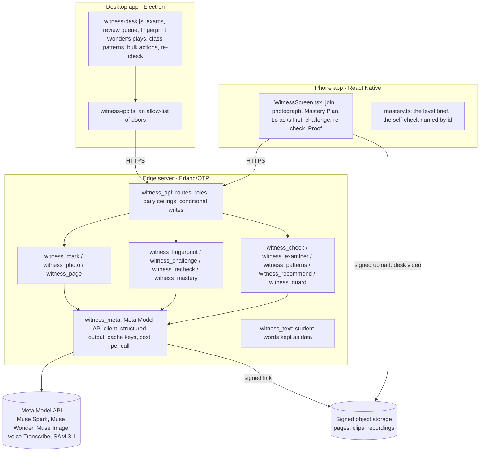

- **A library inside a host.** `witness/src` holds 27 modules; the `witness_` prefix comes from the desk-filming mode built first.
  - It runs inside a host's OTP application through a small behaviour (`witness_host.erl`): that file is the whole contract.
  - Storage, keys, money and accounts stay the host's. In production the host is LoWisa's edge; what was added there is named in [`host/README.md`](host/README.md).
- **Pure core, effects at the edge.** Marking, fingerprints, challenges, re-checks and mastery state are pure functions of a question; `witness_api` does the reading, saving and authorisation. Every model call is a seam a test replaces.
- **Photographed pages go to the edge in the request.** They are kept in the host's storage, and reach Meta inline as base64 images. Only desk videos go straight to storage by signed upload and are read by Meta through a signed link.

## 11. Evidence: every number and where it comes from

| Number | What it is | Raw results |
|---|---|---|
| Multiple choice: 102/109 (A), 105/109 (B), 105, 103, 105 of 109 (C), 105, 104, 104 of 109 on `v1.0-code`; his wrong answers caught 4/10, 7/10, 7/10 each run of C, 7, 6, 7 on `v1.0-code`, with no wrong idea named. Written answers: 37, 38, 38 then 39, 37, 38 of 42; 3 of 4 caught; every answer not accepted held for Lo, none named; 0/9 invented reasons (A and B) | one real student's handwriting, six papers, his teacher's marks | `evidence/real-handwriting/results/` (five files), `score.py` |
| one 30-question paper: 30 of 30 decisions in each of 6 runs, 6/30 every run, 40–58 s, ~$0.05; then 30 of 30 in each of 3 runs on `v1.0-code` | the film's physics paper, never seen before, 6 live runs with and without a scheme, then 3 on the tagged code | `evidence/unseen-physics/` |
| A 5/5, B 5/5 named; C asked 5/5 | the three learners, five readings each, through `witness_photo:mark/4` | `evidence/misconceptions/runs-31oct-steps-rule.jsonl` |
| on `v1.0-code`: asked 40/42, wrong name 2/42, named right 42/48, right work 39/39, injection 30/30 (on `066c9d1`: 39/42, 3/42, 44/48) | held-out v2 (and the blind first run beside it) | `harness/heldout/results/` |
| ambiguous asked 10/11 (development) | the 36 papers the rule was designed on, and the effort ablation | `harness/heldout/results/dev-set-*.json` |
| clean 30/30, faults held 30/30, named 30/30, false claims 9/9 | Muse Wonder's self-check, 20 levels × 3 runs | `harness/selfcheck/results/selfcheck-3-runs.json` |
| false accepts 0/36, false rejects 0/24 | the reason judge, 20 reasons × 3 runs | `harness/reasons/results/reasons-applied-3-runs.json` |
| video 45/46 exact, 46/46 sound | 13 desk clips in 6 languages, SAM 3.1 + Muse Spark | `harness/bench/results/video_on_head.json` |
| photo 39/43 exact, 42/43 sound | the same papers photographed, the product's photo path | `harness/bench/results/photo_on_head.json` |
| 138/138 exact | 39 papers marked at once (28 Oct) | `harness/bench/results/load39.json` |
| 40/40 names, 240/240 sound, no-calculation asked 5/5, 6 groups, $1.01 | a class of 40, two-page papers marked at once, then grouped | `harness/class/results/class-of-40.json` |
| page 64/64, SAM 52/64, Spark 1/64 | where each handwritten line is on the photo | `harness/bench/results/line_placement.json` |
| Voice Transcribe $0.0003; Muse Image $0.015–0.021; structured output; 99.8% cached (one probe) | the live API probe | `harness/probes/results-31oct/` |
| the loop, photo to re-check | one continuous run on the production edge | `evidence/` (`evidence/screens/`, `evidence/replay/`) |
| the demo | frames from the film | `evidence/film/` |

Every bench number is recomputed from the raw files by `python harness/bench/summary.py`; every result file records
the commit it ran on. Notes for Meta's API team, and what each run found: [`harness/FINDINGS.md`](harness/FINDINGS.md).

## 12. Try it, and verify it yourself

Everything in this section is covered for the event's judges and evaluators by the
[additional permission for judging](JUDGING-PERMISSION.md), including changing a port, a key or a path to make it run.

**Followed from a fresh clone of this repository on 4 Nov (`2adbbfd`), on Windows:** `sh scripts/test.sh` 164 tests
passed; the phone's face rule 6 of 6; the recorded Exam Desk opened with its exam, codes, class patterns and measures;
and `mark_my_paper` marked the 30-question physics paper live in 92 s for about $0.07.

**In one minute, with no account and no key:** the teacher's Exam Desk on an exam recorded on the production edge.

```bash
node demo/desk-server.js --replay        # then open http://localhost:4747
```

**Live, with your own phone (works today: LoWisa 1.10.5 on Google Play, 1.10.4 on the App Store, where 1.10.5 is in
Apple's review; desktop 0.9.34 on Windows, macOS and Linux; checked against both stores and the desktop download feed
on 5 Nov).** During judging, From
Exam to Mastery is open to every LoWisa account; nothing needs a sign-up form.
1. Install **LoWisa** on a phone and the **LoWisa desktop app** from [lowisa.dev](https://lowisa.dev). Link them once:
   on the desktop, click **Link your phone** in the status bar; on the phone, Profile → **Link a computer** → **Scan**.
2. On the desktop, open **Exam Desk** and create an exam (from a photo or PDF of the paper, or let the questions be read
   from the paper itself). The desk shows a **join code** and a **photographing code**.
3. On the phone, open **From Exam to Mastery** (Home, near the bottom). Type the join code and your name to join the
   class list. Then type the photographing code in the same box and photograph a finished paper, or pick it from the
   gallery.
   - **Sample papers:** the film's physics paper is [`evidence/unseen-physics/paper.jpg`](evidence/unseen-physics/paper.jpg);
     the name on it is **Daniel Kwan**, so join as Daniel Kwan to receive his Mastery Plan. Three maths papers are in
     `evidence/misconceptions/learner-*-page*.jpg` (two pages each).
4. **Marking takes** about 15 s for a maths page, about a minute (64–161 s on 3 Nov, with the second reading) for the 30-question physics page, and about a minute and a half
   for a 30-question paper of four photos (69–299 s over nine live runs, median about 100 s; section 7). The desk shows
   each fingerprint. Release the marks, and the Mastery Plan reaches the phone.
5. **On the phone:** answer Lo's question if it asks; start the level (2 to 8 minutes to build, including Muse Wonder's
   self-check); play it.
6. **On the desk:** let it start if it is held, send a challenge, read the reason, and issue "Turned around". "Send it
   now" brings the re-check forward.

**What it costs you.** Marking is not charged. A mastery level is built on the free credits every new LoWisa install
starts with (20): building one took 2.6–7.8 credits, median 5, over the last 23 levels built on the production edge,
and each of Lo's live turns in it under 1. So the free credits cover two or three levels; after that LoWisa asks for a
plan, as it does for everything else. One account can play both sides. In a school, a level is paid from the school's
wallet, never by the student.

**Quicker still, from desktop 0.9.33 (released 4 Nov): the demo school.** No school details and no password:
1. On the desktop: **Home → Your school → Try the demo school → As a teacher**. LoWisa reopens inside the demo school
   in a few seconds, and a yellow bar on every page says so.
2. Press **Mark an exam** on that bar, and go on from step 2 above.

What the demo school is, and is not:
- **Your own copy.** One per LoWisa account, with twelve fictional learners and two classes. Open it again and it is the
  same school; open it as the principal or a learner to see their side.
- **Paid from your own free credits.** It is given no school credits.
- **For trying only.** Its school code signs nobody in, so no one else can enter it. It cannot buy anything, publish a
  website or app, share links, link a sister school, invite anyone or take a real class list. Its logins' passwords are
  random and never shown. "Leave the demo" on the bar goes back to your own LoWisa.
- **Not part of this repository.** The demo school, like the rest of the app it runs in, is LoWisa's (section 14).

**Your own exam, marked live, with no LoWisa account** (your own Meta Model API key; about a minute and under $0.50 a
page). The questions are read from the exam, the pages marked through the code the edge runs, and each wrong answer's
fingerprint printed as the desk shows it: the idea named with the student's own lines, or the question Lo asks first.

```bash
sh scripts/test.sh                                        # builds the library (no key)
MODEL_API_KEY=... escript harness/mark_my_paper.escript <the exam: photo or PDF> <finished page.jpg> [more pages]
```

**The code and the numbers:**

```bash
sh scripts/test.sh                                        # every unit and route test (Erlang/OTP 27+, no key, no network)
python harness/bench/summary.py                           # every bench number, from the committed raw results
python harness/heldout/make_items.py /tmp/v2 v2           # the held-out papers
MODEL_API_KEY=... escript harness/fingerprint_eval.escript /tmp/v2 /tmp/v2.json 3
MODEL_API_KEY=... escript harness/selfcheck_eval.escript /tmp/selfcheck.json 3
MODEL_API_KEY=... escript harness/reason_eval.escript /tmp/reasons.json 3
MODEL_API_KEY=... escript harness/probes/panel31_probe.escript /tmp/probe page.jpg answer.wav
```

No keys, learner data or personal recordings are committed. `scripts/secret_scan.py` runs before every push and in CI.

## 13. Safety, privacy and the teacher's authority

**The teacher decides** each of these, and the student sees none of it until the teacher acts:
- the results and marks;
- the focus note;
- releasing the paper;
- letting a held level start;
- which checks to ask for;
- the challenge;
- "Turned around";
- the re-check's timing.

Muse Spark recommends, and never issues. A level the self-check did not pass always waits for the teacher, and the
verdict is the server's own. The lessons are written as the student opens them, after the teacher has let the level
start. Those questions are written by Muse Spark under the server's scope, and each of Lo's turns is read for safety
before it reaches the student. **That check fails closed**: a turn it could not read (no verdict, the check down, the
day's ceiling reached) is replaced by a safe line, never sent.

**Added on 4 Nov after an independent audit (live on the production edge since vb1104m, 4 Nov 03:42 UTC):**
- **The server's scope is the only system message.** The level builder's instructions from the app arrive as a user
  message marked as the app's, so no client can send words with a system message's weight.
- **Plain-code rules run before any model.** A link, an email address, a phone number, a contact app or a meeting, and
  a short list of adult and self-harm words stop a reply with no model involved, in Lo's live turns and in a level's
  own text. The model guard still reads everything else; one model checking another is not the only line.
- **A dollar budget a day across all accounts ($25), reserved before each call** (second audit, live from edge
  vb1104n, 4 Nov 05:12 UTC). The call ceilings count calls; this one counts money. Before a call starts, the most a call
  of its kind costs is held in the same write that checks the budget, and traded for the real cost when it finishes
  (checked live: one exam read left the day at its real $0.0062, not the $0.25 it held). One server switch turns the
  whole feature off at once.
- **Scheduled for deletion at 180 days** (see Deleting, below).

**Added after the third independent audit (live on the edge since vb1104o, 4 Nov 07:19 UTC, unless marked; the one-click line, the holds and the expiry each checked on the live server):**
- **What the budget guarantees, exactly.** Every call to a model caps its output and every input is capped in size, so
  each call's cost is bounded; each kind's hold is set above the largest real cost of its kind in production over the
  last 10 days (a paper's marking at most $0.57 against $1.25; every other kind 2 to 10 times under). Holds are admitted
  only up to $22.50, so the day passes $25 only if the calls running at once cost $2.50 more than they held; any call
  that costs more than its hold is logged and counted in full. A hold not settled in 30 minutes (a call that failed)
  expires, so failures cannot use up a teacher's day, and at most 500 calls hold money at once. Tested with 40 calls at
  once against room for 4: exactly 4 started (`witness/test/witness_api_tests.erl`).
- **One click takes only marks 0.95 sure or more, and only marks called right**, and since edge vb1105a only on an
  exam with a mark scheme the teacher approved (next block), whatever list the desk sends; every
  other mark stays to be checked one by one (section 7 has the cost: more checks, fewer wrong marks). The desk says
  "sure is not proof" beside the button (desktop 0.9.34, 4 Nov).
- **A tampered app, eight kinds of attack.** Lo's live turns now also refuse to hand over the exam question's own
  answer. Sent as a modified app would send them, in both reply modes, three runs each: 46 of 48 held (essays, other
  homework, the server's instructions, a role-play, adult content, dangerous instructions, contact details: every
  time). The two that did not: a level call (not Lo's live turn) asked for the answer to the student's own,
  already-marked question, and gave it with its working ([`harness/design-layout/`](harness/design-layout/README.md)).
  Closed after the fourth audit (below): **48 of 48**. The full fix, the server holding the app's instructions so a
  client cannot write them, is in the [future plans](#17-future-plans-after-the-hackathon).
- **The plain-code screen, tested on the curriculum.** Biology, puberty, drugs education, history, depression,
  self-harm support and online-safety lessons pass; the same words said to a student ("send me a photo of yourself and
  don't tell your parents") are still caught.
- **Real learner material, checked by hand and by machine** ([`evidence/PUBLISHING.md`](evidence/PUBLISHING.md)): every
  picture ever committed looked at; metadata checked in every commit; the learner's name in no commit; four test
  exams whose join codes were visible in old screenshots or tests were closed to joining (live, 4 Nov). CI now scans
  every commit, not only today's files.

**Added after the last review, 5 Nov (edge vb1105a; no phone or desktop release needed):**
- **Where the paper has no mark scheme, Muse Spark drafts one and the teacher approves it** (owner's design). The model
  no longer marks a class against a key nobody checked. Creating an exam from a photo or PDF of the paper, the desk's
  existing "Your mark scheme" box is filled with Muse Spark's draft (the right answer, the steps that earn each mark,
  other answers to accept) under a line asking the teacher to check every line; creating the exam is the approval, the
  line comes off, and every paper is marked against that one scheme (it cannot change afterwards). **One click needs a
  scheme**: on an exam with none, every mark is checked one by one, and the desk shows no one-click row. Live, from
  the unseen physics paper alone (a student's written paper): three drafts, **each with the right answer to all 30
  questions**, none copying any of the student's 24 wrong answers; the paper marked against each draft:
  **30 of 30 decisions right in all three**, one click 5, 6 and 6 marks, **none wrong**, as against the real scheme
  ([`harness/read/`](harness/read/README.md), [marking policy](docs/marking-policy.md)). Marking is still not
  perfect: an approved scheme removes a wrong key, not a misread; the risk checks and the teacher's release remain.
  Checked on production after the release: [live checks 8](evidence/live-checks/README.md).
- **The server's face look: five frames a second, and an incomplete look refuses the video.** A face in view for a
  quarter and for a tenth of a second were both caught (10 of 10 face clips, 8 of 8 face-free clips cleared). A video
  ffmpeg cannot read to its end, or that SAM did not look at frame by frame in full, is deleted unmarked and the paper
  photographed; before, a cut-off video was read only as far as it went and passed as looked at
  ([`harness/face/`](harness/face/README.md)). Tested (`an_exam_from_a_checked_draft_scheme_is_marked_against_it_test`,
  `a_paper_without_a_scheme_gets_a_draft_for_the_teacher_to_check_test`,
  `a_face_look_that_cannot_cover_the_video_deletes_it_unmarked_test`, `the_face_look_covers_every_sampled_frame_test`).
- **Not done: a separate holding area for uploads.** A video still lands in the private store before the look; an
  upload that is never marked is not deleted sooner than the 180 days every file has, unless the teacher deletes the paper. Changing where uploads land
  was not safe to test in the time left; it is in the future plans (17.2a).

**Added after the final follow-up audit of 4 Nov (edge vb1104r):**
- **The server looks for faces itself (the one trust-boundary point left).** Every desk video, before anything reads
  it, is cut to two frames a second and SAM 3.1 is asked for "face". Any face, at any confidence: the video is deleted
  unmarked, no still or clip is cut from it, and the teacher's desk and the student's list say why. A look that cannot
  run marks nothing; a marking cached from before the look is not reused. Live on Meta's API, the server's own code
  refused **8 of 8** clips with a face (a face crossing for one second, a small face in a corner, half a face, the
  phone's own uncovered output from 28 Oct) and cleared **8 of 8** without (desk clips, a writing hand, the phone's
  covered output), about $0.01 a video; the sampled copy is deleted from Meta's store after
  ([`harness/face/`](harness/face/README.md)). Limits: it decides what is marked and kept, not what is uploaded (a
  modified app's video still reaches the private store and SAM before it is deleted); a face shown for under half a
  second can fall between sampled frames; SAM is a model, measured on 16 and 41 clips with one generated face. Tested
  (`the_server_looks_for_faces_itself_test`, `a_face_look_that_cannot_run_marks_nothing_test`,
  `a_cached_marking_from_before_the_face_look_is_not_reused_test`).
- **The judges' marking tool counts "Accept all" by the server's own rule** (found in the repository by the owner's
  audit). `harness/mark_my_paper.escript` counted every answer 0.9 sure or more, without even asking whether it was
  called right; the server accepts only mastered, 0.95 sure, no risk flag. On the unseen physics paper the old line
  would have printed 29 for "Accept all", 23 of them not mastered; it now calls `witness_api:one_click/2` itself and
  prints 6, with each question's own verdict and risk flags. `harness/trace/` the same (its recorded 3 Nov run: 26 of
  30 under the line of that day, 14 under today's). Tested (`the_judges_tools_count_accept_all_by_the_servers_rule_test`).
- **No desk-filming card on a phone without a face look** (iPhone): it used to lead to a "not available" notice.
- **Push failures say why** (platform, security review): a failed phone notification is logged with Google's own error
  code (never the token or the message), so a credential Google refuses is visible.

**Added after the fourth independent audit and the live checks of 4 Nov (edge vb1104p):**
- **Desk video only from an app whose face look ran (finding A).** The phone apps before 1.10.5 (1.10.4, still on the App
  Store while Apple reviews 1.10.5) predate the fail-closed face rule. So the server now takes a desk video, or a filmed
  fresh question, only from an app that says its face look ran to the end (`faces: "checked"`). Those apps never say it,
  so their students are told to photograph the finished paper instead. 1.10.5 (Google Play since 4 Nov) says it, and
  only after its look ran. **This is the app's own
  statement, not proof**: the server cannot see faces, and a modified app could send the statement without running the
  look. It switches the older apps off; it does not make an unsafe upload impossible. What does not depend on the app:
  the main way in (photographing the finished paper) films no one, and a desk video is deleted once marked
  ([privacy](docs/privacy.md); whether a school offers desk filming at all is listed there as its decision before a
  pilot). Tested (`video_needs_the_face_look_test`). **Since edge vb1104r the server also looks for faces itself**
  (next block), so the statement no longer decides what is marked or kept.
- **Each hold settled by its own id (finding B).** Every money hold has its own id, and the call that took it settles
  exactly that hold, so calls finishing out of order never settle each other's. A call that failed after the model was
  asked is counted at its whole hold (what it cost is not known, so the most it could cost), never at nothing. A hold
  given back before any model was asked is released at nothing. A call that ends after its hold expired, and a marking
  stuck when a node stopped, are still counted, and logged. Tested with 20 calls at once finishing in random order, two
  failing: every hold settled exactly once.
- **A level's own calls never write the exam answer (finding C).** A level's JSON calls now carry their own narrow line:
  never the exam question's own final answer or a worked solution of it; examples use other numbers. On the phone's
  own outline request, 20 runs each: valid levels 19 without the line and 18 with it (the two misses whose text was kept, one
  each side, were complete levels the strict parser could not read, not refusals). A tampered app asking for the answer got it 15 of 20 times without the line, **0 of 20** with it. All
  eight attacks again, three runs each: **48 of 48** held ([`harness/design-layout/`](harness/design-layout/README.md)).
- **Risk, not only confidence, decides one click (finding D).** A mark 0.95 sure or more still goes to the teacher when
  the readings of the work disagreed, the student struck something out, or the answer could not be read; the desk is
  told which. **Two options, by the mark scheme** (owner, 4 Nov): with the teacher's scheme the marks are judged against
  it; without one, it falls to the next option, the same rule judged against the model's own key, and the desk is told
  so. On the real learner's papers (no scheme) the risk checks changed nothing, and every wrong answer accepted at 0.95
  had been judged against the model's own key, so a scheme is recommended
  ([`docs/marking-policy.md`](docs/marking-policy.md), `python3 evidence/real-handwriting/score.py`).
- **The online-safety lesson the live check stopped.** Asked what a risky person might say, Lo quoted the lines, and
  2 of 9 such turns were stopped by the plain-code screen. A sentence that quotes what someone might say now counts as
  a lesson about the words; the same words said to the student are still caught.
- **A whole class on one wallet.** Four of Lo's turns at once on one teacher's wallet: 3 of 10 failed with credits
  there, because a charge that met another write on the same balance was not tried again. It now is, exactly once in
  the ledger (LoWisa's platform code, live since vb1104p). The live check after that release still had 1 of 4 fail: the
  balance a charge depends on was read with an ordinary read, which can lag a charge made a moment before. Since edge
  vb1104q it is read strongly consistent: live, 20 of 20 turns fired together (four at a time, then eight) were paid
  ([live checks](evidence/live-checks/README.md)).

**The student is never sent a guess:** not the model's possible idea, not its rivals, not its confidence. While Lo is
asking, they are not sent the reasoning either.

**Who can do what:**
- **The join code** puts a name on the class list. A name that joins after a paper was photographed waits for the teacher.
- **The photographing code** sends pages and nothing else; that phone reads nothing back.
- **The class list** can be edited, and joining can be closed.

**Nothing a student writes is ever followed as an instruction.** Every student-written text is marked as data in every
prompt, and held-out v2 tries ten injections in the ink: none was marked mastered.

**A learner who tries to mislead the marker** (4 Nov, after the independent audit; written before any run,
[`harness/heldout/items_planted.py`](harness/heldout/items_planted.py)): ten papers, three runs. A wrong answer dressed
in right-looking working or a claim of the right method was never marked mastered (**15 of 15**); right work beside a
false story of a wrong idea ("I flipped the first fraction") never had that idea named (**12 of 12**); wrong work
beside a story of something else had its real idea named (**3 of 3**). $0.74. Run again from a clean clone of the
committed code (`2adbbfd`, recorded with no local changes): the same, 30 of 30, $0.73. A small synthetic set, not proof
against every trick ([first run](harness/heldout/results/planted-3-runs.json),
[clean run](harness/heldout/results/planted-3-runs-on-2adbbfd.json), `harness/planted_eval.escript`).

**Deleting:**
- **Nothing is kept for good:** a paper, its pages and its recordings are scheduled for deletion by the store itself 180
  days after they were made, even for an account no one opens again. The store removes them within a few days of that
  time; since edge vb1104o (4 Nov), nothing past its time is ever read or shown, before the store removes it.
- The teacher deletes a paper or a whole exam. With it go its pages, recordings, pictures, clips, cached marking and self-checks, and every pointer to it.
- A desk video is deleted as soon as it is marked.
- **Faces in a desk video (desk filming is the optional way in; photographing the paper, the main way, films no one).**
  On Android, a face or a person the camera caught beside the page is covered on the phone before the video leaves
  it. **It now fails closed** (LoWisa 1.10.5: Google Play since 4 Nov; the App Store once Apple approves it, see
  [Future plans](#17-future-plans-after-the-hackathon)): a video whose
  look for faces failed is never sent, and a phone that cannot cover faces (iPhone today) does not offer desk filming;
  that student's paper is photographed instead. An older app (1.10.4) still offers filming, but
  **since edge vb1104p the server takes no desk video from it** (it cannot say its face look ran), so its students
  photograph the paper instead. **Since edge vb1104r the server also looks for faces in every desk video itself** and
  deletes one with a face unmarked, keeping nothing from it (section 13).

Full statement: [`docs/privacy.md`](docs/privacy.md). It includes what the school must decide before a pilot with minors.

### Licence

This repository is public so it can be read, run and checked. It is **not open source**:
- **[PolyForm Strict License 1.0.0](LICENSE)** for everyone. You may use the software for noncommercial purposes
  (personal study, research and testing, or use by a school, charity or public body). You may **not** distribute it,
  change it or build new works on it, or use it commercially.
- **[An additional permission for judging](JUDGING-PERMISSION.md)** for the Meta Global AI Developer Hackathon's
  organisers, judges and technical evaluators, whatever organisation they work for: clone, build, run, test, change
  what testing needs (a port, a key, their own sample paper), reproduce the demo and the results, run security tests on
  this code, and share it among the evaluators. Every command in [section 12](#12-try-it-and-verify-it-yourself) is
  covered.

Anything else, including commercial use: ask through [lowisa.dev](https://lowisa.dev).

## 14. What was built during the event, and what existed before

**How to verify the dates.** Commit dates are written by our own machine, so they are not proof on their own. This repository was republished fresh on 4 Nov 2026, with the same commits, files and author dates, so GitHub's own dates here start on 4 Nov. The original repository is kept private as an archive, and two dates there are not ours: GitHub created it on 27 Oct 2026 at 00:06 UTC (26 Oct, 8:06 PM ET, eight hours after kickoff), and its GitHub Actions run history starts on 3 Nov. A judge can be given read access to check both. Commit hashes named in these files are the original repository's; [`DEVELOPMENT-PROVENANCE.md`](DEVELOPMENT-PROVENANCE.md) gives each one's hash here, with tree hashes to prove the files are the same.

**Built during the event (26 Oct – 4 Nov 2026), and all of it is in this repository:**

| Part | Where |
|---|---|
| The server library: marking for the path, reading the exam file, names, line placement, the fingerprint, Lo's question, the self-check, class patterns, the examiner, the drawn step, the challenge, the reason judge, the recommendation, the re-check, Proof of Thinking, desk filming, the Meta Model API client | `witness/src` (27 modules), `witness/test` |
| The phone screens: join, photograph, Mastery Plan, Lo asks first, the examiner, challenge, re-check, Proof, Turned around, the Witness camera | `phone/witness`, `phone/android` |
| The teacher's Exam Desk | `desk/` |
| Every measurement, bench and evaluation | `harness/`, `evidence/` |

The list, day by day, is in [`docs/built-during.md`](docs/built-during.md), and the commit history shows it.

**Existed before the event: LoWisa.** Its code is LoWisa's private product code, so it is **not** in this
repository. It is named here so that it is clear what From Exam to Mastery stands on:

| Existed before 26 Oct | What it does for From Exam to Mastery |
|---|---|
| The LoWisa phone app and desktop app | Where the student's Mastery Plan and the teacher's desk are shown |
| Accounts, credits, metering, the school wallet, the school dashboard and roles | Who may use it, who pays for each model call, who sees which student |
| The Master any topic level builder | Builds each mastery level to the same standard as every LoWisa level. From Exam to Mastery gives it new input: the failed question, the diagnosis, the student's own working and the teacher's focus note |
| The lesson and scene players, and what a level contains: lessons, the first look, the halfway twist, the main run, Lo asks, the Insight episode, flashcards, A4 notes | Play the mastery level on the phone. **In a mastery level, the words are written by Muse Spark this week**, from the student's own mistake |
| Lo's voice (LoWisa's own text-to-speech, not a Meta model) | Speaks Lo's lines. Only the sound is the existing voice |
| An earlier exam photo reader on other providers | **Replaced.** The marking for the path, the name read from the page, the line placement, the fingerprint and everything after it are new, and they run on Meta's models |

**Work done inside LoWisa's own files during the event** (the edge host and Meta provider, the level builder's
mastery mode, the checked practical task, the wiring of the phone and desktop apps) is described in
[`host/README.md`](host/README.md), with dates. The level builder's mastery mode is published line by line, each line dated: [`host/mastery-mode/`](host/mastery-mode/README.md). The code is not copied here, because it sits inside LoWisa's private
files. **In the film, LoWisa's parts appear only playing what was made this week, and they are labelled.** Full list:
[`docs/existed-before.md`](docs/existed-before.md).

## 15. Problems we hit, and how we solved them

Each of these was found by testing, checked against the code before anything changed, and fixed with a test. The full
log, day by day, is [`harness/FINDINGS.md`](harness/FINDINGS.md).

**Reading real pages**

| Problem | What we saw | What we did | Result |
|---|---|---|---|
| **Pages photographed sideways** (3 Nov) | On a real student's papers, three of nine question pages were sideways. On one, Witness read his letter right but took the option's value from the wrong place on the turned page | Before marking, Muse Spark looks at small copies of the pages and says which edge of each photo is the page's top; the server turns that page upright with ffmpeg and keeps it so, so the stills and steps are cut from the upright page. If the look fails, the paper is marked as photographed | Turned by hand first, to measure it: wrong answers caught **4 of 10 → 7 of 10**. Then the code that ships, nothing turned by hand, three live runs: the sideways page stored upright in **9 of 9** papers, 7 of 10 caught every run ([`condition-c-shipped-code-3-runs.json`](evidence/real-handwriting/results/condition-c-shipped-code-3-runs.json)) |
| **Asking "how many degrees" turned pages the wrong way** (3 Nov) | In the first live try, Muse Spark found every sideways page but two of three turns would have left the page upside down | Ask which *edge* is the top (top, left, right, bottom) and work out the turn in code | Measured after, on the same small images, 4 papers × 3 runs each way: by edge **45 of 45** pages (15 of 15 sideways); by degrees 44 of 45 (14 of 15). Degrees was better than the first try showed, edge still the surer ([`harness/orient/`](harness/orient/results/orient-03nov.json)) |
| **A long paper took four and a half minutes** (3 Nov) | A real 30-question paper of four photos took 332 s live: one Muse Spark reading wrote 11,650 tokens (108 s), and an unsure question read the whole paper again after it | The quick look that turns pages upright also counts the questions; a paper of two or more pages with more than 12 is marked in parts of about ten **at once**, each part seeing every page, and an unsure question is read again only in its own part | Measured on the same code, two runs each way: one reading **220 and 232 s**, in parts **63 and 65 s**, 28 against 29 of 30 with the teacher ([`harness/parts/`](harness/parts/results/parts-03nov.json)). Live, 69–299 s a paper over nine runs (section 7). A one-page paper stays one reading: the physics page was no faster in parts |
| **Half a mark rounded up to full** (3 Nov) | Re-running the physics page without a scheme, three one-mark answers marked "part way" came back 1 of 1 | Full marks belong to a mastered question only | Back to **6 of 30**, 30 of 30 decisions right, in 3 of 3 runs ([`no-scheme-after-half-mark-fix-3-runs.json`](evidence/unseen-physics/no-scheme-after-half-mark-fix-3-runs.json)) |
| **The teacher's ticks could leak into the test** | His red-pen marks sit on the answer sheet the model reads | The teacher's ink is removed by colour (his letters are grey pencil) before marking; his marks stay the answer key | Every disagreement is published with what the photos show (section 7) |
| **A line's place on the photo** | Muse Spark's own boxes overlapped the ink on 1 of 64 lines, so a crop of a student's step could miss it | `witness_page` finds each line on its own ink; Spark's boxes are never used for a cut | **64 of 64** lines placed (SAM 3.1: 52 of 64) |

**Keeping the model honest**

| Problem | What we saw | What we did | Result |
|---|---|---|---|
| **A wrong idea named from too little ink** | With the demo answers taken out of the prompt, Learner C ("Half up, half down. Same price.") was still named "cancel" 5 of 5 times: the prompt alone does not make the model hold back | The evidence rule moved into code (`witness_mark:fingerprint/4`): quoted evidence must be in the ink, the final answer is no evidence, and a rival idea means Lo asks first | C asked **5 of 5**; on 53 held-out papers a wrong idea named in 2 of 42 ambiguous cases (`v1.0-code`; 3 of 42 on `066c9d1`) |
| **Our own test sets leaked into the rule** | The prompt once quoted the three demo answers; later the rule's worded example mirrored a held-out item | Both taken out; the held-out set run again on the shipped code beside its blind first run, and now reported as a second development set | Section 7; every result file records its commit ([`harness/PROVENANCE.md`](harness/PROVENANCE.md)) |
| **"Is it right?" missed wrong thinking** | At low effort with a plain prompt, a right answer reached by cancelling digits was called right | The marking asks about the method, at medium effort | The wrong thinking caught on every run |
| **A self-check passed a false claim** | Muse Wonder passed a level whose shop "loses $25" by charging $100 for a $75 price | The self-check works out every number and every gain or loss claim | Planted false claims caught **9 of 9** |
| **A safety check that failed open** (3 Nov) | When Lo's live turn could not be read for safety (no key, the day's ceiling, no verdict), it still reached the student | It fails closed: the student gets a safe line, and the miss is logged | `witness_api:guarded/3`, with tests |

**Meta's models in production**

| Problem | What we saw | What we did | Result |
|---|---|---|---|
| **Reasoning ate the whole answer** | Muse Wonder at 4,000 output tokens spent 3,998 on reasoning and returned no verdict; one marking reply in twelve ran out before its JSON | Medium effort with 16,000 tokens; a reply cut short is read again | Wonder returns its verdict; the cut-short reply is read again in code |
| **Two readings that disagreed** | Two readings that split always ended "part way", so a right one-word answer could lose marks | Unsure questions are read again at high effort, and a third reading decides when two disagree | Video bench back to **46 of 46** exact (28 Oct) |
| **Voice Transcribe takes WAV only** | Phone recordings (AAC), MP3 and Opus were refused | The server converts every recording to 16 kHz mono WAV with ffmpeg | $0.0003 for a spoken answer |
| **Rereads sent every page again** | Each extra reading of one paper paid for all its pages again | One prompt-cache key per paper, shared by all its readings | 99.8% cached on the probe |
| **Meta's model unknown to the credit system** | The first mastery level stopped with "provider not configured" | Mastery levels call Muse Spark through the edge's own metered call, at Meta's published prices | Every level since built on Muse Spark |

## 16. Limits, stated plainly

- **One real student's handwriting so far: multiple choice and short written answers.**
  - Apart from one Grade 5 student's papers (section 7), every paper here is a sample: a handwriting font, or a paper written for the demo, on a simulated phone photo. Real written working and real classrooms are harder.
  - **The evaluation sets are ours.** The items, labels and code come from the same team, and v2 has been seen since its blind first run (section 7). That student's papers are the first exception: his teacher's marks, not ours, are the key. The next measurement is a v3 set of written answers in real handwriting from many outside writers, labelled by an outside teacher, run once on frozen code.
  - The class of 40 measures speed and cost at class size; its 40 papers are built from 14 written answers (two to four per question), so it is not an accuracy test.
  - **A real pilot follows the hackathon** (section 17.6): ten days were not enough to run one properly.
- **The research in section 1 is evidence, not proof.** The MIT study is a preprint with 54 participants; the Gerlich and CHI studies are surveys; Butler's is one classroom experiment. Together they show a risk worth designing against and a direction that works, not a settled law. The 65% PISA figure is the OECD average as reported by ACER (source 6).
- **The fingerprint's limits are measured, not solved** (section 7).
  - A wrong idea can still be named on an ambiguous page.
  - The check reads the lines Muse Spark read, not the pixels.
- **Mastery is shown, not proven.** "Turned around" follows a level, a challenge answered with a reason, and the teacher's review. The re-check days later is the evidence that it lasted. One re-check is still one item.
- **The self-check plays the level's outline.** The questions inside each lesson are written as the lesson opens, after the teacher has let it start; they are not checked one by one.
- **The code live now is `v1.0.2-code`** (edge vb1104i, 4 Nov): `v1.0.1-code` plus two fixes. Two readings no longer
  agree when only one says "not", or when their units differ ("5 cm", "5 m"); and an unreadable photographed paper is
  asked to be photographed again, not "filmed again". Both are tested; the real sets and the held-out set
  were run on `v1.0.1-code`, not yet on `v1.0.2-code` (17.2). The teacher's desk says "photograph again" too since
  desktop 0.9.34 (4 Nov; it was not in desktop 0.9.33). Since edge vb1104j (4 Nov) a photographed paper that could not be marked for another reason, or is
  no longer kept, is never told about a video either.
- **Security fixes from a review before going public, live since edge vb1104k (4 Nov):** a join code tried through
  the video upload now counts against the same per-minute limit as joining, and a closed exam takes no new paper there;
  the server's scope for a mastery level's calls comes after any system words the phone sends; a kept recording is
  stored only as a known audio type; the re-check's judge has the same daily ceiling as every other judge call; the
  fresh question is sent once; ffmpeg reads a signed link over https only and a file on the server as a file only; and
  the offline demo answers this computer only (`127.0.0.1`).
- **After the independent audit, live since edge vb1104m (4 Nov):** the server's scope is now the only system message
  (the phone's level instructions go as the app's user message; the same level-builder request, four runs each way,
  gave the same kind of outline, one level of three lessons on the student's idea, and a tampered "write my history
  essay" was refused every time: [`harness/design-layout/`](harness/design-layout/README.md)); plain-code rules before the model guard; $25 a day across all accounts, reserved before each call and never passed since vb1104n; and
  every row and file scheduled for deletion at 180 days (rows written before the release were given their date too). The marking
  code did not change. The phone's face-covering fix shipped in 1.10.5 (Google Play 4 Nov; the App Store: in Apple's review; 17.1).
- **After the fourth independent audit, live since edge vb1104p (4 Nov):** phone apps before 1.10.5 can no longer send a
  desk video (they photograph instead); each money hold is settled by its own id, failures
  counted at their whole hold; a level's own calls never write the exam answer (48 of 48 attacks held); one click
  needs no risk flag as well as 0.95, and says whether the teacher's mark scheme or the model's own key was used. Still not done: the server holding the app's level-building
  instructions (17.2a), and an unfamiliar exam marked live against a real teacher's own marks (17.2).
- **After the last review, live since edge vb1105a (5 Nov):** one click only with a mark scheme the teacher approved
  (where the paper has none, Muse Spark drafts one for the teacher to check); the face look at five frames a second,
  and a look that cannot cover the whole video refuses it. A separate holding area for uploads is not built (17.2a).
- **After the final follow-up audit, live since edge vb1104r (4 Nov):** the server looks for faces in every desk video
  itself (SAM 3.1) and deletes a video with one unmarked, keeping nothing from it; the app's statement no longer decides
  (section 13). Phone 1.10.5 is on Google Play and in Apple's review; desktop 0.9.34 is released (17.1).
- **Muse Spark Open has run on partner inference, with few runs:** 9 of 12 completed. Of the 3 that did not, 2 passed
  the old 5-minute limit per call on the long four-photo maths paper, and 1 reply was not a marking; the 3 runs since
  the limit went to 10 minutes all completed (`harness/open/`). It has not been switched on for the live edge.
- **The low-effort finding is from 36 papers.** The product stays at medium until it is measured on more.

## 17. Future plans: after the hackathon

In ten days we built one path end to end: a teacher photographs an exam, and every failed question becomes a level.
The goal is bigger: **wherever a learner gets something wrong in LoWisa, that moment should become the start of
mastering it.** The plans below take it there, onto features LoWisa already has, so most of the work is joining what
exists rather than starting again.

**Ten days were not enough to do everything we want, and we say so plainly.** The fixes that needed an app release
have shipped, except on the App Store, where phone 1.10.5 is in Apple's review (17.1); some measurements are still to
run (17.2). We are committed to
continuous improvement, and we would value the judges' feedback on anything we have missed (17.7): whatever it is, we
will fix it as part of that work.

### 17.1 Fixes that needed an app release: shipped (App Store in review)

These were done and tested in this repository, and needed a new app release to reach users, because a store app
cannot change until then. As of 5 Nov: **phone 1.10.5 is on Google Play** (published 4 Nov; Android phones on 1.10.4
are offered the update), **in Apple's review for the App Store** (submitted 4 Nov; iPhones stay on 1.10.4 until Apple
approves it), and **desktop 0.9.34 is released** on Windows, macOS and Linux (4 Nov).

| Fix | Where it is now | Reaches users |
|---|---|---|
| **The app sends a desk video only after its face look ran.** A video is sent only when the phone's face look answers, explicitly, that it ran to the end (`faces: "checked"`); a failed look, an empty or unclear answer, or a phone with no look at all (iPhone today) sends nothing, and the student is asked to have the paper photographed instead. A phone that cannot cover faces no longer offers desk filming. On a long video (over 25 minutes), a face that stays in view is now covered all the way through (the cover grows with the gap between looks). Found by three independent audits on 4 Nov ([what was checked in the app's build](evidence/app-validation/phone-and-desk-2026-11-04.md)) | `phone/witness/safeVideo.ts` (the rule, tested on its own in this repository's CI), `WitnessScreen.tsx` (`smaller`, `canCoverFaces`); the Android face look in LoWisa's app; tested (`phone/__tests__/`). A safeguard with a photograph fallback, not a guarantee: the look runs on the phone, so a modified app could skip it; **since edge vb1104r the server looks for faces itself** and deletes a video with one unmarked (section 13) | **LoWisa 1.10.5: on Google Play since 4 Nov** (its store build was checked on a device against the live server first, [live checks 7](evidence/live-checks/README.md)); **App Store: in Apple's review** (submitted 4 Nov; the iPhone build was checked on Xcode 27.1's simulator: no desk-filming card, photograph the paper) |
| **The Exam Desk's one-click button says what the server now enforces.** It takes only the marks called right and 0.95 sure or more (the server's line), says "sure is not proof", and counts what was left to check; an unreadable photographed paper is to be photographed again, not filmed again; a video deleted for a face says so; the desk says whether the marks were judged against the teacher's mark scheme or the model's own key. The desk's six-second clips also play now (the desktop app's content rules had blocked them) | `desk/witness-desk.js` (`acceptAt`, `countNot`, `judgedAgainst`), synced into the desktop app | **LoWisa desktop 0.9.34, released 4 Nov** |

**What protects students on any app version (live today):**
- **The main way in films no one.** The teacher photographs the finished paper; desk filming is the optional way.
- **On Android, faces are covered on the phone** before a desk video leaves it, including any part of a person beside
  the page; the writing hand and the ink stay seen.
- **A desk video is deleted as soon as it is marked.** Only short clips and stills at the moments that matter are kept.
- **Nothing is kept for good:** pages, recordings, clips and stills are scheduled for deletion by the store itself 180 days after they
  were made, even for an account no one opens again (live from edge vb1104m).
- **The teacher can delete** a paper or a whole exam at any time, and everything kept with it goes too.

- **The server takes no desk video from apps before 1.10.5** (since edge vb1104p): they cannot say their face look ran,
  so their students photograph the finished paper instead.
- **The server looks for faces in every desk video itself** (since edge vb1104r): a video with a face is deleted
  unmarked and nothing from it is kept, whatever the app said ([`harness/face/`](harness/face/README.md)).

What 1.10.5 adds is desk filming back, with the last step: a video whose faces could not be covered is never sent at
all, on any phone.

Everything on the server is already live; it changes without an app release. On 4 Nov that was the independent
audit's server fixes (section 13), live from edge vb1104m.

### 17.2 Measurements still to run

- **The real student's papers and the held-out set on the code live now.** They were run on `v1.0.1-code`; the two
  fixes since (`v1.0.2-code`) change only when two readings count as the same answer and one message's wording.
- **A learner trying to mislead the marker, at scale.** Ten synthetic papers passed 30 of 30 (section 13). Next: more
  tricks, and real handwriting.
- **An adversarial test of the live service with a real account**, beyond the code's own tests: the design route, the
  daily ceilings and the safety rules, as an attacker would try them.
- **An exam it has never seen, marked live, against a real teacher's own marks**, with every disagreement written up:
  a paper not in this repository, marked by the teacher before we see it.
- **The controlled study** of whether it strengthens learning lastingly: delayed tests without AI, on new items,
  against the usual feedback. The design is fixed before any data ([`docs/STUDY-PLAN.md`](docs/STUDY-PLAN.md)).
- **The phone build run on a device** before its release, by the release checklist: a desk video with a face in view,
  covered all the way; a failed look, nothing sent ([what was already checked](evidence/app-validation/phone-and-desk-2026-11-04.md)).

### 17.2a Built next, from the third audit

- **The server holds the app's instructions.** Today the app sends the level builder's instructions, and the server
  marks them as the app's; a tampered app can still write them. Since edge vb1104p, the server's own line keeps the
  exam's answer out of a level whatever the app writes (48 of 48 attacks held, section 13). Next, the app sends only
  which instruction it wants, and the server supplies the words, so no client can write them. It needs a phone and a
  desktop release.
- **Done after the final audit (edge vb1104r): a face check on the server, not only on the phone.** The server looks
  for faces in every desk video itself (SAM 3.1) before anything reads it, and a video with a face is deleted unmarked
  with nothing kept (section 13); since edge vb1105a at five frames a second, and a look that cannot cover the whole
  video refuses it. Still next: the look runs after the upload, so the phone's own cover stays the first step; and a
  separate holding area for uploads, deleted within a day unless the look clears them (not built: changing where
  uploads land could not be tested safely in the time left).
- **Done after the last review (edge vb1105a): a scheme for every exam that has one click.** Where the paper has no
  mark scheme, Muse Spark drafts one and the teacher approves it; one click needs a scheme (section 13). Next: a desk
  view that shows the drafted scheme beside the paper question by question, and a scheme the teacher can correct after
  the exam is made, with every paper marked again against the new version.
- **Done after the fourth audit (edge vb1104p):** each hold settled by its own id, failures and late calls counted
  (section 13); one click by risk as well as confidence (section 13). Next for both: the desk showing the teacher why a
  mark was held back (the server already says); not built yet (desktop 0.9.34 says what the marks were judged against,
  not each mark's reason).

### 17.3 Already joined to LoWisa's existing features

A mastery level is played by LoWisa's own lesson player, so it already comes with two features that strengthen
cognitive ability (area 4, from temporary memorisation to lasting mastery): the **flashcards** made from the level's lessons, and **Insight mode**, which
replays the student's lessons as an episode. Both existed before the event; the level they replay is new.

### 17.4 Next: a Mastery Plan wherever a learner fails a question

Today the Mastery Plan starts from a teacher's photographed exam. After the hackathon it goes wherever a learner is
tested in LoWisa:

1. **Study Kit practice.** Every question a learner fails while practising in Study Kit brings up a Mastery Plan, so
   they can go into depth on whatever they are learning, even with no teacher. Muse Wonder's check still plays every
   level as the student before they see it.
2. **Every test question in the phone and desktop apps.** Wherever the apps ask a question, a failed one offers a
   Mastery Plan as the way to go deeper.
3. **The desktop app's electronic exams.** LoWisa's desktop app already lets a teacher set an exam that students sit in
   the app (Study Kit, *Sit an exam with a code*, or from the Classroom). The answers are already typed, so no photo is
   needed: every question failed will go into the student's Mastery Plan automatically, for the teacher to review as
   they do now.

### 17.5 Interactive experiments: change it, watch it, find out why

**What exists now, in 2D.** The scenes inside a mastery level already let the learner act, not only watch: shapes that
move through what happens, and controls (one to three sliders) that change a real quantity, worked out live with its
graph, until the learner hits a target. In Daniel's level the learner pushes the log down until the water holds 200 kg
(the film shows the first look before it, section 2). The scene player is LoWisa's and existed before; what each scene shows in a mastery
level is written from the student's own mistake. **This is part of what we want: the learner changes one or two values
along a path we wrote. It is not yet an open experiment.**

**What comes next: a working laboratory for the question the learner failed.** Imagine a student fails a physics
question about electrical resistance. Instead of only receiving an explanation, they get a working 3D laboratory, made
for that question, where they can:

- move the sliding contact along a resistance wire;
- change resistance values, the voltage, or the way the circuit is connected;
- watch how the current, the meters and the bulb respond, at once;
- keep experimenting until they understand the physics underneath.

The learner is free to test a hypothesis, make a mistake, investigate an outcome they did not expect, and discover the
principle by exploring, not by following set steps. The aim is to extend what a mastery level already does (deep
understanding, then real-world practice) with **open-ended experimentation**: not only how something works, but what
happens when the conditions change, and why.

**Why it was not built during the hackathon.** A laboratory a learner can trust must behave as the real apparatus
would, every time. That needs engineering, validation of every reading against the physics, and testing well beyond
ten days. It is a planned extension of what is built, not a replacement for it: we want learners to move from mastering
known problems to investigating unfamiliar ones, testing possibilities, and finding solutions on their own.

### 17.6 A pilot in schools

A real pilot follows the hackathon. It needs consenting schools, parents' consent for minors, real exams, and a
re-test a week or more later. We plan to run it in this order:

1. **Real written working first:** papers from many outside writers, labelled by an outside teacher, run once on
   frozen code (the v3 set). One real student's multiple-choice papers and short written answers, against his own
   teacher, are done (section 7).
2. **Teachers' time:** the minutes a teacher spends per paper, against their own hand marking of the same class.
3. **Agreement:** the desk's marks and fingerprints against the teacher's own, question by question.
4. **Learning:** a fresh question on the same idea a week after "Turned around", for students who did and did not
   play their level.

`witness_measure` already records agreement, the teacher's seconds per paper, turned-around questions and re-checks,
so the pilot needs no new code to report them.

### 17.7 Your feedback

We would be grateful for the judges' feedback on anything we have missed: a weakness in the code, a claim the
evidence does not support, a risk to learners, or something that is hard to run. Each one becomes part of our
continuous improvement, and we will fix it. Write to us through [lowisa.dev](https://lowisa.dev).

## 18. Sources

Every number in section 1 was checked against these. Where the original was reachable (the MIT paper, Hattie and
Timperley, Kiray et al., TALIS 2024), the figure was read in the original.

**AI and thinking**

1. Kosmyna, N., Hauptmann, E., Yuan, Y. T., et al. (2025). *Your Brain on ChatGPT: Accumulation of Cognitive Debt when
   Using an AI Assistant for Essay Writing Task.* MIT Media Lab, arXiv:2506.08872 (preprint). The quoting result is in
   "Question 3. Ability to Quote" (p. 31 of v1). https://arxiv.org/abs/2506.08872
2. Bastani, H., Bastani, O., Sungu, A., et al. (2025). Generative AI without guardrails can harm learning: Evidence
   from high school mathematics. *PNAS* 122(26), e2422633122. https://doi.org/10.1073/pnas.2422633122
3. Lee, H.-P., Sarkar, A., et al. (2025). The Impact of Generative AI on Critical Thinking: Self-Reported Reductions in
   Cognitive Effort and Confidence Effects From a Survey of Knowledge Workers. *CHI '25*.
   https://doi.org/10.1145/3706598.3713778
4. Gerlich, M. (2025). AI Tools in Society: Impacts on Cognitive Offloading and the Future of Critical Thinking.
   *Societies* 15(1), 6. https://doi.org/10.3390/soc15010006

**Exam failure, feedback and mistakes**

5. OECD (2023). *PISA 2022 Results (Volume I)*, executive summary: about 69% of students reached at least the basic
   level in mathematics, and the OECD average fell by nearly 15 points.
   https://www.oecd.org/en/publications/pisa-2022-results-volume-i_53f23881-en/full-report/executive-summary_077a9867.html
6. OECD (2024). *PISA 2022 Results (Volume V): Learning Strategies and Attitudes for Life.*
   https://doi.org/10.1787/c2e44201-en. The 65% OECD average is as reported by ACER's *Teacher* magazine:
   https://www.teachermagazine.com/au_en/articles/pisa-2022-insights-student-questions-mathematics-anxiety-and-homework
7. World Bank, UNESCO, UNICEF, FCDO, USAID, Bill & Melinda Gates Foundation (2022). *The State of Global Learning
   Poverty: 2022 Update.* https://www.worldbank.org/en/topic/education/publication/state-of-global-learning-poverty
8. Butler, R. (1988). Enhancing and undermining intrinsic motivation: The effects of task-involving and ego-involving
   evaluation on interest and performance. *British Journal of Educational Psychology* 58(1), 1–14.
   https://doi.org/10.1111/j.2044-8279.1988.tb00874.x
9. Hattie, J., & Timperley, H. (2007). The Power of Feedback. *Review of Educational Research* 77(1), 81–112.
   https://doi.org/10.3102/003465430298487
10. Metcalfe, J. (2017). Learning from Errors. *Annual Review of Psychology* 68, 465–489.
    https://doi.org/10.1146/annurev-psych-010416-044022
11. Butterfield, B., & Metcalfe, J. (2001). Errors committed with high confidence are hypercorrected. *Journal of
    Experimental Psychology: Learning, Memory, and Cognition* 27(6), 1491–1494.
    https://doi.org/10.1037/0278-7393.27.6.1491
12. Kiray, S. A., Aktan, F., Kaynar, H., Kilinc, S., & Gorkemli, T. (2015). A descriptive study of pre-service science
    teachers' misconceptions about sinking–floating. *Asia-Pacific Forum on Science Learning and Teaching* 16(2).
    https://www.eduhk.hk/apfslt/v16_issue2/kiray/index.htm
13. UNESCO and the International Task Force on Teachers for Education 2030 (2024). *Global Report on Teachers:
    Addressing Teacher Shortages and Transforming the Profession.*
    https://www.unesco.org/en/articles/global-report-teachers-what-you-need-know

14. OECD (2025). *Results from TALIS 2024: The State of Teaching*, chapter 3 "The demands of teaching" (Table 3.10:
    marking and correcting, 9% of working time; Table 3.16: 40% report too much marking as a source of stress).
    https://www.oecd.org/en/publications/results-from-talis-2024_90df6235-en/full-report/the-demands-of-teaching_0e941e2f.html

**What works**

15. Black, P., & Wiliam, D. (1998). Assessment and Classroom Learning. *Assessment in Education* 5(1), 7–74.
    https://doi.org/10.1080/0969595980050102. Later meta-analyses estimate smaller effects, about 0.2–0.3.
16. Sinha, T., & Kapur, M. (2021). When Problem Solving Followed by Instruction Works: Evidence for Productive Failure.
    *Review of Educational Research* 91(5), 761–798. https://doi.org/10.3102/00346543211019105
17. Roediger, H. L., & Karpicke, J. D. (2006). Test-Enhanced Learning: Taking Memory Tests Improves Long-Term Retention.
    *Psychological Science* 17(3), 249–255. https://doi.org/10.1111/j.1467-9280.2006.01693.x
