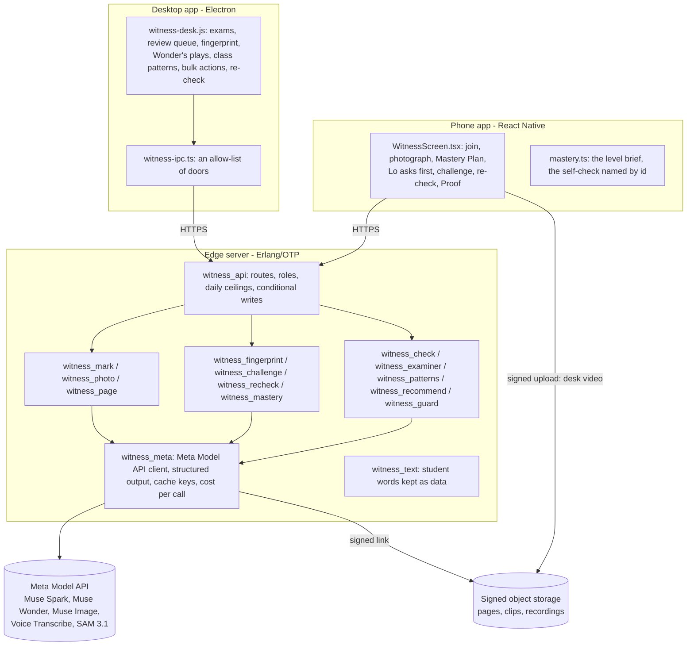

# From Exam to Mastery

**A way to turn every failed question into a moment of discovery. Confusion into understanding. Understanding into
practice. And practice into the confidence and ability to solve real-world problems.**

Meta's models read *how* a student reached each answer, from their own handwriting. The code lets a misconception be
named only when a line read from the page shows it; otherwise Lo asks the student first. A mastery level is then built
to repair exactly that idea, Muse Wonder plays it as the student before they see it, and the teacher tests the principle
with a new challenge and a re-check days later. The teacher holds every decision that reaches a student's record.

Part of [LoWisa](https://lowisa.dev), built for the Meta Global AI Developer Hackathon, 26 Oct – 4 Nov 2026.


| | |
|---|---|
|  |  |
| The teacher's desk: the Misconception Fingerprint beside the student's own step, cut from the photographed page | The student's phone: when the page is not enough evidence, nothing is named; Lo asks one question, out loud |

### Meta's models at a glance

| Model | Its job here | Code | Measured | Evidence |
|---|---|---|---|---|
| **Muse Spark 1.3** | Reads the teacher's exam file. Marks every photographed paper for the path, not only the answer. Writes the Misconception Fingerprint. Reads the student's answer to Lo. Writes the mastery level. Drafts the challenge, judges the reason, recommends the badge. Writes the re-check. Reads Lo's spoken turns for safety. | `witness_photo`, `witness_mark`, `witness_fingerprint`, `witness_challenge`, `witness_recheck`, `witness_recommend`, `witness_guard` | held-out v2, 159 marked papers: right work 39/39; injection 30/30; ambiguous pages asked first 40/42; clear ideas named right 43/48 | `harness/heldout/` |
| **Muse Wonder** | Plays each mastery level as the student who still holds the misconception and as one who has it right (in one reasoning pass), and holds a level that would not catch it or says a false thing. Groups the class by reasoning. Asks the examiner's questions. | `witness_check`, `witness_patterns`, `witness_examiner` | 20 levels × 3: planted faults held 30/30, the fault named 30/30; clean levels passed 30/30 | `harness/selfcheck/` |
| **Muse Voice Transcribe** | The student's spoken answer to Lo; the teacher's spoken comment | `witness_meta:transcribe/2` | a 6.4 s spoken answer written down for $0.0003 | `harness/probes/results-31oct/transcript-31oct.json` |
| **Muse Image** | Draws the corrected step on lined paper | `witness_draw` | the three learners' steps drawn, $0.015–0.021 each | `harness/probes/results-31oct/drawn-learner-*.webp` |
| **SAM 3.1** | Desk filming (the optional way in): follows the ink through a video, so each line has the second it was written | `witness_sam`, `witness_timeline` | on a photo it answers "word" (not "handwriting"); its word boxes, joined into lines, found 52 of 64 handwritten lines (mean overlap 0.75) | `harness/probes/`, `harness/bench/results/line_placement.json` |
| Muse Spark Open | The same marking, on a photographed paper or a desk video, through any OpenAI-compatible endpoint | `witness_open`, `witness_photo` | **wired, not yet run**: no hosted endpoint for it in this account | – |

**What surprised us about Meta's models**
- **Muse Spark changed its own reading from one sentence.** Leo's page read "half up, half down": its guess was
  "cancel". His answer to Lo ("both halves are of 100") moved it to "the second change was taken of the original
  amount", which no reading of the page could have shown.
- **Muse Wonder caught a false sentence a level said in passing.** "Charging $100 loses the shop $25" is false: the shop
  gains it. Asked to work out every number and claim, it found every planted false claim (9 of 9, over three runs).
- **The API gave us things we expected to build ourselves:**
  - `/responses` holds a strict JSON schema for Muse Spark and Muse Wonder.
  - A prompt cache key made a second reading of the same pages 99.8% cached.
  - SAM 3.1 follows written lines in the order they were written.

Notes for Meta's API team: `harness/FINDINGS.md`.

---

## Contents

1. [The problem](#1-the-problem)
2. [What is new, who it is for, and who pays](#2-what-is-new-who-it-is-for-and-who-pays)
3. [One question, three learners: the Misconception Fingerprint](#3-one-question-three-learners-the-misconception-fingerprint)
4. [Held out: 53 papers written after the rule froze](#4-held-out-53-papers-written-after-the-rule-froze)
5. [The loop, end to end](#5-the-loop-end-to-end)
6. [How it meets the judging criteria](#6-how-it-meets-the-judging-criteria)
7. [Architecture](#7-architecture)
8. [Evidence: every number and where it comes from](#8-evidence-every-number-and-where-it-comes-from)
9. [Try it, and verify it yourself](#9-try-it-and-verify-it-yourself)
10. [Safety, privacy and the teacher's authority](#10-safety-privacy-and-the-teachers-authority)
11. [What was built during the event, and what existed before](#11-what-was-built-during-the-event-and-what-existed-before)
12. [Limits, stated plainly](#12-limits-stated-plainly)

---

## 1. The problem

Every day, millions of us ask AI to think for us, and a fear is growing that it is weakening how we think, and how
our children will.

Think back to the last exam you failed. You probably remember the mark, and maybe how it felt. Did anyone show you
exactly where your thinking went wrong, and help you fix it in a way you could use in the real world? A failed question
is treated as the end of the story: a verdict on what you cannot do. Many adults still carry a failed exam as proof they
"aren't a maths person". Not because they could not learn it, but because nobody ever turned that mistake into the next
thing they mastered.

**A failed question should not be a verdict. It should be the start of building real capability.** As part of
LoWisa's mission to strengthen cognitive abilities, From Exam to Mastery uses the same AI people fear to make students
think again, never to think for them.

Three students can circle the same wrong answer for different reasons. A mark cannot tell them apart, and re-teaching
"the topic" to all of them wastes two students' time and may miss the third. With a class of forty, no teacher has
time to read every student's reasoning, ask each one what they meant, and write each a repair.

## 2. What is new, who it is for, and who pays

| Before | From Exam to Mastery |
|---|---|
| A mark per question | **The reasoning that produced each answer**, read from the handwriting (Muse Spark), with the student's own step cut from their page |
| "Wrong" | **A Misconception Fingerprint**: the reasoning, the evidence quoted from the lines read from the page, the misconception (named only when a quoted line shows it, decided by code), and the intervention that repairs it |
| Guessing when the page is ambiguous | **Lo asks first**, out loud. Nothing is shown to the student until they answer; their answer settles the fingerprint (Muse Spark, Muse Voice Transcribe) |
| A generic revision sheet | **A mastery level built around that one intervention**, checked by Muse Wonder as the student who still holds the misconception, held for the teacher. Its practical task ends in a number the student works out, checked by the app |
| "Did they memorise it?" | **The teacher's new challenge** (the same principle in a new situation, the order reversed, answered with a reason), then **a re-check days later** on a different structure, answered with the student's own number and working |
| A verdict | **No verdict.** Every question not mastered goes into the student's Mastery Plan; "Turned around" is the teacher's alone |

**Why not an existing tool**

| | What it does | What it does not do that this does |
|---|---|---|
| Grading tools for paper exams | Speed up marking by grouping similar answers or applying a rubric | Read which wrong idea produced each answer, ask the student when the ink can't tell, build the repair, test the principle later |
| Diagnostic multiple-choice (Eedi / Diagnostic Questions) | Each wrong option is written to reveal one misconception | Read the student's own free working on their own exam, in any subject, and ask when the working fits two ideas |
| AI tutors | A conversation the student starts | Start from the student's own handwritten exam, decide nothing without evidence, keep the teacher in charge |
| A photo pasted into a chatbot | One answer for one student | A class at once, the evidence rule in code, the class view, the teacher's gates, a record the teacher signs |

It draws on what is known to work:
- **formative assessment:** finding what a student thinks and acting on it;
- **refutation:** the student's own wrong idea is shown and tested against a case where it fails;
- **spaced retrieval:** the re-check.

**Who uses it**
- **Teachers and schools, in any country.** The questions and the scheme come from the teacher's own file.
- **Students on their own phones**, through the LoWisa app.
- **A student with no phone:** the teacher types the name and prints that student's Mastery Plan from the desk.

**Who pays**
- **Model calls come from the teacher's or the school's existing LoWisa credits** (1 credit = 1 US cent).
- **No new price was set for this.**
- **Each account has a daily ceiling on every model route.** A whole class fits under it.

**What it costs**, measured on the production edge and priced at Meta's published rates:

| | Cost |
|---|---|
| Marking a page | $0.016 (held-out v2) |
| One question turned around (marking, Lo's question, the level and its animations, the self-check, the challenge, the recommendation) | about $0.25 to $0.35 |
| A class of 40, two-page papers ([`harness/class/`](harness/class/)) | **$1.01**: $0.90 to mark all 40, $0.10 for the class patterns. All 40 marked at once in 32 s; the patterns ready 1 minute after the last photo |

**Why this matters, and why it is hard to copy**
- **The scale of the need:** UNESCO counts 44 million more teachers needed by 2030 ([Global Report on Teachers, 2024](https://www.unesco.org/en/articles/global-report-teachers-what-you-need-know)). Teacher time is the scarcest thing in a school.
- **What is hard to copy:**
  - the evidence rule in code;
  - the teacher's gates;
  - the store of settled fingerprints, each a real student's reasoning, labelled by what repaired it, per curriculum. That store grows with every exam.

## 3. One question, three learners: the Misconception Fingerprint

> A product costs $100. Its price increases by 50%, then decreases by 50%. What is its final price?
> **A** $100 · **B** $75 · **C** $50 · **D** $150

It looks easy, and an adult can still fall into the trap that +50% and −50% cancel. It is the arithmetic of a salary
rise then a cut, inflation then a sale, an investment's gain then its loss.

Three sample students all circled **A $100**. Each photographed paper was marked **five times** by Muse Spark through the
product's own code (31 Oct 2026; every reply in [`evidence/misconceptions/runs-31oct-steps-rule.jsonl`](evidence/misconceptions/runs-31oct-steps-rule.jsonl)):

| | Learner A | Learner B | Learner C |
|---|---|---|---|
| Wrote | `+50% - 50% = 0%` · `so it stays at $100.` | `100 + 50 = 150` · `150 - 50 = 100` | `Half up, half down. Same price.` |
| Named (of 5) | **5 of 5**: the two changes cancel | **5 of 5**: 50% taken as a fixed $50 | **0 of 5** |
| Lo asks first (of 5) | 0 | 0 | **5 of 5**: *"Write or say what you had after each step, and how you got it."* |

**Two ideas the ink shows, one it can't.**
- **A's ink shows cancelling.** "+50% − 50% = 0%" is the cancellation written down.
- **B's ink shows the second change taken of the first amount.** B subtracted $50 again: 50% of the original $100, not of $150.
- **C's ink shows no calculation at all.** "Half up, half down. Same price." states a result. It could be A's idea or B's, and each needs a different repair.

**Why C is asked.** Muse Spark's guess for C was "cancel" every time. **The code does not let it name that**, because no
line read from the page shows a calculation. The student sees no label at all. Lo asks a question that suggests nothing.

In the rehearsal, Leo (the sample student C) wrote back *"Both halves are of 10 Half of 100 is 50, so up 50 then down
50"*. That is the text as captured, typed on an emulator. Muse Spark settled his fingerprint on the base: **B's idea, not
the "cancel" it had guessed.** The page alone could not have shown it. The class view then groups Leo with B.

**What the code decides** ([`witness_mark:fingerprint/4`](witness/src/witness_mark.erl), [`witness_fingerprint`](witness/src/witness_fingerprint.erl)):

| The model returns | The code keeps |
|---|---|
| A name, with quoted evidence that is (part of) a line read from the student's page | the name |
| A quote longer than any line read (an invented ending), or the final answer alone | no name: Lo asks |
| A name **and** a question for Lo | no name yet; the guess kept for the teacher only |
| A numeric answer, and no quoted line with an operation, an "=" or a comparison between numbers | no name yet: Lo asks |
| After Lo asks: a name whose evidence is neither the page's lines nor the student's own words | no name: Lo may ask once more |

**What the check is, and what it is not.**
- The quotes are checked against **the lines Muse Spark read from the page**, never the pixels themselves.
- A line Muse Spark misread is therefore the limit of this check.
- The marking's bench is that guard: questions read exactly from photos and video (section 8).

Full write-up: [`docs/misconception-fingerprint.md`](docs/misconception-fingerprint.md).

## 4. Held out: 53 papers written after the rule froze

The first 36 papers (30 Oct) were used to design the rule in code, so they are now the **development set**. The held-out
set **v2** has 53 papers in 13 new topics:
- 3 topics not maths, 2 not in English;
- 22 hard items, 10 with injection written into the ink.

It was labelled by a rule stated in [`items_v2.py`](harness/heldout/items_v2.py) and committed before its first run.
Scoring is strict: the name itself must carry a key, and an "ask" passes only when nothing at all names an idea.

| v2, three runs on the committed code (159 marked papers, [`v2-held-out-steps-rule-3-runs.json`](harness/heldout/results/v2-held-out-steps-rule-3-runs.json)) | Result | Rate (95% interval) |
|---|---|---|
| Right work marked mastered | **39 of 39** | 100% (91–100%) |
| Ink that tries to instruct the marker, never marked mastered | **30 of 30** | 100% (89–100%) |
| Ink that cannot tell the idea: Lo asks | **40 of 42** | 95% (84–99%) |
| … a wrong idea named instead (the harmful error) | 2 of 42 | 5% (1–16%) |
| Ink that shows the idea: named right | **43 of 48** | 90% (78–96%) |
| … named, but a different idea (both are the right idea in other words; scored as missed) | 2 of 48 | 4% (1–14%) |
| … asked first instead (cautious) | 3 of 48 | |

The misses are read by hand in [`harness/heldout/README.md`](harness/heldout/README.md), with the hinted-scheme ablation
and the effort ablation (on the development set, low effort was as accurate as medium, 28% cheaper and 40% faster).
**The design choice: when unsure, ask. A wrong label is the error that harms a learner; a question costs a sentence.**

### A class of 40

The film's maths test (six questions, two pages) answered by 40 sample students ([`make_class.py`](harness/class/make_class.py)):
each wrong answer is one of six ideas a teacher sees in this topic, drawn before the run, and "a percentage taken as
that many dollars" is written on three different questions. All 40 papers went through the product's marking at once,
then every question not mastered went to Muse Wonder's class patterns ([`class_run.escript`](harness/class/class_run.escript)).

| | Result |
|---|---|
| Names read from the pages | **40 of 40** |
| Questions marked soundly (mastered or not, as drawn) | **240 of 240** |
| "Half up, half down. Same price.": nothing named, Lo asks | **5 of 5** |
| Wrong ideas named | 48 of 51 (the other 3, "3/5 = 35%", show no calculation: Lo asks) |
| Time | all 40 marked in 32 s; the class patterns ready at 1 minute |
| Cost | **$1.01** for the class ($0.90 marking, $0.10 patterns) |

| Group Muse Wonder made | Lines | Drawn as |
|---|---|---|
| The percent taken as that many dollars (Q2, Q4, Q5) | 23 | 23 of 23 the same idea |
| Equal increases and decreases cancel | 12 | 12 of 12 |
| No working shown: ask the student first | 8 | the 8 lines where Lo asks |
| Dividing by each ratio number | 7 | 7 of 7 |
| Finding a percentage by dividing by it | 4 | 4 of 4 |
| Joining the fraction's digits into a percentage | 2 | 2 of 2 |

Raw results: [`harness/class/results/class-of-40.json`](harness/class/results/class-of-40.json). These are sample
papers in one handwriting font; a real class is harder.

## 5. The loop, end to end

```mermaid
flowchart LR
  F[Teacher's own file<br/>questions + scheme] -->|Muse Spark reads it| E[Exam + join code<br/>+ photographing code]
  E --> P[One phone photographs<br/>each finished paper]
  P -->|Muse Spark| M[Marks the answer AND the path<br/>name read from the page<br/>Misconception Fingerprint]
  M -->|code: evidence in the lines read| D[Teacher's desk<br/>least certain first<br/>release]
  D --> S[Student's Mastery Plan<br/>no verdict]
  S -->|ink not enough| L[Lo asks first, out loud]
  L -->|Muse Spark + Voice Transcribe| S
  S --> B[Level built on the intervention<br/>Muse Wonder plays it as both students<br/>held for the teacher]
  B --> Q[Lessons, Lo teaching,<br/>a checked practical, flashcards]
  Q --> C[Teacher's new challenge<br/>same idea, new situation]
  C -->|reason read by Muse Spark| T[Teacher issues Turned around]
  T --> R[Re-check days later<br/>a different structure]
```



⟪REHEARSAL⟫

## 6. How it meets the judging criteria

### Impact
- **It strengthens thinking instead of replacing it.** The AI never does the student's work:
  - it reads where the thinking slipped, and asks when it cannot tell;
  - it makes the student think again: a level built on their own mistake, their own wrong idea offered as a wrong option, a practical they work out, a challenge with a reason, a re-check days later.
- **It repairs the right thing.** Two ideas the ink shows get two repairs. A page that cannot tell is asked about before anything is decided.
- **It scales to a class.** A teacher acts on a whole pattern group at once (one challenge, one review of the badges), and accepts the confident marks in one step.
- **The teacher holds the decisions** (section 10).
- **Not yet proven:** learning gain with real students. A pilot with real classes follows the hackathon (section 12).

### Use of Meta's models
- **Six Meta models in the product, five of them measured**, each doing the job it is best at (the table at the top).
- **The new use:** Muse Spark reading the *reasoning* in a student's handwriting, and writing a diagnosis that code checks against the lines it read.
- **Around it, a gated pipeline of model agents with code-checked hand-offs:**
  - Lo's question;
  - the level, with Muse Wonder's two plays and its false-claim check;
  - the challenge, the reason judge, the re-check;
  - the safety read of every spoken turn.
- **Structured outputs and prompt caching are used where the API offers them.**

Prices and calls: [`docs/integration.md`](docs/integration.md), `witness_meta:cost/2`.

### Technical depth
- **The evidence rule is code, measured on a held-out set** written after it froze, with the misses read by hand.
- **Handwriting placed where it is on the page.**
  - Muse Spark's line boxes drift. `witness_page.erl` snaps each line onto real ink bands with dynamic programming, splits touching lines, leaves printed pictures out, and tells pen from print by colour.
  - It is measured against the truth beside Muse Spark's own boxes and SAM 3.1's word boxes, on the 36 development papers (64 lines; a line is found at an overlap of 0.5 or more with the ink's own box): **`witness_page` 64 of 64 (mean overlap 0.92)**, SAM 3.1 52 of 64 (0.75), Muse Spark's own boxes 1 of 64 (0.06: they are loose and drift, which is why the product never cuts a step with them).
- **Disagreement is measured, not hidden.** An unsure marking is read again at high effort, sharing the prompt cache; two readings that split are settled by a third.
- **Production engineering:**
  - Erlang/OTP on the edge, every model call metered;
  - conditional writes, so forty joins at once all land and a paper deleted mid-marking stays deleted;
  - every model route capped per account per day;
  - the self-check's verdict bound to the level on the server;
  - access by role: the join code, the photographing code, the student, the teacher.
- **Tested.** 138 library tests from a fresh clone (`sh scripts/test.sh`, CI); the edge's own suite; 66 phone and 23 desk tests in the host app (copies in `phone/__tests__`, `desk/__tests__`).

### Demo and experience
- **The 3-minute film is cut from one continuous run** on the production edge and the release build.
  - Every shot is labelled "built this week", or "LoWisa (existing), playing a level written this week".
  - Lo is heard from the phone's own audio.
- **Judges can try it live** (section 9).

## 7. Architecture



- **A library inside a host.** `witness/src` holds 27 modules; the `witness_` prefix comes from the desk-filming mode built first.
  - It runs inside a host's OTP application through a small behaviour (`witness_host.erl`).
  - Storage, keys, money and accounts stay the host's. In production the host is LoWisa's edge (`host/`).
- **Pure core, effects at the edge.** Marking, fingerprints, challenges, re-checks and mastery state are pure functions of a question; `witness_api` does the reading, saving and authorisation. Every model call is a seam a test replaces.
- **Photographed pages go to the edge in the request.** They are kept in the host's storage, and reach Meta inline as base64 images. Only desk videos go straight to storage by signed upload and are read by Meta through a signed link.

## 8. Evidence: every number and where it comes from

| Number | What it is | Raw results |
|---|---|---|
| A 5/5, B 5/5 named; C asked 5/5 | the three learners, five readings each, through `witness_photo:mark/4` | `evidence/misconceptions/runs-31oct-steps-rule.jsonl` |
| asked 40/42, wrong name 2/42, named right 43/48, right work 39/39, injection 30/30 | held-out v2, 53 papers × 3 runs | `harness/heldout/results/v2-held-out-steps-rule-3-runs.json` |
| ambiguous asked 10/11 (development) | the 36 papers the rule was designed on, and the effort ablation | `harness/heldout/results/dev-set-*.json` |
| clean 30/30, faults held 30/30, named 30/30, false claims 9/9 | Muse Wonder's self-check, 20 levels × 3 runs | `harness/selfcheck/results/selfcheck-3-runs.json` |
| false accepts 0/36, false rejects 0/24 | the reason judge, 20 reasons × 3 runs | `harness/reasons/results/reasons-applied-3-runs.json` |
| video 45/46 exact, 46/46 sound | 13 desk clips in 6 languages, SAM 3.1 + Muse Spark | `harness/bench/results/video_on_head.json` |
| photo 39/43 exact, 42/43 sound | the same papers photographed, the product's photo path | `harness/bench/results/photo_on_head.json` |
| 138/138 exact | 39 papers marked at once (28 Oct) | `harness/bench/results/load39.json` |
| 40/40 names, 240/240 sound, no-calculation asked 5/5, 6 groups, $1.01 | a class of 40, two-page papers marked at once, then grouped | `harness/class/results/class-of-40.json` |
| page 64/64, SAM 52/64, Spark 1/64 | where each handwritten line is on the photo | `harness/bench/results/line_placement.json` |
| Voice Transcribe $0.0003; Muse Image $0.015–0.021; structured output; 99.8% cached | the live API probe | `harness/probes/results-31oct/` |
| the loop, photo to re-check | one continuous run on the production edge | `evidence/` (⟪REHEARSAL-FILES⟫) |

Every bench number is recomputed from the raw files by `python harness/bench/summary.py`; every result file records
the commit it ran on. Notes for Meta's API team, and what each run found: [`harness/FINDINGS.md`](harness/FINDINGS.md).

## 9. Try it, and verify it yourself

**Live, as a judge.** From Exam to Mastery is open to every LoWisa account from the Sunday 1 Nov release:
1. Install **LoWisa** from Google Play or the App Store, and the **LoWisa desktop app** from [lowisa.dev](https://lowisa.dev).
2. Sign in with the same account on both. On the desktop, open **Exam Desk** and create an exam; you can read it from a photo or PDF of the paper.
3. The desk shows a **join code** and a **photographing code**. On the phone, open **From Exam to Mastery**, join with the join code and your name. Then photograph a finished paper with the photographing code: take photos, or pick them from the gallery.
   - Three sample papers are in `evidence/misconceptions/learner-*-page*.jpg`.
4. **Marking takes about 15 s a page.** The desk shows each fingerprint. Release the marks, and the Mastery Plan reaches the phone.
5. **On the phone:**
   - answer Lo's question if it asks;
   - start the level (about 2 minutes to build, and the self-check runs);
   - play it.
6. **On the desk:** let it start if it is held, send a challenge, read the reason, and issue "Turned around". "Send it now" brings the re-check forward.

One account can play both sides. A level's calls are paid from the teacher's credits.

**Without an account or a key:**

```bash
node demo/desk-server.js --replay        # the desk on a recorded exam from the rehearsal: http://localhost:4747
```

**The code and the numbers:**

```bash
sh scripts/test.sh                                        # every unit and route test (Erlang/OTP 27+, no key, no network)
python harness/bench/summary.py                           # every bench number, from the committed raw results
python harness/heldout/make_items.py /tmp/v2 v2           # the held-out papers
MODEL_API_KEY=... escript harness/fingerprint_eval.escript /tmp/v2 /tmp/v2.json 3
MODEL_API_KEY=... escript harness/selfcheck_eval.escript /tmp/selfcheck.json 3
MODEL_API_KEY=... escript harness/reason_eval.escript /tmp/reasons.json 3
MODEL_API_KEY=... escript harness/probes/panel31_probe.escript /tmp/probe page.jpg answer.wav
```

No keys, learner data or personal recordings are committed. `scripts/secret_scan.py` runs before every push and in CI.

## 10. Safety, privacy and the teacher's authority

**The teacher decides** each of these, and the student sees none of it until the teacher acts:
- the results and marks;
- the focus note;
- releasing the paper;
- letting a held level start;
- which checks to ask for;
- the challenge;
- "Turned around";
- the re-check's timing.

Muse Spark recommends, and never issues. A level the self-check did not pass always waits for the teacher, and the
verdict is the server's own. The lessons are written as the student opens them, after the teacher has let the level
start. Those questions are written by Muse Spark under the server's scope, and each spoken turn is read for safety.

**The student is never sent a guess:** not the model's possible idea, not its rivals, not its confidence. While Lo is
asking, they are not sent the reasoning either.

**Who can do what:**
- **The join code** puts a name on the class list. A name that joins after a paper was photographed waits for the teacher.
- **The photographing code** sends pages and nothing else; that phone reads nothing back.
- **The class list** can be edited, and joining can be closed.

**Nothing a student writes is ever followed as an instruction.** Every student-written text is marked as data in every
prompt, and held-out v2 tries ten injections in the ink: none was marked mastered.

**Deleting:**
- The teacher deletes a paper or a whole exam. With it go its pages, recordings, pictures, clips, cached marking and self-checks, and every pointer to it.
- A desk video is deleted as soon as it is marked.
- A face the camera caught is covered on the phone before upload.

Full statement: [`docs/privacy.md`](docs/privacy.md). It includes what the school must decide before a pilot with minors.

## 11. What was built during the event, and what existed before

Everything in this repository was written during the event, 26 Oct – 4 Nov 2026: the list, day by day, is in
[`docs/built-during.md`](docs/built-during.md), and the commit history shows it.
- **Built this week inside LoWisa:** the account switch, the edge host, the level builder's mastery mode and the checked practical task. Copied whole or in marked extracts into [`host/`](host/).
- **LoWisa existed before the event:** the phone app, the desktop app, accounts and credits, the level builder and lesson player, Lo's voice (LoWisa's own text-to-speech; Lo's words in a mastery level are Muse Spark's), the school dashboard. See [`docs/existed-before.md`](docs/existed-before.md).
- **In the film, LoWisa's parts appear only playing what was made this week**, and are labelled.

## 12. Limits, stated plainly

- **No real students yet.**
  - Every paper here is a sample: a handwriting font on a simulated phone photo. Real handwriting and real classrooms are harder.
  - **A real pilot follows the hackathon.** Ten days were not enough to run one properly, with consenting schools and a delayed re-test.
  - The pilot will measure agreement with the teacher, the teacher's minutes, and the re-check a week later (`witness_measure` already records agreement, minutes, turned-around and re-checks).
- **The fingerprint's limits are measured, not solved** (section 4).
  - A wrong idea can still be named on an ambiguous page.
  - The check reads the lines Muse Spark read, not the pixels.
- **Mastery is shown, not proven.** "Turned around" follows a level, a challenge answered with a reason, and the teacher's review. The re-check days later is the evidence that it lasted. One re-check is still one item.
- **The self-check plays the level's outline.** The questions inside each lesson are written as the lesson opens, after the teacher has let it start; they are not checked one by one.
- **Muse Spark Open is wired but has not been run** on hosted open weights.
- **The low-effort finding is from 36 papers.** The product stays at medium until it is measured on more.
