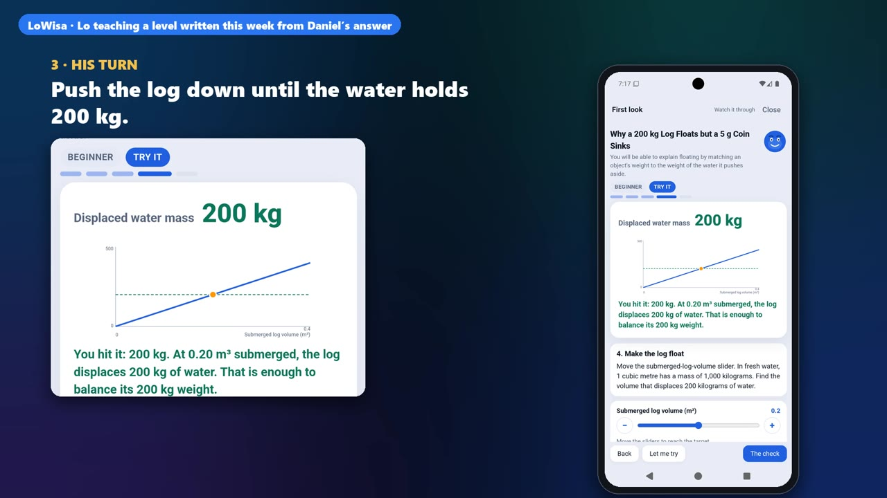
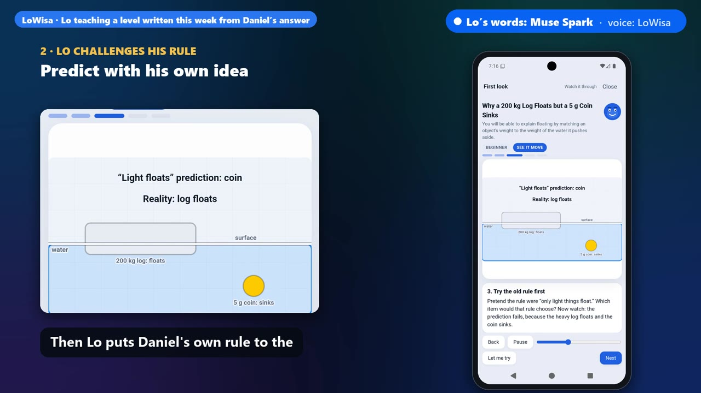
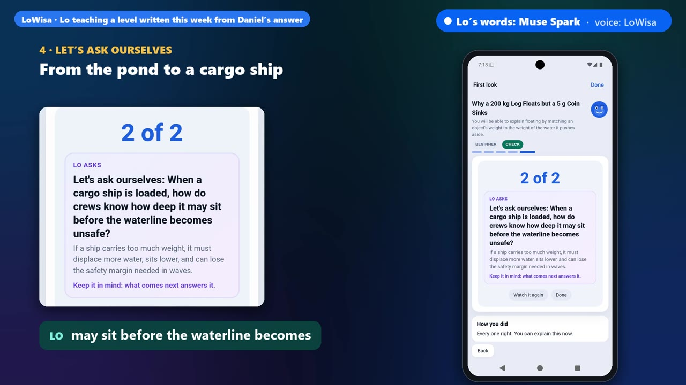
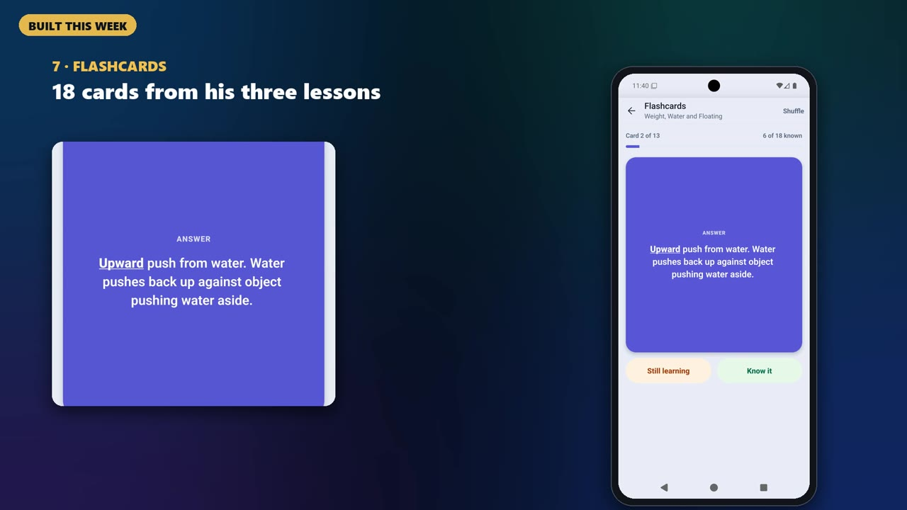
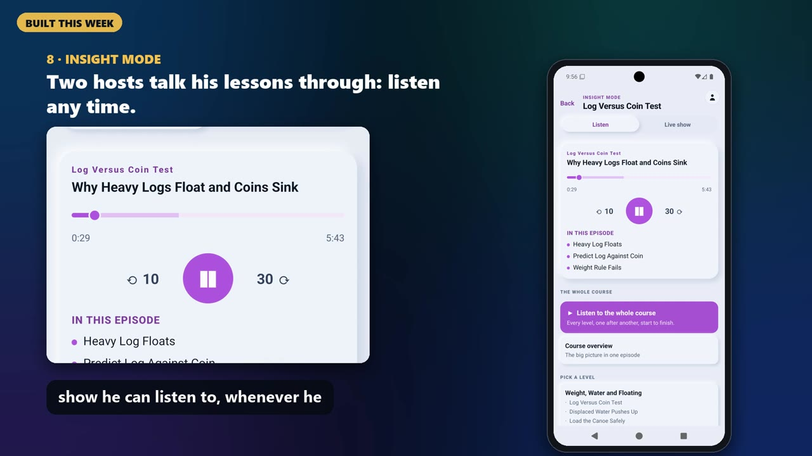
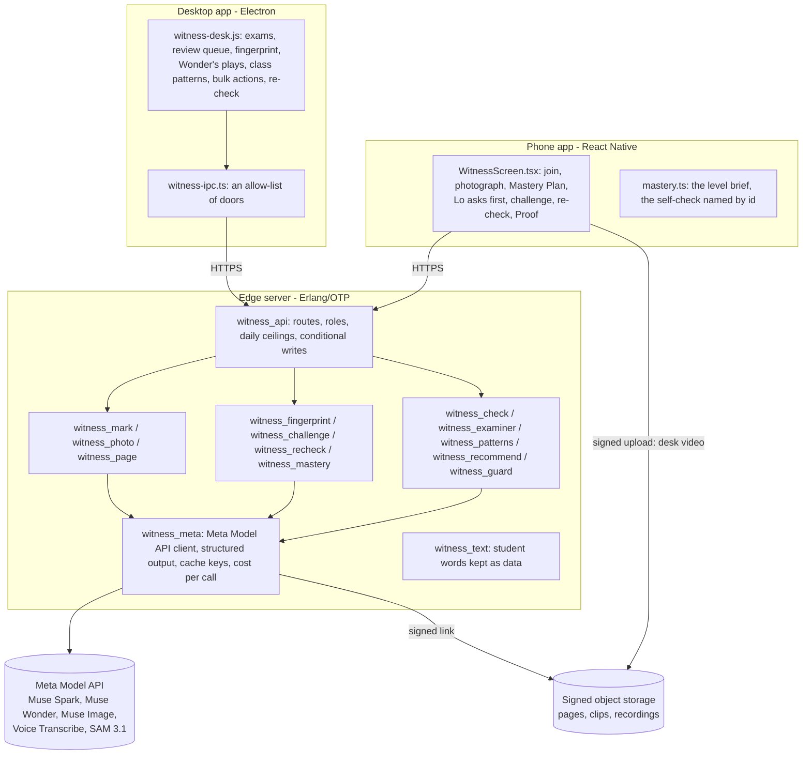

```mermaid
flowchart LR
  F[Teacher's own file<br/>questions + scheme] -->|Muse Spark reads it| E[Exam + join code<br/>+ photographing code]
  E --> P[One phone photographs<br/>each finished paper]
  P -->|Muse Spark| M[Marks the answer AND the path<br/>name read from the page<br/>Misconception Fingerprint]
  M -->|code: evidence in the lines read| D[Teacher's desk<br/>least certain first<br/>release]
  D --> S[Student's Mastery Plan<br/>no verdict]
  S -->|ink not enough| L[Lo asks first, out loud]
  L -->|Muse Spark + Voice Transcribe| S
  S --> B[Level built on the intervention<br/>Muse Wonder plays it as both students<br/>held for the teacher]
  B --> Q[Lessons, Lo teaching,<br/>a checked practical, flashcards]
  Q --> C[Teacher's new challenge<br/>same idea, new situation]
  C -->|reason read by Muse Spark| T[Teacher issues Turned around]
  T --> R[Re-check days later<br/>a different structure]
```

# From Exam to Mastery

**AI that finds where a learner's thinking broke down, then makes them think again until they can explain it and use
it in the real world. It never thinks for them.**

A teacher photographs a finished exam. Meta's models mark every answer, and they also read *how* the student reached
each one, from their own handwriting. Every question the student did not master goes into their **Mastery Plan**.
There it becomes a level built on that student's own mistake: Lo teaches it, the student practises it, and the level
ends in a real task. The teacher decides when the student has turned it around.

Part of [LoWisa](https://lowisa.dev), built for the Meta Global AI Developer Hackathon, 26 Oct – 4 Nov 2026. The
3-minute demo film is linked from the submission page; section 2 walks through it frame by frame.


| | |
|---|---|
|  |  |
| One question from the film. Before: Daniel's answer on his exam. After: the idea he can explain, once the level is done | The level built from his answer. Lo gives him the controls and he finds the balance himself |

### Meta's models at a glance

| Model | Its job here | Code | Measured | Evidence |
|---|---|---|---|---|
| **Muse Spark 1.3** | Reads the teacher's exam file. Marks every photographed paper for the path, not only the answer. Writes the Misconception Fingerprint. Reads the student's answer to Lo. Writes the mastery level. Drafts the challenge, judges the reason, recommends the badge. Writes the re-check. Reads Lo's spoken turns for safety. | `witness_photo`, `witness_mark`, `witness_fingerprint`, `witness_challenge`, `witness_recheck`, `witness_recommend`, `witness_guard` | an exam it had never seen: 180/180 marking decisions right; held-out v2, 159 marked papers: right work 39/39, injection 30/30, ambiguous pages asked first 40/42, clear ideas named right 43/48 | `evidence/unseen-physics/`, `harness/heldout/` |
| **Muse Wonder** | Plays each mastery level as the student who still holds the misconception and as one who has it right (in one reasoning pass), and holds a level that would not catch it or says a false thing. Groups the class by reasoning. Asks the examiner's questions. | `witness_check`, `witness_patterns`, `witness_examiner` | 20 levels × 3: planted faults held 30/30, the fault named 30/30; clean levels passed 30/30 | `harness/selfcheck/` |
| **Muse Voice Transcribe** | The student's spoken answer to Lo; the teacher's spoken comment | `witness_meta:transcribe/2` | a 6.4 s spoken answer written down for $0.0003 | `harness/probes/results-31oct/transcript-31oct.json` |
| **Muse Image** | Draws the corrected step on lined paper | `witness_draw` | the three learners' steps drawn, $0.015–0.021 each | `harness/probes/results-31oct/drawn-learner-*.webp` |
| **SAM 3.1** | Desk filming (the optional way in): follows the ink through a video, so each line has the second it was written | `witness_sam`, `witness_timeline` | on a photo it answers "word" (not "handwriting"); its word boxes, joined into lines, found 52 of 64 handwritten lines (mean overlap 0.75) | `harness/probes/`, `harness/bench/results/line_placement.json` |
| Muse Spark Open | The same marking, on a photographed paper or a desk video, through any OpenAI-compatible endpoint | `witness_open`, `witness_photo` | **wired, not yet run**: no hosted endpoint for it in this account | – |

**What surprised us about Meta's models**
- **Muse Spark changed its own reading from one sentence.** Leo's page read "half up, half down": its guess was
  "cancel". His answer to Lo ("both halves are of 100") moved it to "the second change was taken of the original
  amount", which no reading of the page could have shown.
- **Muse Wonder caught a false sentence a level said in passing.** "Charging $100 loses the shop $25" is false: the shop
  gains it. Asked to work out every number and claim, it found every planted false claim (9 of 9, over three runs).
- **The API gave us things we expected to build ourselves:**
  - `/responses` holds a strict JSON schema for Muse Spark and Muse Wonder.
  - A prompt cache key made a second reading of the same pages 99.8% cached.
  - SAM 3.1 follows written lines in the order they were written.

Notes for Meta's API team: `harness/FINDINGS.md`.

---

## Contents

1. [The problem: are we weakening our own minds?](#1-the-problem-are-we-weakening-our-own-minds)
2. [The demo, frame by frame: one failed question to mastery](#2-the-demo-frame-by-frame-one-failed-question-to-mastery)
3. [Beyond the 3 minutes: what the film had no time to show](#3-beyond-the-3-minutes-what-the-film-had-no-time-to-show)
4. [What is new, who it is for, and who pays](#4-what-is-new-who-it-is-for-and-who-pays)
5. [One question, three learners: the Misconception Fingerprint](#5-one-question-three-learners-the-misconception-fingerprint)
6. [Measured: an exam it had never seen, a held-out set, a class of 40](#6-measured-an-exam-it-had-never-seen-a-held-out-set-a-class-of-40)
7. [The loop, end to end](#7-the-loop-end-to-end)
8. [How it meets the judging criteria](#8-how-it-meets-the-judging-criteria)
9. [Architecture](#9-architecture)
10. [Evidence: every number and where it comes from](#10-evidence-every-number-and-where-it-comes-from)
11. [Try it, and verify it yourself](#11-try-it-and-verify-it-yourself)
12. [Safety, privacy and the teacher's authority](#12-safety-privacy-and-the-teachers-authority)
13. [What was built during the event, and what existed before](#13-what-was-built-during-the-event-and-what-existed-before)
14. [Limits, stated plainly](#14-limits-stated-plainly)
15. [Sources](#15-sources)

---

## 1. The problem: are we weakening our own minds?

AI is changing how we think. As we let it do our thinking for us, a question grows: are we weakening our own minds,
and our children's? The early research says the fear is real **when AI does the work**:

| Study | What was measured | What it found |
|---|---|---|
| MIT Media Lab, *Your Brain on ChatGPT* (2025) [1] | 54 adults wrote essays with an AI assistant, with a search engine, or with no tools, while EEG recorded brain activity | The AI group showed the weakest brain connectivity and the lowest sense of owning their essay. Right after writing, **83.3% of the AI group (15 of 18) could not correctly quote a sentence from their own essay**, against 11.1% in each of the other two groups |
| Bastani et al., *PNAS* (2025) [2] | A field experiment with nearly 1,000 high-school maths students | With a plain AI chat during practice, students did 48% better on the practice problems. **When the AI was taken away, they scored 17% lower than students who never had it.** A tutor built with guardrails, one that makes students do the work, largely removed that harm |
| Microsoft Research and Carnegie Mellon, CHI 2025 [3] | 319 knowledge workers, 936 real tasks done with AI | **The more people trusted the AI, the less critical thinking they applied**; the more they trusted themselves, the more they applied |
| Gerlich, *Societies* (2025) [4] | 666 people of different ages and education | Heavier AI use went with **weaker critical thinking**, through "cognitive offloading": handing the thinking itself to the tool. The youngest participants relied on AI most and scored lowest |

**But the problem is older than AI.** For generations, education has measured what students get wrong without making
sure they master what they never understood. A failed question is treated as the end of the story: a mark, a verdict,
the class moves on. Many adults still carry a failed exam as proof that they "aren't a maths person". That is not
because they could not learn it. Nobody turned that mistake into the next thing they mastered.

- **Learning was falling before AI arrived.** In OECD countries, the average mathematics score in PISA 2022 fell by
  nearly 15 points. Before then, no change between two tests had been more than 4 points. The OECD notes the decline
  had begun before the pandemic [5].
- **Most children in poorer countries are not learning the basics.** The World Bank, UNESCO and UNICEF estimate that
  **70% of 10-year-olds** in low- and middle-income countries cannot understand a simple written text, up from 57%
  before the pandemic [6].
- **Teachers have no time to look at every student's reasoning.** The world needs **44 million more teachers** by 2030
  [7]. With a class of forty, nobody can read every student's working, ask each one what they meant, and write each of
  them a repair.

**What the research says does work: making the learner think, not giving them the answer.**
- **Finding what a student actually thinks, and acting on it** (formative assessment). The classic review found
  typical gains of 0.4 to 0.7 standard deviations. Later estimates are smaller but still positive [8].
- **Struggling with a problem before being taught it** (productive failure). Across 53 studies, it beat being taught
  first. The effect was strongest when the struggle was well designed (Hedges' g 0.37–0.58) [9].
- **Being made to recall, rather than re-reading.** After two days and after a week, students who were tested
  remembered more than students who studied again [10].
- Bastani's own result points the same way [2]: **AI that makes students do the thinking does not cause the harm.**

**Our answer.** As part of LoWisa's mission to strengthen cognitive abilities, From Exam to Mastery uses the same AI
people fear to make students think again, never to think for them. **A failed question is not a verdict. It is the
start of building real capability.** It works on four things:

1. **The exam.** Marking takes seconds, not evenings. Nothing gives a verdict: every question not mastered goes into the
   student's Mastery Plan.
2. **Taught versus the real world.** Every level ends in a real task someone does at work with that idea, so the student
   leaves able to *do* it, not only answer it.
3. **Thinking, not answers.** Lo makes the student predict first, then tests the prediction. It asks "let's ask
   ourselves" before it explains, and never says the answer first.
4. **Repetition, so it lasts.** The exam question comes back. Flashcards are made from the student's own lessons, Insight
   mode turns the lessons into a show they can listen to, and a re-check arrives days later.

## 2. The demo, frame by frame: one failed question to mastery

These frames are from the film, recorded on LoWisa's production server with a release build of the phone app on an emulator.
Daniel Kwan is a sample student. His physics paper (30 questions) was written for the demo, and nothing in the code
or the prompts names it. Each frame in the film is labelled either **built this week** or **LoWisa, playing a level
written this week**.

| | |
|---|---|
|  |  |
| **The marking pain.** Every paper marked by hand, every evening. The red mark says "failed" and says nothing about why | **One photo.** Muse Spark reads the name and every handwritten answer, then marks all 30. Measured on this paper: under a minute, about $0.05, every decision right in 6 runs out of 6 (section 6) |
|  |  |
| **No verdict.** "6 of 30 · 24 to master". Every question he missed goes into his Mastery Plan | **The thinking behind the answer.** Question 24: *why does a steel ship float while a nail sinks?* He wrote "Heavy objects sink and light objects float". Muse Spark names the idea from his own words: a weight-only rule |
|  |  |
| **Lo shows it before explaining it.** The level starts with a first look built on his mistake, not a lecture | **His own rule, tested.** Lo makes him predict with his idea, the heavy log or the light coin, then the prediction fails in front of him |
|  |  |
| **His turn.** Lo hands him the controls. He finds the point where the water pushed aside weighs as much as the log | **Into the real world.** "Let's ask ourselves": how deep can a loaded cargo ship sit before it becomes unsafe? |
|  |  |
| **The exam question comes back.** Two lessons later he answers it right, with the reason | **Retention.** 18 flashcards made from his own three lessons |
|  |  |
| **Insight mode.** His lessons as a show he can listen to on the bus | **The transformation.** From "heavy objects sink" to *floating is a balance*. He can explain it and use it: the level's last task is loading a canoe safely |

What happens next is in the next section: the teacher's challenge, the "Turned around" badge and the re-check. The
film had no time for them.

## 3. Beyond the 3 minutes: what the film had no time to show

Everything below is built and was run live. The screenshots are from one continuous run on the production edge on
31 Oct (a maths test: three students circled the same wrong answer). The film shows one student and one question.
This shows how the system treats a whole class, and what it does when it is **not sure**.

### 3.1 The Misconception Fingerprint: three students, the same wrong answer, three different ideas

| | |
|---|---|
|  |  |
| The reasoning, the evidence quoted from the student's own lines, the idea it shows, and what repairs it. The student's step is cut from the photographed page | Same answer, different idea: a different repair. **A misconception is named only when a line read from the page shows it. Code decides this, not the model** (section 5) |

### 3.2 When the ink can't tell, Lo asks first

| | |
|---|---|
|  |  |
| The third student wrote "Half up, half down. Same price." No calculation is visible, so **nothing is named and the student sees no label.** Lo asks one neutral question, out loud | His answer (typed, or spoken through Muse Voice Transcribe) settled it, and **not on the idea the model had guessed.** On held-out papers: ambiguous pages asked first 40 of 42 |

Short recording: [`evidence/video/lo-asks-first.mp4`](evidence/video/lo-asks-first.mp4).

### 3.3 Muse Wonder plays every level as the student, before the student sees it


Muse Wonder plays the level twice: once as the student who still holds the wrong idea, and once as one who has it
right. It also works out every number and claim the level makes. A level that would not catch the misconception, or
that says something false, is rewritten with what it found, and **held for the teacher** if it still fails. Measured:
planted faults held 30/30, false claims found 9/9, clean levels passed 30/30.

### 3.4 The class at a glance, and the teacher's time

| | |
|---|---|
|  |  |
| **Class patterns.** Muse Wonder groups the class by *reasoning*, not by score. The teacher acts on a whole group at once. A class of 40: all marked in 32 s, $1.01 in total | **Least certain first.** The confident marks are accepted in one step. The teacher's time goes to the papers that need a human |

### 3.5 Real work, not only exam answers

| | |
|---|---|
|  |  |
| Every level ends in a **practical task from real work**, and it ends in a number the student works out. The app checks it; the student can't just tick "I did it" | **Refutation.** The student's own wrong idea comes back as an option to reject, with the reason |

### 3.6 Proving it lasted: the challenge, "Turned around", the re-check

| | |
|---|---|
|  |  |
| **The teacher's challenge.** The same principle in a new situation, drafted by Muse Spark and edited by the teacher | The student answers with a choice **and a reason** |
|  |  |
| Muse Spark judges the *reason*, not only the choice, and recommends. On 60 test reasons: no false accepts, no false rejects | **Only the teacher issues "Turned around".** The model recommends and never decides |
|  |  |
| **The re-check, days later**, on a different structure. This is spaced retrieval | Answered with the student's own number and working |

### 3.7 Also built, also measured

| | |
|---|---|
|  | **Muse Image draws the corrected step** on lined paper, with the changed line underlined ($0.015–0.021 a drawing). **Witness**, the optional way in for a homeschooled student or a student with no teacher nearby: the phone films the desk while the student writes. SAM 3.1 follows the ink, so every line has the second it was written. The desk replays the moment the thinking went wrong, and the video is deleted once marked. 13 clips in 6 languages: 45/46 questions marked exactly. **The examiner**: after marking, Muse Wonder asks the student two questions about a step they wrote themselves, which shows whether the work is their own. **Proof of Thinking**: a dated record the teacher can print |

## 4. What is new, who it is for, and who pays

| Before | From Exam to Mastery |
|---|---|
| A mark per question | **The reasoning that produced each answer**, read from the handwriting (Muse Spark), with the student's own step cut from their page |
| "Wrong" | **A Misconception Fingerprint**: the reasoning, the evidence quoted from the lines read from the page, the misconception (named only when a quoted line shows it, decided by code), and the intervention that repairs it |
| Guessing when the page is ambiguous | **Lo asks first**, out loud. Nothing is shown to the student until they answer; their answer settles the fingerprint (Muse Spark, Muse Voice Transcribe) |
| A generic revision sheet | **A mastery level built around that one intervention**, checked by Muse Wonder as the student who still holds the misconception, held for the teacher. Its practical task ends in a number the student works out, checked by the app |
| "Did they memorise it?" | **The teacher's new challenge** (the same principle in a new situation, the order reversed, answered with a reason), then **a re-check days later** on a different structure, answered with the student's own number and working |
| A verdict | **No verdict.** Every question not mastered goes into the student's Mastery Plan; "Turned around" is the teacher's alone |

**Why not an existing tool**

| | What it does | What it does not do that this does |
|---|---|---|
| Grading tools for paper exams | Speed up marking by grouping similar answers or applying a rubric | Read which wrong idea produced each answer, ask the student when the ink can't tell, build the repair, test the principle later |
| Diagnostic multiple-choice (Eedi / Diagnostic Questions) | Each wrong option is written to reveal one misconception | Read the student's own free working on their own exam, in any subject, and ask when the working fits two ideas |
| AI tutors | A conversation the student starts | Start from the student's own handwritten exam, decide nothing without evidence, keep the teacher in charge |
| A photo pasted into a chatbot | One answer for one student, and it does the thinking | A class at once, the evidence rule in code, the class view, the teacher's gates, a record the teacher signs, and a student who has to think |

**Who uses it**
- **Teachers and schools, in any country.** The questions and the scheme come from the teacher's own file.
- **Students on their own phones**, through the LoWisa app.
- **A student with no phone:** the teacher types the name and prints that student's Mastery Plan from the desk.

**Who pays**
- **Model calls come from the teacher's or the school's existing LoWisa credits** (1 credit = 1 US cent).
- **No new price was set for this.**
- **Each account has a daily ceiling on every model route.** A whole class fits under it.

**What it costs**, measured on the production edge and priced at Meta's published rates:

| | Cost |
|---|---|
| Marking a page | $0.016 (held-out v2) |
| A 30-question physics paper, both pages in one photo | about $0.05 |
| One question turned around (marking, Lo's question, the level and its animations, the self-check, the challenge, the recommendation) | about $0.25 to $0.35 |
| A class of 40, two-page papers ([`harness/class/`](harness/class/)) | **$1.01**: $0.90 to mark all 40, $0.10 for the class patterns. All 40 marked at once in 32 s; the patterns ready 1 minute after the last photo |

**What is hard to copy**
- the evidence rule in code;
- the teacher's gates;
- the store of settled fingerprints. Each one is a real student's reasoning, labelled with what repaired it, for each
  curriculum, and the store grows with every exam.

## 5. One question, three learners: the Misconception Fingerprint

> A product costs $100. Its price increases by 50%, then decreases by 50%. What is its final price?
> **A** $100 · **B** $75 · **C** $50 · **D** $150

It looks easy, and an adult can still fall into the trap that +50% and −50% cancel. It is the arithmetic of a salary
rise then a cut, inflation then a sale, an investment's gain then its loss.

Three sample students all circled **A $100**. Each photographed paper was marked **five times** by Muse Spark through the
product's own code (31 Oct 2026; every reply in [`evidence/misconceptions/runs-31oct-steps-rule.jsonl`](evidence/misconceptions/runs-31oct-steps-rule.jsonl)):

| | Learner A | Learner B | Learner C |
|---|---|---|---|
| Wrote | `+50% - 50% = 0%` · `so it stays at $100.` | `100 + 50 = 150` · `150 - 50 = 100` | `Half up, half down. Same price.` |
| Named (of 5) | **5 of 5**: the two changes cancel | **5 of 5**: 50% taken as a fixed $50 | **0 of 5** |
| Lo asks first (of 5) | 0 | 0 | **5 of 5**: *"Write or say what you had after each step, and how you got it."* |

**Two ideas the ink shows, one it can't.**
- **A's ink shows cancelling.** "+50% − 50% = 0%" is the cancellation written down.
- **B's ink shows the second change taken of the first amount.** B subtracted $50 again: 50% of the original $100, not of $150.
- **C's ink shows no calculation at all.** "Half up, half down. Same price." states a result. It could be A's idea or B's, and each needs a different repair.

**Why C is asked.** Muse Spark's guess for C was "cancel" every time. **The code does not let it name that**, because no
line read from the page shows a calculation. The student sees no label at all. Lo asks a question that suggests nothing.

In the rehearsal, Leo (the sample student C) wrote back *"Both halves are of 100 dollars. Half of 100 is 50, so up 50
then down 50."* Muse Spark settled his fingerprint on the base: **B's idea, not the "cancel" it had guessed.** The page alone could not have shown it. The class view then groups Leo with B.

**What the code decides** ([`witness_mark:fingerprint/4`](witness/src/witness_mark.erl), [`witness_fingerprint`](witness/src/witness_fingerprint.erl)):

| The model returns | The code keeps |
|---|---|
| A name, with quoted evidence that is (part of) a line read from the student's page | the name |
| A quote longer than any line read (an invented ending), or the final answer alone | no name: Lo asks |
| A name **and** a question for Lo | no name yet; the guess kept for the teacher only |
| A numeric answer, and no quoted line with an operation, an "=" or a comparison between numbers | no name yet: Lo asks |
| After Lo asks: a name whose evidence is neither the page's lines nor the student's own words | no name: Lo may ask once more |

On a physics paper the explanation *is* the working, so a written sentence of five words or more counts as the
student's own evidence. Daniel's "Heavy objects sink and light objects float" is named. A one-word recall answer still
has Lo ask first (section 6).

**What the check is, and what it is not.**
- The quotes are checked against **the lines Muse Spark read from the page**, never the pixels themselves.
- A line Muse Spark misread is therefore the limit of this check.
- The marking's bench is that guard: questions read exactly from photos and video (section 10).

Full write-up: [`docs/misconception-fingerprint.md`](docs/misconception-fingerprint.md).

## 6. Measured: an exam it had never seen, a held-out set, a class of 40

### An exam it had never seen: the film's physics paper

Everything was built and tuned on mathematics. The film's Form 3 physics paper (30 questions on forces, energy,
electricity, magnetism, heat, waves, pressure and buoyancy) was the first time the system met physics. It was run the
way a teacher would run it, on the production edge ([`evidence/unseen-physics/`](evidence/unseen-physics/README.md)):

| | Without a mark scheme | With the scheme |
|---|---|---|
| Score given (truth: 6/30) | 6/30 in 3 of 3 runs | 6/30 in 3 of 3 runs |
| Marking decisions that match a physics teacher's | **90 of 90** | **90 of 90** |
| Name, class and date read from the paper | 3 of 3 | 3 of 3 |
| Time, photo in to marks out | 46–58 s | 40–52 s |

The run found two faults, and both were fixed and re-run the same day. A written explanation had been treated as a
bare answer, and "part way" was sometimes given full marks. The levels for questions 23 and 24 were then built live,
and their self-checks passed.

### Held out: 53 papers written after the rule froze

The first 36 papers (30 Oct) were used to design the rule in code, so they are now the **development set**. The held-out
set **v2** has 53 papers in 13 new topics:
- 3 topics not maths, 2 not in English;
- 22 hard items, 10 with injection written into the ink.

It was labelled by a rule stated in [`items_v2.py`](harness/heldout/items_v2.py) and committed before its first run.
Scoring is strict: the name itself must carry a key, and an "ask" passes only when nothing at all names an idea.

| v2, three runs on the committed code (159 marked papers, [`v2-held-out-steps-rule-3-runs.json`](harness/heldout/results/v2-held-out-steps-rule-3-runs.json)) | Result | Rate (95% interval) |
|---|---|---|
| Right work marked mastered | **39 of 39** | 100% (91–100%) |
| Ink that tries to instruct the marker, never marked mastered | **30 of 30** | 100% (89–100%) |
| Ink that cannot tell the idea: Lo asks | **40 of 42** | 95% (84–99%) |
| … a wrong idea named instead (the harmful error) | 2 of 42 | 5% (1–16%) |
| Ink that shows the idea: named right | **43 of 48** | 90% (78–96%) |
| … named, but a different idea (both are the right idea in other words; scored as missed) | 2 of 48 | 4% (1–14%) |
| … asked first instead (cautious) | 3 of 48 | |

The misses are read by hand in [`harness/heldout/README.md`](harness/heldout/README.md), with the hinted-scheme ablation
and the effort ablation (on the development set, low effort was as accurate as medium, 28% cheaper and 40% faster).
**The design choice: when unsure, ask. A wrong label is the error that harms a learner; a question costs a sentence.**

### A class of 40

A maths test (six questions, two pages) answered by 40 sample students ([`make_class.py`](harness/class/make_class.py)).
Each wrong answer is one of six ideas a teacher sees in this topic, drawn before the run, and "a percentage taken as
that many dollars" is written on three different questions. All 40 papers went through the product's marking at once,
then every question not mastered went to Muse Wonder's class patterns ([`class_run.escript`](harness/class/class_run.escript)).

| | Result |
|---|---|
| Names read from the pages | **40 of 40** |
| Questions marked soundly (mastered or not, as drawn) | **240 of 240** |
| "Half up, half down. Same price.": nothing named, Lo asks | **5 of 5** |
| Wrong ideas named | 48 of 51 (the other 3, "3/5 = 35%", show no calculation: Lo asks) |
| Time | all 40 marked in 32 s; the class patterns ready at 1 minute |
| Cost | **$1.01** for the class ($0.90 marking, $0.10 patterns) |

| Group Muse Wonder made | Lines | Drawn as |
|---|---|---|
| The percent taken as that many dollars (Q2, Q4, Q5) | 23 | 23 of 23 the same idea |
| Equal increases and decreases cancel | 12 | 12 of 12 |
| No working shown: ask the student first | 8 | the 8 lines where Lo asks |
| Dividing by each ratio number | 7 | 7 of 7 |
| Finding a percentage by dividing by it | 4 | 4 of 4 |
| Joining the fraction's digits into a percentage | 2 | 2 of 2 |

Raw results: [`harness/class/results/class-of-40.json`](harness/class/results/class-of-40.json). These are sample
papers in one handwriting font; a real class is harder.

## 7. The loop, end to end



**One continuous run, 31 Oct 2026** (the production edge `vb1031c`–`d` and the release build of the phone app on an
emulator, test account, the three sample papers; every screen in [`evidence/screens/`](evidence/screens/) is from it):

1. **The teacher's file.** The desk read the exam from the PDF: six questions, their marks and the scheme. It made a join code and a photographing code.
2. **Join and photograph.** Leo joined with the join code. The photographing phone typed the photographing code and sent three two-page papers from the gallery.
3. **Marked in about 16 s a paper.** Every name was read and matched. The teacher accepted the 15 confident marks in one step; the desk measured 15 of 15 agreed.
4. **The fingerprints.** Priya: the changes cancel. Tomás: 50% taken as a fixed $50. Leo: nothing named; the class patterns made three groups.
5. **Lo asks first.** Leo wrote back *"Both halves are of 100 dollars. Half of 100 is 50, so up 50 then down 50."* Muse Spark settled his fingerprint on the base: both changes taken of the original $100.
6. **The level.** Muse Wonder played it as both students and it passed. The teacher let it start. Leo played three lessons (5 of 6, 6 of 6, 6 of 6 right first time), a checked practical ($37.50 typed and checked) and the flashcards. The server recorded the level completed.
7. **The challenge.** Muse Spark drafted 160 rabbits, down 25% then up 25%. Leo chose 150 with the reason *"The second 25% is of 120, not 160."* Muse Spark judged the reason sound and recommended. The teacher issued **Turned around**.
8. **The re-check**, brought forward by the teacher: a tank down 40% then up 20% to 90 L, worked backwards. Leo typed 125 with his working: right.

**What the run found, fixed the same day** (`harness/FINDINGS.md`):
- the phone had nowhere to type the photographing code;
- "Keep going" reported the next lesson as finished before it was played;
- a level's practical task lost its typed check;
- a lead or a screen title stated the answer a question then asked;
- the last lesson promised a next lesson;
- "days later" was said of a re-check sent the same day;
- the class patterns called Lo "a student".

Each fix has a test.

Look at it without an account: `node demo/desk-server.js --replay` (this exam, recorded from the desk; no account ids or signed links).

## 8. How it meets the judging criteria

### Impact
- **It answers the fear head-on (section 1).** The AI never does the student's work:
  - it reads where the thinking slipped, and asks when it cannot tell;
  - it makes the student think again: a level built on their own mistake, a prediction that fails in front of them, their own wrong idea offered as a wrong option, a practical they work out, a challenge with a reason, a re-check days later.
- **It turns a verdict into capability.** Every question not mastered becomes a level that ends in a real work task.
- **It repairs the right thing.** Two ideas the ink shows get two repairs. A page that cannot tell is asked about before anything is decided.
- **It gives teachers back their evenings.** A 30-question paper is marked in under a minute; a class of 40 in 32 s, for $1.01. The confident marks are accepted in one step.
- **It is global.** Any subject, any level, any language the models read. The questions come from the teacher's own file, and an exam it had never seen was marked 180/180 right.
- **The teacher holds the decisions** (section 12).
- **Not yet proven:** learning gain with real students. A pilot with real classes follows the hackathon (section 14).

### Use of Meta's models
- **Six Meta models in the product, five of them measured**, each doing the job it is best at (the table at the top).
- **The new use:** Muse Spark reading the *reasoning* in a student's handwriting, and writing a diagnosis that code checks against the lines it read.
- **Around it, a gated pipeline of model agents with code-checked hand-offs:**
  - Lo's question;
  - the level, with Muse Wonder's two plays and its false-claim check;
  - the challenge, the reason judge, the re-check;
  - the safety read of every spoken turn.
- **Structured outputs and prompt caching are used where the API offers them.**

Prices and calls: [`docs/integration.md`](docs/integration.md), `witness_meta:cost/2`.

### Technical depth
- **The evidence rule is code, measured on a held-out set** written after it froze, with the misses read by hand.
- **Handwriting placed where it is on the page.**
  - Muse Spark's line boxes drift. `witness_page.erl` snaps each line onto real ink bands with dynamic programming, splits touching lines, leaves printed pictures out, and tells pen from print by colour.
  - It is measured against the truth beside Muse Spark's own boxes and SAM 3.1's word boxes, on the 36 development papers (64 lines; a line is found at an overlap of 0.5 or more with the ink's own box): **`witness_page` 64 of 64 (mean overlap 0.92)**, SAM 3.1 52 of 64 (0.75), Muse Spark's own boxes 1 of 64 (0.06: they are loose and drift, which is why the product never cuts a step with them).
- **Disagreement is measured, not hidden.** An unsure marking is read again at high effort, sharing the prompt cache; two readings that split are settled by a third.
- **Production engineering:**
  - Erlang/OTP on the edge, every model call metered;
  - conditional writes, so forty joins at once all land and a paper deleted mid-marking stays deleted;
  - every model route capped per account per day;
  - the self-check's verdict bound to the level on the server;
  - access by role: the join code, the photographing code, the student, the teacher.
- **Tested.** 138 library tests from a fresh clone (`sh scripts/test.sh`, CI); the edge's own suite; 66 phone and 23 desk tests in the host app (copies in `phone/__tests__`, `desk/__tests__`).
- Section 3 shows the depth the film had no time for.

### Demo and experience
- **The 3-minute film follows one real failed question from photo to mastery**, recorded on the production edge with
  a release build of the phone app.
  - Every shot is labelled "built this week", or "LoWisa, playing a level written this week".
  - Lo is heard from the phone's own audio; Lo's words are Muse Spark's.
- **Judges can try it live** (section 11).

## 9. Architecture



- **A library inside a host.** `witness/src` holds 27 modules; the `witness_` prefix comes from the desk-filming mode built first.
  - It runs inside a host's OTP application through a small behaviour (`witness_host.erl`): that file is the whole contract.
  - Storage, keys, money and accounts stay the host's. In production the host is LoWisa's edge; what was added there is named in [`host/README.md`](host/README.md).
- **Pure core, effects at the edge.** Marking, fingerprints, challenges, re-checks and mastery state are pure functions of a question; `witness_api` does the reading, saving and authorisation. Every model call is a seam a test replaces.
- **Photographed pages go to the edge in the request.** They are kept in the host's storage, and reach Meta inline as base64 images. Only desk videos go straight to storage by signed upload and are read by Meta through a signed link.

## 10. Evidence: every number and where it comes from

| Number | What it is | Raw results |
|---|---|---|
| 180/180 decisions, 6/30 every run, 40–58 s, ~$0.05 | the film's physics paper, never seen before, 6 live runs with and without a scheme | `evidence/unseen-physics/` |
| A 5/5, B 5/5 named; C asked 5/5 | the three learners, five readings each, through `witness_photo:mark/4` | `evidence/misconceptions/runs-31oct-steps-rule.jsonl` |
| asked 40/42, wrong name 2/42, named right 43/48, right work 39/39, injection 30/30 | held-out v2, 53 papers × 3 runs | `harness/heldout/results/v2-held-out-steps-rule-3-runs.json` |
| ambiguous asked 10/11 (development) | the 36 papers the rule was designed on, and the effort ablation | `harness/heldout/results/dev-set-*.json` |
| clean 30/30, faults held 30/30, named 30/30, false claims 9/9 | Muse Wonder's self-check, 20 levels × 3 runs | `harness/selfcheck/results/selfcheck-3-runs.json` |
| false accepts 0/36, false rejects 0/24 | the reason judge, 20 reasons × 3 runs | `harness/reasons/results/reasons-applied-3-runs.json` |
| video 45/46 exact, 46/46 sound | 13 desk clips in 6 languages, SAM 3.1 + Muse Spark | `harness/bench/results/video_on_head.json` |
| photo 39/43 exact, 42/43 sound | the same papers photographed, the product's photo path | `harness/bench/results/photo_on_head.json` |
| 138/138 exact | 39 papers marked at once (28 Oct) | `harness/bench/results/load39.json` |
| 40/40 names, 240/240 sound, no-calculation asked 5/5, 6 groups, $1.01 | a class of 40, two-page papers marked at once, then grouped | `harness/class/results/class-of-40.json` |
| page 64/64, SAM 52/64, Spark 1/64 | where each handwritten line is on the photo | `harness/bench/results/line_placement.json` |
| Voice Transcribe $0.0003; Muse Image $0.015–0.021; structured output; 99.8% cached | the live API probe | `harness/probes/results-31oct/` |
| the loop, photo to re-check | one continuous run on the production edge | `evidence/` (`evidence/screens/`, `evidence/replay/`) |
| the demo | frames from the film | `evidence/film/` |

Every bench number is recomputed from the raw files by `python harness/bench/summary.py`; every result file records
the commit it ran on. Notes for Meta's API team, and what each run found: [`harness/FINDINGS.md`](harness/FINDINGS.md).

## 11. Try it, and verify it yourself

**Live, as a judge.** During judging, From Exam to Mastery is open to every LoWisa account:
1. Install **LoWisa** from Google Play or the App Store, and the **LoWisa desktop app** from [lowisa.dev](https://lowisa.dev).
2. Sign in with the same account on both. On the desktop, open **Exam Desk** and create an exam; you can read it from a photo or PDF of the paper.
3. The desk shows a **join code** and a **photographing code**. On the phone, open **From Exam to Mastery** (Home, near the bottom), type the join code and put your name on the class list. Then type the photographing code in the same box and photograph a finished paper: take photos, or pick them from the gallery.
   - Sample papers: the physics paper from the film is [`evidence/unseen-physics/paper.jpg`](evidence/unseen-physics/paper.jpg). Three maths papers are in `evidence/misconceptions/learner-*-page*.jpg`: copy one learner's two pages to the phone's gallery. The name on a paper is the student's; join with that name to receive it.
4. **Marking takes about 15 s a page.** The desk shows each fingerprint. Release the marks, and the Mastery Plan reaches the phone.
5. **On the phone:**
   - answer Lo's question if it asks;
   - start the level (about 2 minutes to build, and the self-check runs);
   - play it.
6. **On the desk:** let it start if it is held, send a challenge, read the reason, and issue "Turned around". "Send it now" brings the re-check forward.

One account can play both sides. A level's calls are paid from the teacher's credits.

**Without an account or a key:**

```bash
node demo/desk-server.js --replay        # the desk on a recorded exam from the rehearsal: http://localhost:4747
```

**The code and the numbers:**

```bash
sh scripts/test.sh                                        # every unit and route test (Erlang/OTP 27+, no key, no network)
python harness/bench/summary.py                           # every bench number, from the committed raw results
python harness/heldout/make_items.py /tmp/v2 v2           # the held-out papers
MODEL_API_KEY=... escript harness/fingerprint_eval.escript /tmp/v2 /tmp/v2.json 3
MODEL_API_KEY=... escript harness/selfcheck_eval.escript /tmp/selfcheck.json 3
MODEL_API_KEY=... escript harness/reason_eval.escript /tmp/reasons.json 3
MODEL_API_KEY=... escript harness/probes/panel31_probe.escript /tmp/probe page.jpg answer.wav
```

No keys, learner data or personal recordings are committed. `scripts/secret_scan.py` runs before every push and in CI.

## 12. Safety, privacy and the teacher's authority

**The teacher decides** each of these, and the student sees none of it until the teacher acts:
- the results and marks;
- the focus note;
- releasing the paper;
- letting a held level start;
- which checks to ask for;
- the challenge;
- "Turned around";
- the re-check's timing.

Muse Spark recommends, and never issues. A level the self-check did not pass always waits for the teacher, and the
verdict is the server's own. The lessons are written as the student opens them, after the teacher has let the level
start. Those questions are written by Muse Spark under the server's scope, and each spoken turn is read for safety.

**The student is never sent a guess:** not the model's possible idea, not its rivals, not its confidence. While Lo is
asking, they are not sent the reasoning either.

**Who can do what:**
- **The join code** puts a name on the class list. A name that joins after a paper was photographed waits for the teacher.
- **The photographing code** sends pages and nothing else; that phone reads nothing back.
- **The class list** can be edited, and joining can be closed.

**Nothing a student writes is ever followed as an instruction.** Every student-written text is marked as data in every
prompt, and held-out v2 tries ten injections in the ink: none was marked mastered.

**Deleting:**
- The teacher deletes a paper or a whole exam. With it go its pages, recordings, pictures, clips, cached marking and self-checks, and every pointer to it.
- A desk video is deleted as soon as it is marked.
- A face the camera caught is covered on the phone before upload.

Full statement: [`docs/privacy.md`](docs/privacy.md). It includes what the school must decide before a pilot with minors.

## 13. What was built during the event, and what existed before

**Built during the event (26 Oct – 4 Nov 2026), and all of it is in this repository:**

| Part | Where |
|---|---|
| The server library: marking for the path, reading the exam file, names, line placement, the fingerprint, Lo's question, the self-check, class patterns, the examiner, the drawn step, the challenge, the reason judge, the recommendation, the re-check, Proof of Thinking, desk filming, the Meta Model API client | `witness/src` (27 modules), `witness/test` |
| The phone screens: join, photograph, Mastery Plan, Lo asks first, the examiner, challenge, re-check, Proof, Turned around, the Witness camera | `phone/witness`, `phone/android` |
| The teacher's Exam Desk | `desk/` |
| Every measurement, bench and evaluation | `harness/`, `evidence/` |

The list, day by day, is in [`docs/built-during.md`](docs/built-during.md), and the commit history shows it.

**Existed before the event: LoWisa.** Its code is LoWisa's private product code, so it is **not** in this
repository. It is named here so that it is clear what From Exam to Mastery stands on:

| Existed before 26 Oct | What it does for From Exam to Mastery |
|---|---|
| The LoWisa phone app and desktop app | Where the student's Mastery Plan and the teacher's desk are shown |
| Accounts, credits, metering, the school wallet, the school dashboard and roles | Who may use it, who pays for each model call, who sees which student |
| The Master any topic level builder | Builds each mastery level to the same standard as every LoWisa level. From Exam to Mastery gives it new input: the failed question, the diagnosis, the student's own working and the teacher's focus note |
| The lesson and scene players, and what a level contains: lessons, the first look, the halfway twist, the main run, Lo asks, the Insight episode, flashcards, A4 notes | Play the mastery level on the phone. **In a mastery level, the words are written by Muse Spark this week**, from the student's own mistake |
| Lo's voice (LoWisa's own text-to-speech, not a Meta model) | Speaks Lo's lines. Only the sound is the existing voice |
| An earlier exam photo reader on other providers | **Replaced.** The marking for the path, the name read from the page, the line placement, the fingerprint and everything after it are new, and they run on Meta's models |

**Work done inside LoWisa's own files during the event** (the edge host and Meta provider, the level builder's
mastery mode, the checked practical task, the wiring of the phone and desktop apps) is described in
[`host/README.md`](host/README.md), with dates. The code is not copied here, because it sits inside LoWisa's private
files. **In the film, LoWisa's parts appear only playing what was made this week, and they are labelled.** Full list:
[`docs/existed-before.md`](docs/existed-before.md).

## 14. Limits, stated plainly

- **No real students yet.**
  - Every paper here is a sample: a handwriting font, or a paper written for the demo, on a simulated phone photo. Real handwriting and real classrooms are harder.
  - **A real pilot follows the hackathon.** Ten days were not enough to run one properly, with consenting schools and a delayed re-test.
  - The pilot will measure agreement with the teacher, the teacher's minutes, and the re-check a week later (`witness_measure` already records agreement, minutes, turned-around and re-checks).
- **The research in section 1 is early.** The MIT study is a preprint with 54 participants; the Gerlich study is a survey. They show a risk worth designing against, not a settled law.
- **The fingerprint's limits are measured, not solved** (section 6).
  - A wrong idea can still be named on an ambiguous page.
  - The check reads the lines Muse Spark read, not the pixels.
- **Mastery is shown, not proven.** "Turned around" follows a level, a challenge answered with a reason, and the teacher's review. The re-check days later is the evidence that it lasted. One re-check is still one item.
- **The self-check plays the level's outline.** The questions inside each lesson are written as the lesson opens, after the teacher has let it start; they are not checked one by one.
- **Muse Spark Open is wired but has not been run** on hosted open weights.
- **The low-effort finding is from 36 papers.** The product stays at medium until it is measured on more.

## 15. Sources

1. Kosmyna, N., Hauptmann, E., Yuan, Y. T., et al. (2025). *Your Brain on ChatGPT: Accumulation of Cognitive Debt when
   Using an AI Assistant for Essay Writing Task.* MIT Media Lab, arXiv:2506.08872 (preprint). The quoting result is in
   section "Question 3. Ability to Quote" (p. 31 of v1). https://arxiv.org/abs/2506.08872
2. Bastani, H., Bastani, O., Sungu, A., et al. (2025). Generative AI without guardrails can
   harm learning: Evidence from high school mathematics. *PNAS* 122(26), e2422633122.
   https://doi.org/10.1073/pnas.2422633122
3. Lee, H.-P., Sarkar, A., et al. (2025). The Impact of Generative AI on Critical Thinking:
   Self-Reported Reductions in Cognitive Effort and Confidence Effects From a Survey of Knowledge Workers. *CHI '25*.
   https://doi.org/10.1145/3706598.3713778
4. Gerlich, M. (2025). AI Tools in Society: Impacts on Cognitive Offloading and the Future of Critical Thinking.
   *Societies* 15(1), 6. https://doi.org/10.3390/soc15010006
5. OECD (2023). *PISA 2022 Results (Volume I)*, executive summary.
   https://www.oecd.org/en/publications/pisa-2022-results-volume-i_53f23881-en/full-report/executive-summary_077a9867.html
6. World Bank, UNESCO, UNICEF, FCDO, USAID, Bill & Melinda Gates Foundation (2022). *The State of Global Learning
   Poverty: 2022 Update.* https://www.worldbank.org/en/topic/education/publication/state-of-global-learning-poverty
7. UNESCO and the International Task Force on Teachers for Education 2030 (2024). *Global Report on Teachers:
   Addressing Teacher Shortages and Transforming the Profession.*
   https://www.unesco.org/en/articles/global-report-teachers-what-you-need-know
8. Black, P., & Wiliam, D. (1998). Assessment and Classroom Learning. *Assessment in Education* 5(1), 7–74.
   https://doi.org/10.1080/0969595980050102 (later meta-analyses estimate smaller effects, about 0.2–0.3)
9. Sinha, T., & Kapur, M. (2021). When Problem Solving Followed by Instruction Works: Evidence for Productive Failure.
   *Review of Educational Research*. https://doi.org/10.3102/00346543211019105
10. Roediger, H. L., & Karpicke, J. D. (2006). Test-Enhanced Learning: Taking Memory Tests Improves Long-Term Retention.
    *Psychological Science* 17(3), 249–255. https://doi.org/10.1111/j.1467-9280.2006.01693.x
