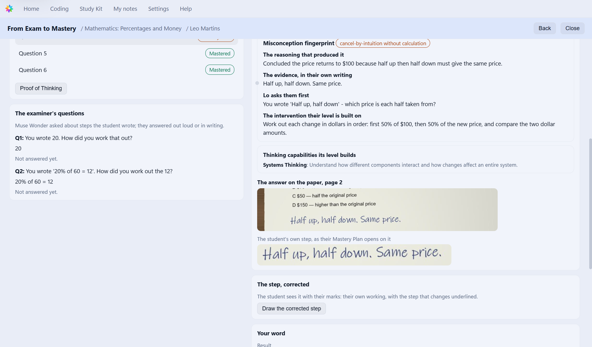
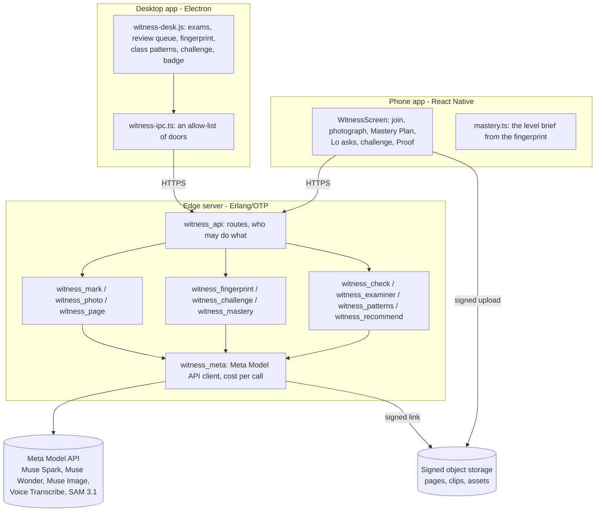

# From Exam to Mastery

**A failed exam question becomes demonstrated understanding: Meta's models read *how* a student reached each answer
from their handwriting, name the misconception only when the evidence is on the page, and turn it into a mastery
level built to repair exactly that idea, with the teacher in charge at every step.**

Part of [LoWisa](https://lowisa.dev). Built for the Meta Global AI Developer Hackathon, 27 Oct – 4 Nov 2026.
Meta models: **Muse Spark 1.3 · Muse Wonder · Muse Image · Muse Voice Transcribe · SAM 3.1 · Muse Spark Open**.

| | |
|---|---|
|  |  |
| The teacher's desk: the Misconception Fingerprint beside the student's own step, cut from the photographed page | The student's phone: when the page is not enough evidence, Lo asks one question, out loud, before teaching |

---

## Contents

1. [The problem](#1-the-problem)
2. [What is new](#2-what-is-new)
3. [One question, three learners: the Misconception Fingerprint](#3-one-question-three-learners-the-misconception-fingerprint)
4. [The loop, end to end](#4-the-loop-end-to-end)
5. [How it meets the judging criteria](#5-how-it-meets-the-judging-criteria)
6. [Architecture](#6-architecture)
7. [Evidence: tests, live runs, measurements](#7-evidence-tests-live-runs-measurements)
8. [Verify it yourself](#8-verify-it-yourself)
9. [Safety, privacy and the teacher's authority](#9-safety-privacy-and-the-teachers-authority)
10. [What was built during the event, and what existed before](#10-what-was-built-during-the-event-and-what-existed-before)
11. [Limits, stated plainly](#11-limits-stated-plainly)

---

## 1. The problem

People everywhere fear that AI is weakening how we think, and parents fear it for their children. To be fair, AI is not
the only thing that weakens thinking. For years, failure has been hidden instead of fixed:

- softer grade labels;
- softer study materials;
- a mark recorded, and the thinking never looked at;
- a right answer reached the wrong way, and counted as right.

Every one of these hides the gap. None of them closes it. **The failed exam is where the gap is largest and best
documented**, in the student's own handwriting, and it is usually thrown away with a number on it.

A mark says *that* a student was wrong. It cannot say *why*, and the why decides the repair. Three students can circle
the same wrong answer for three different reasons. Re-teaching "the topic" to all three wastes two students' time and
may miss the third entirely.

## 2. What is new

What was not possible before, and is now with Meta's models:

| Before | From Exam to Mastery |
|---|---|
| A mark per question | **The reasoning that produced each answer**, read from the handwriting (Muse Spark), with the step where it went wrong cut from the student's own page |
| "Wrong" | **A Misconception Fingerprint**: reasoning, quoted evidence, the misconception (named only on enough evidence), and the intervention that repairs it |
| Guessing when the page is ambiguous | **Lo asks one diagnostic question first**, out loud, and the answer completes the fingerprint (Muse Spark, Muse Voice Transcribe) |
| A generic revision sheet | **A mastery level built around that one intervention**, checked by an agent that plays it as the student who still holds the misconception and as one who doesn't (Muse Wonder) |
| "Did they memorise it?" | **The teacher's new challenge**: the same principle in a new situation, drafted by Muse Spark, edited and sent by the teacher, answered with a reason that Muse Spark reads |
| A verdict | **No verdict.** Every question not mastered goes into the student's Mastery Plan. The teacher issues "Turned around" only after the level is finished |

It works on any paper, in any subject and language: the questions and the mark scheme come from the teacher's own file.

## 3. One question, three learners: the Misconception Fingerprint

> A product costs $100. Its price increases by 50%, then decreases by 50%. What is its final price?
> **A** $100 · **B** $75 · **C** $50 · **D** $150

It looks easy. A child can follow the story; an adult can still fall into the trap that +50% and −50% cancel. It is the
arithmetic of a salary rise then a cut, inflation then a sale, an investment's gain then its loss.

Three students all circled **A $100**. These are Muse Spark's readings of their photographed papers, recorded live on
30 Oct 2026 (raw output in [`evidence/misconceptions/`](evidence/misconceptions/)):

| | Learner A | Learner B | Learner C |
|---|---|---|---|
| Wrote | `+50% - 50% = 0%` | `100 + 50 = 150` · `150 - 50 = 100` | `Half up, half down. Same price.` |
| Reasoning read | Combined the percentages themselves to get 0% change | Worked the increase correctly, then took the second 50% of the original $100 | An intuition; the steps were never worked as numbers |
| Misconception | **percentages cancel** | **second percentage taken of original amount** | **cannot be told from the page alone** |
| Lo asks first | – | – | **"You wrote 'Half up, half down' – which price is each half taken from?"** |
| Marks | 0 of 3 | **1 of 3** (the increase was right) | 0 of 3 |
| Intervention | Work 50% of $100, then 50% of the new price, and compare the two amounts | Only: which amount is the second 50% of? | Write each step as numbers; then decided by the answer |

Learner C answered Lo: *"Both halves are of 100 dollars. Half of 100 is 50, so up 50 then down 50."* Muse Spark
completed the fingerprint from the page **and** the answer: *"Treats successive percentages as both taken from the
original amount… The follow-up pins the mechanism: combined evidence is sufficient."* Learner C holds B's idea, not
A's, which the page alone could not show. Their level is built around the base, not around cancellation.

The class view (Muse Wonder) then groups the class by misconception, with what to reteach tomorrow and four new exam
questions that test the principle, not the memorised answer:


|  |  |  |
|---|---|---|
| Learner A | Learner B | Learner C, before Lo asks |

Full write-up: [`docs/misconception-fingerprint.md`](docs/misconception-fingerprint.md).

## 4. The loop, end to end

```mermaid
flowchart LR
  F[Teacher's own file<br/>questions + scheme] -->|Muse Spark reads it| E[Exam + join code]
  E --> P[One phone photographs<br/>each finished paper]
  P -->|Muse Spark| M[Marks the answer AND the path<br/>name read from the page<br/>Misconception Fingerprint]
  M --> D[Teacher's desk<br/>least certain first<br/>focus note, release]
  D --> S[Student's Mastery Plan<br/>no verdict]
  S -->|evidence not enough| L[Lo asks one question<br/>out loud]
  L -->|Muse Spark + Voice Transcribe| S
  S --> B[Mastery level built on the intervention<br/>Muse Wonder plays it as both students]
  B --> Q[Lessons, Lo teaching, practice,<br/>flashcards]
  Q --> C[Teacher's new challenge<br/>same idea, new situation]
  C -->|reason read by Muse Spark| R[Muse Spark recommends]
  R --> T[Teacher issues Turned around]
```



| Step | Who / which model | Where |
|---|---|---|
| The exam read from the teacher's own PDF or photo | Muse Spark | `witness_read.erl` |
| Each finished paper photographed, page by page, by one phone | the teacher's phone or the school's | `phone/witness/WitnessScreen.tsx` |
| The name read from the paper finds the student on the class list | Muse Spark + name matching | `witness_photo.erl`, `witness_names.erl` |
| Marked for the path as well as the answer, with confidence | Muse Spark (a split reading is read again; a third decides) | `witness_mark.erl`, `witness_photo.erl` |
| Each written line placed on its own ink on the photo; the student's own step cut out | ink bands, pen told from print by colour | `witness_page.erl` |
| The Misconception Fingerprint, or Lo's diagnostic question | Muse Spark, Muse Voice Transcribe | `witness_mark.erl`, `witness_fingerprint.erl` |
| The examiner asks about the student's own step | Muse Wonder (asks), Muse Spark (judges) | `witness_examiner.erl` |
| The corrected step, drawn on lined paper | Muse Spark + Muse Image | `witness_draw.erl` |
| The teacher's spoken comment written down | Muse Voice Transcribe | `witness_meta.erl` |
| A mastery level per question, around the intervention, self-checked | Muse Spark (writes), Muse Wonder (plays it as both students) | `phone/witness/mastery.ts`, `witness_check.erl` |
| Class patterns, tomorrow's reteach, next exam's questions | Muse Wonder | `witness_patterns.erl` |
| The teacher's new challenge, and the reason behind the answer | Muse Spark | `witness_challenge.erl` |
| The badge recommendation from all the evidence | Muse Spark (recommends; the teacher decides) | `witness_recommend.erl` |
| Proof of Thinking: a dated record of every step, mark and answer | | `witness_proof.erl` |

### The rehearsal, end to end, on the real edge (30 Oct 2026)

One exam, three photographed papers, one student followed through to the badge. Every step below is the live app on
the production edge and the Meta Model API; the clips carry the phone's own audio, so **Lo is heard** as the student
hears it.

| | |
|---|---|
| **1. Lo asks first.** Leo's paper says only "Half up, half down. Same price." Lo asks, out loud, which price each half is taken from; Leo answers in his own words. [▶ clip with Lo's voice](evidence/video/lo-asks-first.mp4) |  |
| **2. The fingerprint completes.** Muse Spark reads the page and the answer together: *"Treats successive percentages as both taken from the original amount… the follow-up pins the mechanism: combined evidence is sufficient."* Leo held B's idea, not A's. |  |
| **3. The level is built on the intervention**, held for the teacher first: *Successive Percentages: New Base*. Lesson 1 starts from his own words, lesson 2 is the base, lesson 3 is the real task (price the boots sale). |  |
| **4. Lo teaches it, out loud**, scene by scene and idea by idea. [▶ the first look](evidence/video/lo-first-look.mp4) · [▶ Lo teaching the ideas](evidence/video/lo-teaches-the-level.mp4) |  |
| **5. His own idea comes back as the wrong option**, word for word, and he chooses the base. |  |
| **6. Real work, on paper**: ticket your own sale ($40 → $60 → $30). Then 18 of 18 flashcards: *"This level is yours."* |  |
| **7. The teacher's new challenge.** Muse Spark drafts one (400,000 litres, +25% then −25%); the teacher rewrites it to their own: 1,000 litres, **−30% then +30%**, the order reversed, so the memorised answer cannot be reused. [▶ the desk](evidence/video/teacher-sends-a-challenge-desk.mp4) |  |
| **8. It reaches the phone by itself**; Lo reads it out; Leo picks 910 litres and writes why: *"30% of 700 is only 210, so 910. The rise is on the smaller amount."* [▶ clip with Lo's voice](evidence/video/teacher-challenge-on-the-phone.mp4) |  |
| **9. The reason, read for the teacher**: *"Muse Spark: the reason holds. Student correctly applies percentages to the changing base…"*, then Muse Spark recommends, and the teacher issues **Turned around**. |  |

### Found by the rehearsal, fixed the same day

The rehearsal is a test, not a show. What it found, and what changed (all in this repository or noted as host-side):

| Found | Fixed |
|---|---|
| A released paper vanished from the teacher's exam after the student answered Lo (rows read with `[safe]`; a hand-kept list of modules missed two new ones) | the list is the application's own, with a guard test |
| A quiz question marked "Shop loses $25" right while its own why said the shop overcharges | every scene's quiz is read a second time before it is kept; a wrong question is dropped |
| Lo's question about the boots said the shop "keeps $25 extra" (it loses $25) | the question and its why must be true as stated |
| The student's card still showed the first reading ("cancel") after Lo's question found the base | the card shows what the working *and* the answer to Lo showed |
| Lo's question vanished without a word once answered | Lo says the answer was heard, out loud |
| "The recording is kept for your teacher" under a spoken answer to Lo that was not kept | it is kept, and the desk plays it |
| A slider target needed exactly 50%: three taps to land it on a phone | each slider has − and + steps |
| "It is 100 $, you said 80 $. starting price" | "It is $100 (starting price), you said $80." |
| "What this lesson taught you" listed the old idea ("Expect same hundred dollars") | a mastery level names every beat for something true |

## 5. How it meets the judging criteria

### Impact

- **The pain is universal and personal:** a failed exam is the moment a student decides "I can't do this". The
  product's answer is not a softer label but a repair: *Every one of these hides the gap. None of them closes it.*
- **It strengthens thinking instead of replacing it.** The AI never does the student's work; it reads where the
  thinking slipped and makes the student think again: Lo's diagnostic question, the self-checked level, the new
  challenge with a reason. The seven thinking capabilities each level builds are named on the student's screen.
- **Teachers keep authority and gain time.** Marking runs in seconds per paper (median 11–13 s measured on the demo
  exam), the review queue puts the least certain marking first, and the class view says what to reteach tomorrow.
- **Global by design.** Any subject, any language (Voice Transcribe hears 25 languages, including mixed speech), any
  paper; one phone per class is enough; a student with no phone gets a printed Proof of Thinking record.

### Use of Meta's models

Six Meta models, each doing the job it is best at, all through the Meta Model API from the server:

| Model | Job in the product |
|---|---|
| **Muse Spark 1.3** | Reads the teacher's exam file; marks every paper for the path, not only the answer; writes the Misconception Fingerprint; reads the student's answer to Lo; drafts the teacher's challenge and reads the reason behind its answer; writes the mastery level; recommends on the badge |
| **Muse Wonder** | The examiner's questions about the student's own step; plays each mastery level as the student who still holds the misconception and as one who doesn't, and fails a level that would not catch it; groups the class's misconceptions |
| **Muse Image** | Draws the corrected step on lined paper; draws the real-world place each level happens in |
| **Muse Voice Transcribe** | Hears the student's spoken answers and the teacher's spoken comments, in the languages they actually speak |
| **SAM 3.1** | Witness (the optional way in): follows the page and the ink through a video of the desk, so the moment the thinking went wrong has a time |
| **Muse Spark Open** | The same marking through any OpenAI-compatible endpoint, on open weights |

Calls, prices and costs per call: [`docs/integration.md`](docs/integration.md), `witness_meta:cost/2`.

### Technical depth

- **Evidence before labels**, enforced in code, not only in the prompt: a misconception without quoted evidence
  becomes a question (`witness_mark:fingerprint/2`); nothing reaches a model unless Lo is still asking
  (`witness_fingerprint:pending/1`); at most two questions, and the student is never held up.
- **Reading handwriting where it is on the page**: Muse Spark's line boxes drift; `witness_page.erl` snaps each line
  onto real ink bands with dynamic programming over the bands, splits touching lines, leaves printed pictures out, and
  tells pen from print by colour, so the student's own step is cut from their own page.
- **Disagreement is measured, not hidden**: an unsure marking is read again at high effort; two readings that split
  are settled by a third; confidence orders the teacher's queue.
- **Agentic self-check** of every mastery level by Muse Wonder playing two students; a level that lets the
  misconception through is rewritten.
- **Production engineering**: Erlang/OTP on the edge (supervised, metered per call, retries only on Meta's busy
  answers, signed uploads straight to storage so the server never holds a video), behind a release switch; React
  Native phone; Electron desktop.
- **Found and fixed in our own rehearsal** (30 Oct): rows are read with `binary_to_term(.., [safe])`; a hand-kept list
  of modules to load first missed two new modules, so a paper vanished from its exam on a cold node. The list is now
  the application's own, with a guard test. Every such finding is written down in
  [`harness/FINDINGS.md`](harness/FINDINGS.md).

### Demo and experience

- The 3-minute film shows the real app, start to finish, on the real edge: the teacher's file read, papers
  photographed, the fingerprint, **Lo heard teaching** the level, the teacher's new challenge, the badge.
- No chat box anywhere. The student is never told "fail". Every screen says what to do next.

## 6. Architecture



- **Witness is a library** (`witness/src`, 24 modules) that runs inside a host's OTP application through a small
  behaviour (`witness_host.erl`): storage, keys, money and accounts stay the host's. In production the host is
  LoWisa's edge.
- **Pure core, effects at the edge**: marking, fingerprints, challenges, mastery state are pure functions of a
  question (`witness_mastery`, `witness_challenge`, `witness_fingerprint`); `witness_api` does the reading, saving and
  authorisation. Every model call is a seam a test can replace.
- **The desktop never talks to the edge directly from the page**: `witness-ipc.ts` forwards only an allow-list of
  doors, with longer timeouts only for the calls that need them.

## 7. Evidence: tests, live runs, measurements

| What | Result | Where |
|---|---|---|
| Edge unit and route tests (Witness) | **103 passing** | `witness/test/` |
| The three learners, marked live from photographs | A and B named on the ink; C asked, then named from the answer | `evidence/misconceptions/*.json` |
| Video against a photo of the finished page, 12 papers, 43 questions, 6 languages | video 43/43 exact, photo 36/43; right-answer-wrong-thinking caught 3/3 vs 2/3 | `harness/FINDINGS.md` |
| Marking time on the demo exam | median 11–13 s a paper | the desk's own "Measured on this exam" |
| The self-check | a weak level failed ("the misconception student passes"), a good one passed | `harness/FINDINGS.md` |
| The rehearsal, end to end on the production edge: three papers photographed, fingerprints, Lo's question, a level built and played (3 lessons, 18 flashcards), the teacher's challenge answered, the badge | every step passed; 9 faults found and fixed the same day (above) | `evidence/screens/`, `evidence/video/` |
| Clips with Lo's real voice, captured from the phone's own audio | Lo asks first · the first look · Lo teaching · the challenge on the phone | `evidence/video/*.mp4` |

## 8. Verify it yourself

```bash
# the unit and route tests (Erlang/OTP 27+)
erlc -o _build/default/lib/witness/ebin witness/src/*.erl witness/test/*.erl
erl -noshell -pa _build/default/lib/witness/ebin -eval 'eunit:test([witness_fingerprint_tests, witness_challenge_tests, witness_api_tests], [verbose]), halt().'

# the three learners, marked live by Muse Spark from the photographed pages (needs your Meta key)
MODEL_API_KEY=... escript harness/fingerprint_check.escript \
  evidence/misconceptions/learner-c-mental-model-page1.jpg evidence/misconceptions/learner-c-mental-model-page2.jpg \
  evidence/misconceptions/paper-spec.json 4
```

No keys, learner data or recordings are committed. `scripts/secret_scan.py` runs before every push.

## 9. Safety, privacy and the teacher's authority

- **The teacher decides**: results, marks, focus notes, which checks to ask for, the challenge, the badge. Muse Spark
  recommends; it never issues anything.
- **The student sees what helps them**: their own step, what to work on, Lo's question. Spark's verdict on their
  reasons and the badge recommendation are the teacher's to read.
- **Nothing reaches a model that does not need to**: refused answers (empty, unasked, out of range) are refused
  before any call.
- **Video is deleted once marked** (Witness); a face the camera caught is covered on the phone before upload.
- **Sample data only in this repository**: the papers are made for the demo; the readings of them are live.

## 10. What was built during the event, and what existed before

Everything in this repository was written between 27 Oct and 4 Nov 2026: the full list, day by day, is in
[`docs/built-during.md`](docs/built-during.md), and the commit history shows it.

LoWisa existed before the event: the phone app, the desktop app, accounts and credits, the level builder and lesson
player, Lo's voice, the school dashboard. Their code is not in this repository; how Witness plugs into them is in
[`docs/existed-before.md`](docs/existed-before.md) and [`docs/integration.md`](docs/integration.md).

## 11. Limits, stated plainly

- The papers shown are samples made for the demo, not real students; every reading of them is a live model call.
- A real-teacher pilot with measured agreement and time saved is the next step; the measurement code
  (`witness_measure.erl`) is built and shows on the desk.
- The fingerprint's intervention is the model's own wording; the rule asks for a repair of that one idea, and the
  teacher can change the focus before the level is built.
- Muse Spark Open runs through any OpenAI-compatible endpoint; the hosted open-weight key is pending.

## Licence

MIT
